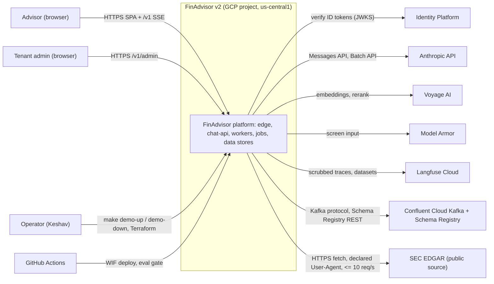
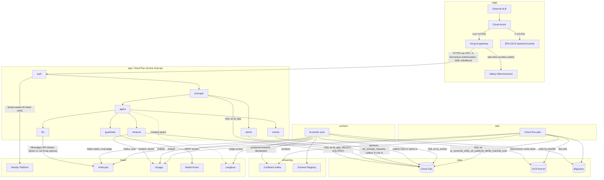
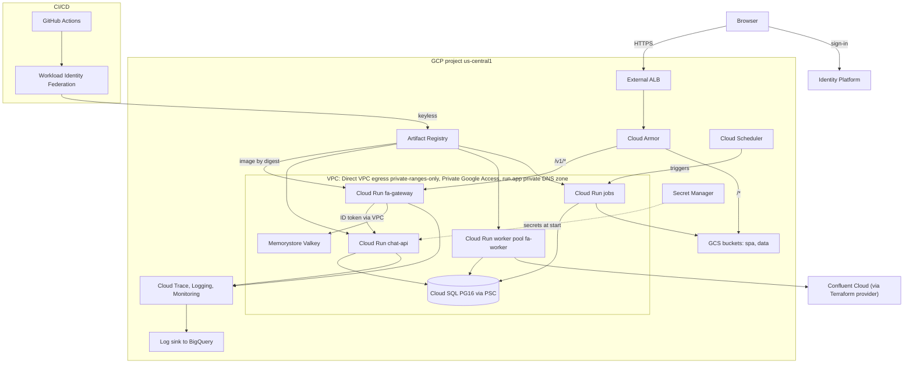
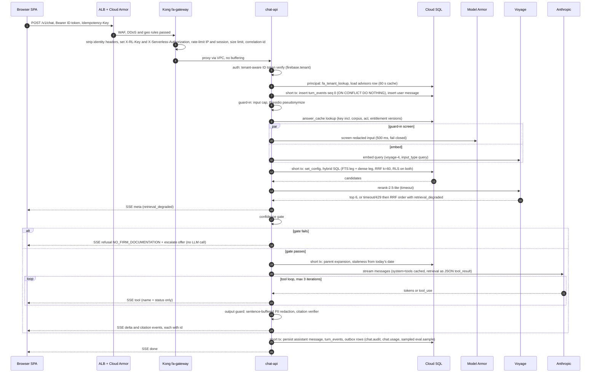
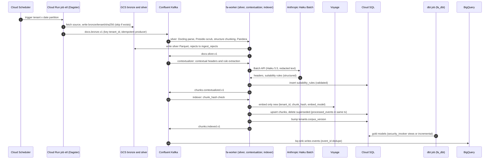
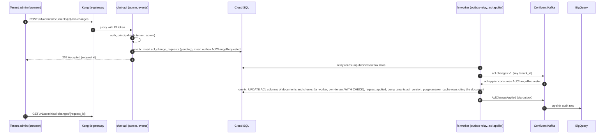
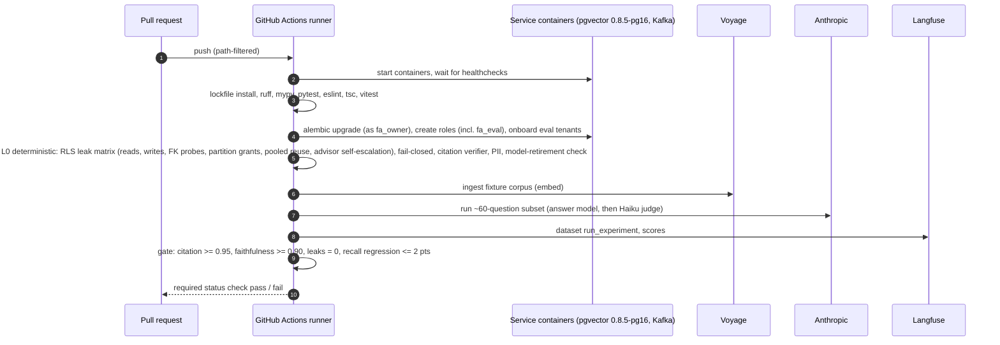
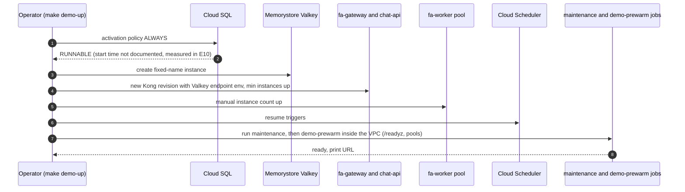
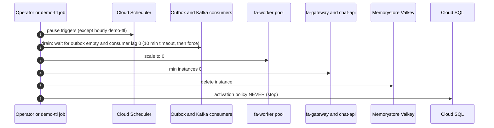
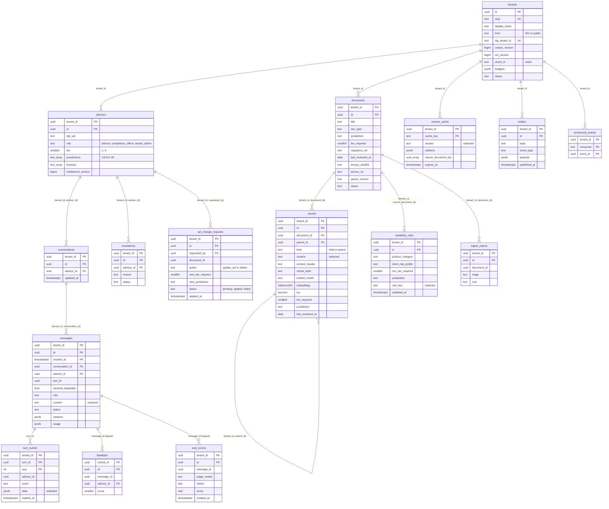

# finadvisor: architecture

Binding. Agents read this by section. When it is silent, the orchestrator resolves it with research and an ADR.

Target architecture "FinAdvisor v2 — pooled multi-tenant modular monolith, event-driven ingest, demo-on-demand". Decided 2026-11-01 (ADR-002 to ADR-024, `decisions.md`; rulings D14-D16 applied). Baseline: `MVP.md` (as built at d6c2bd3, unchanged). Stack with pinned versions: `stack.md`. Build order: `plan.md` (epics E0-E10).

## 1. Context and goals

### 1.1 Goal

FinAdvisor v2 is a compliance-aware RAG assistant for wealth advisors, serving several tenant firms (customers) and many concurrent sessions from one deployment. Every claim is cited. Tier (1-4) and jurisdiction (US/EU/UK) access control is enforced in the database. PII is redacted before embedding, before LLM calls, in traces and logs, and on output. Sources older than 12 months are flagged stale. ETL / data engineering, evaluation, guardrails, security and Kafka are first-class parts of the system (Keshav's learning goals), not add-ons. Backend: Python FastAPI. Frontend: React + TypeScript. Both are deployed; the cloud deployment is real but scales to zero between demos.

### 1.2 Keshav's decisions (2026-11-01)

| Topic | Decision | Source |
|---|---|---|
| Tenancy | Demo multi-tenant: 2-3 synthetic firms, a few hundred advisors, ~10 QPS peak. Isolation fully built. Design documented to scale to 50 tenants / 2,000 advisors | evidence-r2.md |
| Budget | ~$100-200/month, demo-on-demand. Dev runs everything locally in docker compose, including Kafka. Cloud prod is real but scales to zero; costly parts start only for demos and load tests | evidence-r2.md |
| Stack | Keep Python FastAPI. Frontend React + TypeScript | evidence-r2.md |
| ETL data | Synthetic per-tenant corpus plus one real public source (SEC EDGAR fund summary prospectuses, 497K HTML, first) | evidence-r2.md, D13p |
| Compliance | As MVP: US/EU/UK synthetic corpus; no real certification | requirements.md |
| Gateway | Kong must be in the design for rate limiting and proxy plugins (D12, "include kong ... we need it"). Binding | decision-r2.md D12 |
| Learning goals | ETL (Dagster, dbt, BigQuery), Kafka, evaluation, guardrails, databases at scale | evidence-r2.md, D3 |

### 1.3 Non-goals

- No real regulatory certification; synthetic data only (Langfuse Cloud, Confluent Basic and BigQuery are acceptable only for synthetic data; trigger "real firm data" is in ADR-013 and ADR-018).
- No cross-provider LLM fallback (changes regulated answers). No semantic answer cache (cross-user leak risk).
- No LLM-based guardrails on the hot path. No web fallback in the confidence gate.
- No SPLADE, ColBERT, HyDE by default, GraphRAG, RAPTOR, Self-RAG, semantic chunking.
- No per-tenant Kafka topics. No Debezium in v2 scope (optional later learning epic).
- No project-per-tenant or database-per-tenant silo in v2 (seam kept: `tenants.shard_id`).
- No Konnect, no Kong Enterprise image, no Enterprise-only Kong plugins.
- No always-on prod in the budget: the `prod` profile is designed and costed (~$300+/month) but out of budget by design.
- Cloud Composer, Apigee ($365+/month), API Gateway streaming preview, GCP Managed Kafka (~$189-248/month) are rejected.

### 1.4 MVP critical gaps and where v2 fixes them

Gap IDs refer to `MVP.md` §13.

| Gap | MVP defect | v2 fix | Where | Epic |
|---|---|---|---|---|
| G-01 | Identity is an `X-User-Id` header over 4 hard-coded users | Identity Platform ID tokens verified tenant-aware (`firebase.tenant`; signature, aud, iss, exp); entitlements from `advisors` | §8.2, §4 `auth`/`principal`, ADR-010 | E1 |
| G-02 | `allUsers` run.invoker on backend and frontend | No `allUsers` on any service. `fa-gateway` has the Cloud Run invoker check disabled (the only such service; Google's recommended alternative to `allUsers`), ingress internal-and-cloud-load-balancing, Cloud Armor on the backend service. `chat-api` has ingress internal and `run.invoker` only for the Kong service account | §8.3, ADR-011, ADR-012 | E2, E10 |
| G-03 | `documents.raw_content` unredacted, returned to LLM and client | Column dropped in the E1 migration; raw bytes only in GCS bronze; factsheet tool returns redacted chunks | §5.2, §6.3, ADR-014 | E1, E3, E6 |
| G-04 | `tool` / `tool_result` SSE events carry raw tool JSON | Client receives tool name + status only; errors carry codes, not exception text | §6.2, §8.5, ADR-009 | E4 |
| G-05 | CI installs a non-existent `dev` extra; lint/test tools missing | Lockfile installs; ruff, mypy, pytest, eslint, tsc, vitest, trivy, gitleaks, pip-audit | §4.12, ADR-021 | E0 |
| G-06 | Eval gate cannot run (no keys, no DB URL, DB user rewritten, `sleep 5`) | Eval gate runs on the runner against real pgvector + Kafka service containers with keys from the CI secret store; healthcheck-gated | §4.14 (flow 4), ADR-017, ADR-021 | E0, E7 |
| G-07 | `suitability_rules` has no ingest path | Rules extracted with Haiku structured output, validated, loaded by the ETL | §5.2, §4.14 (flow 2), ADR-014 | E6 |
| G-08 | LiteLLM shuffles traffic across Claude, GPT-4o, Gemini under one name | LiteLLM removed; in-process `LLMClient`, same-provider fallback only | §4.5 `llm`, ADR-005 | E0, E4 |
| G-09 | LiteLLM `fallbacks` key matches nothing | Fallback implemented and tested in `LLMClient`; enabled only if it passes the eval gate | §4.5 `llm`, ADR-005 | E4 |
| G-10 | Backend `KONG_URL` points at itself in Cloud Run | Explicit config `ANTHROPIC_BASE_URL` (direct, or Kong egress route if the spike passes); readiness checks model availability | §6.6, ADR-005, ADR-011 | E2, E4 |
| G-11 | Kong upstream is Docker DNS; no service-to-service wiring | Kong `fa-gateway` Cloud Run service with ID token to chat-api (`X-Serverless-Authorization`); Terraform wires URLs, SAs, ingress | §4.3, §4.12, ADR-011 | E2, E10 |
| G-12 | `schema.sql` never applied; superuser + `SET ROLE` | Alembic baseline; migrations as `fa_owner` in a Cloud Run job before traffic; one non-superuser NOBYPASSRLS login role per process; startup and readiness assert role flags and FORCE RLS | §5.3, §5.4, ADR-002 | E0, E1, E10 |
| G-13 | No frontend Dockerfile; `/api/*` rewrite hard-coded to localhost | Vite SPA served from GCS behind the same ALB (`/*`), API on `/v1/*`; compose gets a frontend dev image | §4.4, ADR-012, ADR-019 | E0, E8, E10 |

## 2. Quality attributes (with numbers: load, latency, availability, cost)

All latency figures are estimates to be measured (D13e). They replace the earlier requirement figures (TTFT p50 < 1.5 s, p95 < 3 s).

### 2.1 Latency

| Metric | Target | Notes |
|---|---|---|
| Time to first token (TTFT) | p50 < 2.0 s, p95 < 3.5 s | with rerank |
| Retrieval first stage (embed + hybrid SQL) | p95 < 300 ms | |
| Rerank | p95 < 700 ms | Voyage rerank ~0.68 s per call measured by a third party on short facts (evidence-r2.md) |
| Full answer | p95 < 8 s | |

### 2.2 Availability

| Profile | Target | Basis |
|---|---|---|
| `demo` (default) | No SLA | Zonal Cloud SQL, stopped by default, Confluent Basic 99.5% (D13g) |
| `prod` | 99.5% monthly on the chat path | HA Cloud SQL flag on, min instances >= 1. Applies to `prod` only |
| Ingest | Asynchronous, minutes of lag | requirements.md |
| Entitlement revocation | <= 60 s worst case | `principal` cache TTL 60 s is the bound; `chat-api` does not consume Kafka (D14.9). Document ACL changes are applied asynchronously by the `acl-applier` worker; the bump of `acl_version` then makes older cached answers unreachable (ADR-022) |

RPO / RTO: not set by the brief.

### 2.3 Scale envelope

| Dimension | Demo (built and tested) | Designed (documented) |
|---|---|---|
| Tenants | 2-3 synthetic firms + PUBLIC | 50 |
| Advisors | a few hundred | 2,000 |
| Peak QPS | ~10 | 5-50 (requirements.md range) |
| Corpus | 50 docs / ~114 chunks today; EDGAR 497K + synthetic per tenant | 100k-1M chunks across tenants (1M x 1024 halfvec ~ 2 GB) |
| Rerank throughput | Voyage Tier 1: 2M TPM, ~5 QPS at 10-15 candidates x <= 400 tokens (~6k tokens/query) | request a tier upgrade before load tests (D13e) |
| Partition triggers | n/a | one tenant > 250k chunks, total > 2M chunks, or ANN p95 > 100 ms (§7.2) |

### 2.4 Quality gates (blocking)

Citation accuracy >= 0.95, faithfulness >= 0.90, cross-tenant/tier/jurisdiction leaks = 0, retrieval recall regression <= 2 points (ADR-017). Staleness: sources with `last_reviewed_at` older than 12 months are flagged, computed server-side from today's date.

### 2.5 Cost (monthly, us-central1 list prices; D13r)

| Profile | Estimate |
|---|---|
| Idle | $40-55: ALB $18.25, Cloud Armor ~$6-10 (UNVERIFIED), Cloud SQL storage + IP ~$4-6, PSC endpoint, Confluent Basic ~$0-5 (UNVERIFIED), Artifact Registry / Secrets / GCS / logs ~$5, Kong / API / workers at 0 |
| Demo month (~40 h up, ~2,000 chats) | $110-160 including LLM, evals, Valkey and Cloud SQL hours |
| Always-on `prod` | $300+ (out of budget, by design) |
| Budget | $100-200/month (Keshav) |

Unit prices (evidence-r2.md): Sonnet 5.5 $2 / $10 per MTok in/out, cache read $0.10; Haiku 5.5 $0.10 / $0.50; Batch API -50%; fallback Sonnet 4.6 $3 / $15; voyage-4 $0.06/M tokens (200M free); rerank-2.5-lite $0.05/M; Model Armor free to 2M tokens/month then $0.10/1M; Cloud SQL Enterprise 2 vCPU / 8 GiB ~$101 while running (HA ~$202); Memorystore Valkey shared-core-nano ~$23/month (~$0.03/h, only while the demo is up).

### 2.6 Other attributes

- Isolation: zero cross-tenant reads or writes; enforced by Postgres RLS, tested by the L0 leak matrix on every PR (§5.4, ADR-017).
- Cost control: per-tenant token budgets and per-tenant concurrency in FastAPI (numbers set in E4); BigQuery `maximum_bytes_billed`; budget alerts (§9).
- Operability: one developer; one Python image with three entrypoints; Terraform owns everything except the Valkey instance lifecycle, which the demo script creates and deletes (fixed instance name, outside Terraform state; stated once here and in §4.12); demo up/down is one command each.

## 3. System context and boundaries



Boundaries:
- Users reach the system only through the external ALB (`/*` SPA, `/v1/*` API). Nothing else is internet-facing; Cloud Run services use ingress internal-and-cloud-load-balancing or internal.
- The tenant boundary is inside the database (RLS, §5.4), not at the network. All tenants share one deployment.
- Trust: browsers, SaaS responses, retrieved documents and tool outputs are untrusted. Identity comes only from a verified ID token (sub + IdP tenant); entitlements come from the DB.
- Data classification: synthetic data only. Redacted text may leave to Anthropic, Voyage, Langfuse, Confluent, BigQuery; raw documents leave only to GCS bronze.
- SEC EDGAR: at most 10 requests/s, declared User-Agent, nightly index about 10 pm ET (evidence-r2.md).

## 4. Components and responsibilities



Notes on the diagram: `chat-api` neither produces nor consumes Kafka; its events leave through the outbox rows that the `fa-worker` relay publishes. `chat-api` calls Kong's internal egress route to reach Anthropic only if the egress spike passes (§10); otherwise `llm` calls Anthropic directly. The SPA hosts no code that talks to anything but `/v1/*` on its own origin. Platform services (Cloud Scheduler, Secret Manager, Artifact Registry, VPC / PSC / Private Google Access, Cloud Trace / Logging / Monitoring, GitHub Actions + WIF) are in the deployment diagram (§4.12); Terraform is described there in a note.

Runtime shape (ADR-019): one Python image, entrypoints `api | worker | jobs`. `chat-api` is a Cloud Run service (SSE, explicit concurrency, request timeout 3600 s). `fa-worker` is a Cloud Run worker pool. Jobs are Cloud Run jobs. Local dev is docker compose with the same image. All Cloud Run services and jobs use Direct VPC egress in `private-ranges-only` mode with no Cloud NAT (ADR-024).

### 4.1 External ALB
- Purpose: single public entry point, same origin for SPA and API. URL map: `/*` to the GCS backend bucket (SPA, CDN); `/v1/*` to the `fa-gateway` serverless NEG. Managed certificate.
- Persistent (~$18-25/month with Cloud Armor) because certificate provisioning is slow; never torn down by `demo-down` (D7).
- `fa-gateway` has the Cloud Run invoker check disabled (the only service where it is), ingress internal-and-cloud-load-balancing, so `run.app` is unreachable from the internet and the ALB is the only path in; no `allUsers` binding anywhere (D15.1, D16.1; https://docs.cloud.google.com/run/docs/authenticating/public ). IAP was rejected: it replaces the caller identity and conflicts with end-user ID tokens. E10 checks the org policy `constraints/run.managed.requireInvokerIam` and that no service has an `allUsers` binding.
- Fixes G-02, G-13. Decision: ADR-012.

### 4.2 Cloud Armor
- Policy attached to the ALB backend services: DDoS / WAF preconfigured rules, geo rules, coarse per-IP throttle. Kong keeps the fine-grained limits; Cloud Armor keeps DDoS / WAF / geo (D12).
- Cost ~$0.75/1M requests + policy fee: exact cost UNVERIFIED (§10).

### 4.3 Kong (Cloud Run service `fa-gateway`)
- Image `kong:3.9.4`, DB-less, `_format_version: "3.0"`, admin API off, status listener for health. Ingress internal-and-cloud-load-balancing, invoker check disabled (§4.1). min instances 0 (demo), max 2. Binding per D12 (Keshav); ADR-011.
- Network: Direct VPC egress `private-ranges-only`, Private Google Access on the subnet, and a Cloud DNS private zone mapping `run.app` to `private.googleapis.com`, so Kong reaches `chat-api` (ingress internal) through the VPC (D16.12, ADR-024). Valkey endpoint comes from a Kong environment variable; `demo-up` deploys a new Kong revision with it.
- Responsibilities: rate limits (per client IP and per session key, `redis` policy on Valkey), request-size limit, CORS (SPA origin allow-list), `correlation-id` (`X-Request-Id`), OpenTelemetry (`traceparent`), Prometheus, `file-log` audit, bot-detection, `request-transformer` stripping client `X-User-Id`, `X-Tenant-Id`, `X-Serverless-Authorization`, `X-RL-Key`, and a `pre-function` that (a) sets `X-Serverless-Authorization: Bearer <Google ID token>` (from the metadata server, audience = chat-api URL, cached until near expiry), leaving the user's `Authorization` intact (Cloud Run IAM checks only that header when both are present; https://docs.cloud.google.com/run/docs/authenticating/service-to-service ), and (b) sets `X-RL-Key = sha256(Authorization)` so raw tokens never reach Valkey keys.
- Audit (D16.9, ADR-023): `file-log` to stdout with a field whitelist (no `Authorization`, no bodies, no query strings) to Cloud Logging, then a log sink to BigQuery `gateway_audit`. There is no `/internal/audit/gateway` route. Fixes G-48.
- Does not verify tokens, does not set identity headers, cannot key on the verified tenant (OSS limitation); per-tenant budgets and concurrency live in `chat-api`.
- SSE chat routes: `response_buffering: false`, `request_buffering: false`, service `read_timeout` 3,600,000 ms.
- Local: `kong:3.9.4` + Valkey in compose; `kong.yml` in git, validated in CI with `kong config parse`, smoke-tested with deck/curl.
- Full route and plugin table: §6.5. Spikes: SSE pass-through, `X-Serverless-Authorization` passthrough smoke test, private-DNS `run.app` egress, ai-proxy `preserve` egress, `X-RL-Key` behaviour (§10).

### 4.4 SPA (GCS backend bucket)
- Vite + React 19 + TypeScript single-page app, static files in a GCS bucket behind the ALB with CDN. Same origin as the API, so no CORS in the normal path and no BFF buffering hop.
- Behaviour: tenant discovery from `/t/<slug>`, Identity Platform sign-in for that IdP tenant, fetch-based SSE client with `Last-Event-ID` resume and `Idempotency-Key`, citations with excerpts, stale badges, conversation history, feedback, error states keyed by error code. Renders sanitized markdown only. Tests: vitest + Playwright. Epic E8.
- Replaces Next.js 14 (G-13, G-57).

### 4.5 chat-api modules (Cloud Run service `chat-api`)
Single deployable, modular monolith. Import-linter contracts enforce the boundaries below, plus a test. DB login role `fa_app`: SELECT only on content tables, no write on content tables anywhere in `chat-api`. Ingress internal; `run.invoker` granted only to the Kong service account (IAM checks the `X-Serverless-Authorization` header). Request timeout 3600 s, explicit concurrency (number set in E10 from the load test), one Uvicorn process per container. `chat-api` has no Kafka credentials: it neither produces nor consumes.

**`auth`**: verifies the `Authorization: Bearer <Identity Platform ID token>` with firebase-admin tenant-aware verification: the `firebase.tenant` claim names the IdP tenant, and `tenant_mgt.auth_for_tenant(tenant_id).verify_id_token(...)` checks signature, `aud`, `iss`, `exp` and raises `TenantIdMismatchError` on a tenant mismatch (D15.3; https://docs.cloud.google.com/identity-platform/docs/multi-tenancy-managing-tenants ). Output: `(sub, idp_tenant_id)`. Never reads identity from headers. The claim name is verified in the first E1 ticket. Fixes G-01.

**`principal`**: maps `idp_tenant_id` to `tenants.id` (via `fa_tenant_lookup`, §5.4), loads `advisors` (tier, jurisdictions, licenses, role, `entitlement_version`) into a `Principal` object, cached <= 60 s per process; the TTL is the revocation bound (no Kafka invalidation). Owns the only function that sets the per-transaction settings `app.tenant_id`, `app.idp_uid`, `app.user_id`, `app.role`, `app.tier`, `app.jurisdictions` via `set_config(name, $n, true)` with bind parameters (the principal-load transaction sets `app.tenant_id` and `app.idp_uid` plus neutral values for the rest). Provides the tenant-scoped transaction context manager used by every module; transactions are short and never held across the LLM loop.

**`retrieval`**: `RetrievalService(principal)` is the single enforcement point (ADR-004). Only module allowed to touch content tables (`documents`, `chunks`, `suitability_rules`), read-only. Methods: `search(query_text, query_vec)` (hybrid SQL + RRF), `rerank`, `gate`, `expand_parents`, `factsheet`, `suitability`, `fetch_chunks(ids)` (used by the citation verifier and the cache-hit path). Tools never pass tenant, tier or jurisdiction. Embeds via Voyage `voyage-4` (`input_type=query`), reranks via `rerank-2.5-lite`; a rerank timeout or 429 falls back to RRF order and marks the turn degraded (§6.2 `meta`). Also owns the `answer_cache` read/write (not a content table); turns that called a side-effect tool are never cached.

**`guardrails`**: input cap; Presidio (`presidio-analyzer` 2.2.x, spaCy `en_core_web_sm`) in-process pseudonymization before embed / LLM / traces / logs; Model Armor input screen (parallel with embed, timeout 500 ms, fail closed); sentence-buffered output PII redaction; deterministic citation verifier (every `[n]` is in the retrieved chunk ids; quote overlap); error-code mapping. No LLM-based rails on the hot path (ADR-009). Presidio latency is benchmarked in E4 (no official figure).

**`agent`**: the retrieve-first orchestrator (ADR-007). Order: guard-in, answer-cache lookup, embed + screen, retrieval, gate, then one streaming `llm` call with tools (`lookup_product_factsheet`, `lookup_suitability_rule`, `escalate_to_compliance`, `search_firm_kb` follow-up), max 3 iterations. Conversation state: last 6 turns <= 3k tokens, follow-up condensation with Haiku only when history exists. Emits SSE events with sequence ids and persists them to `turn_events`; sets `messages.retrieval_degraded`. Persists escalations (G-18). On a sampled fraction of completed turns (`EVAL_SAMPLE_RATE`) writes an `eval.sample.v1` outbox row.

**`llm`**: `LLMClient` over the Anthropic SDK: streaming, explicit timeouts, retries with jitter, circuit breaker, same-provider fallback (`claude-sonnet-5-5` to `claude-sonnet-4-6`) enabled only if the eval gate passed against the fallback; model ids only from config; no `temperature`/`top_p`/`top_k`; prompt caching on system prompt + tools (tool definitions versioned with the prompt); `max_tokens` bound; CI and readiness fail on a retired or soon-retiring model. Base URL from config (`ANTHROPIC_BASE_URL`): direct, or Kong egress route (`key-auth` consumer `chat-api`). ADR-005, ADR-006.

**`events`**: transactional outbox writer: rows inserted in the same transaction as the business write (turn persist, escalation, admin change). It has no Kafka client and no listener: chat never depends on Kafka. ADR-013.

**`admin`**: tenant-admin endpoints (`/v1/admin/*`). Advisor entitlement changes are a direct `UPDATE advisors` (allowed to `tenant_admin` only by policy, bumping `entitlement_version`) plus an outbox event for analytics. Document ACL changes and deletes never write content tables: `admin` inserts an `acl_change_requests` row and an `acl.changes.v1` outbox row in one transaction and returns 202; the `acl-applier` worker applies it (ADR-022). Role check `tenant_admin` through `principal`. Tenant onboarding (partition creation) is a job, not an endpoint (§4.8).

### 4.6 Valkey (Memorystore, shared-core-nano)
- Backing store for Kong `rate-limiting` counters (`policy: redis`, `sync_rate: 0` on the chat route). Local: valkey container in compose. In the cloud it is a fixed-name Memorystore instance created by `demo-up` and deleted by `demo-down` by the demo script, outside Terraform state (documented once here and in §2.6); `demo-up` passes its endpoint to Kong as an environment variable by deploying a new Kong revision. ~$23/month, ~$0.03/h only while up. Not used for anything else (no session or answer cache).

### 4.7 fa-worker (Cloud Run worker pool)
- Entrypoint `worker`; one image, roles selected by `WORKER_ROLES`: `outbox-relay`, `silver`, `contextualizer`, `indexer`, `acl-applier`, `eval-judge`, `bq-sink`. DB login role `fa_worker`. Confluent: one service account and API key per service, Kafka ACLs per service account (ADR-013). Instance count 0 when the demo is down.
- Envelope check on every consumed message: if `envelope.tenant_id` differs from the message key, or the tenant is PUBLIC, the message goes to `dlq.v1` with a reason (PUBLIC is ingested in-process by `etl-public`, never through worker consumers). `bq-sink` is exempt for PUBLIC analytics events.
- `outbox-relay`: per tenant, reads unpublished `outbox` rows in order, produces with an idempotent producer, marks `published_at`. At-least-once. No Debezium.
- `silver`: consumes `docs.bronze.v1`: Docling parse, Presidio scrub, structure-aware chunking (256-512-token children, ~1k-token parents, token counts from Voyage `count_tokens`), Pandera validation, rejects to `ingest_rejects`, writes silver Parquet to the data bucket under `silver/tenant_id=<id>/dt=<date>/`, emits `docs.silver.v1`.
- `contextualizer`: consumes `docs.silver.v1`: Haiku 5.5 Batch API contextual headers (behind flag `CONTEXTUAL_RETRIEVAL_ENABLED`), suitability-rule extraction (Haiku structured output, validated) into `suitability_rules`, emits `chunks.contextualized.v1`.
- `indexer`: consumes `chunks.contextualized.v1`: Voyage `voyage-4` document embeddings only for chunks whose `(tenant_id, chunk_hash, embed_model)` is new, upserts `chunks`, deletes superseded chunks, then bumps the tenant's `corpus_version` (UPDATE on its own tenant row by policy), emits `chunks.indexed.v1`.
- `acl-applier`: consumes `AclChangeRequested` events on `acl.changes.v1`: applies the ACL-column UPDATE (or delete) on `documents` and `chunks` for the request (own-tenant WITH CHECK, ACL columns only), marks the `acl_change_requests` row `applied`, bumps `tenants.acl_version`, purges `answer_cache` rows that cite the document, emits `AclChangeApplied` (ADR-022).
- `eval-judge`: consumes `eval.sample.v1` (a `EVAL_SAMPLE_RATE` sample, 5-10%), scores the redacted question / answer / cited excerpts with `claude-haiku-5-5` (judge differs from the answer model), writes scores to Langfuse and `eval_scores`, emits `JudgeScored` on `eval.events.v1`. Langfuse-side evaluators are not used.
- `bq-sink`: consumes audit, usage, eval, ingest and ACL topics; writes BigQuery with event-id dedupe.
- Every consumer: `processed_events` dedupe in the sink transaction, retries, then DLQ `dlq.v1`. Each message handled in a transaction with `app.tenant_id` set from the event key.
- The PUBLIC corpus is never written by `fa_worker` (§5.4).

### 4.8 Cloud Run jobs
All from the one image (`jobs` entrypoint). Triggered by Cloud Scheduler, by `demo-up`, or manually.

| Job | DB role | Purpose |
|---|---|---|
| `migrate` | `fa_owner` | Alembic upgrade before traffic; tenant onboarding (`--onboard-tenant <slug>`: LIST partition + indexes, `tenants` row, IdP mapping; the IdP tenant itself is provisioned by an onboarding script in E1 and Terraform in E10); asserts role flags, FORCE RLS and that partitions carry no runtime grants |
| `maintenance` | `fa_maint` | Purges expired `answer_cache` and `turn_events` rows; creates `messages` partitions 3 months ahead and drops those past retention; hourly while the demo is up and run by `demo-up` (D16.8) |
| `etl` | `fa_etl` | Dagster run of tenant bronze assets (fetch, GCS by sha256, register `documents`, publish `docs.bronze.v1`), backfills and replays. Daemon-less: `dagster asset materialize` in a Cloud Run job; run and event storage in Postgres (`dagster-postgres`, database `dagster` on the same Cloud SQL instance, owned by role `fa_dagster`, no access to app schemas); `dagster dev` locally |
| `etl-public` | `fa_etl_public` | Public-ingest (EDGAR 497K): runs every stage in-process and publishes only analytics topics (`ingest.analytics.v1`); the only writer of PUBLIC rows |
| `dbt` | `fa_dbt` | dbt Core gold models on Postgres (`dbt-postgres`: views with `security_invoker = true`, or incremental models with a tenant predicate, never full rebuilds) and BigQuery marts (`dbt-bigquery`); per tenant run on a dedicated connection |
| `eval` | `fa_eval` | Full or subset eval run (L1-L3) against the dedicated `eval` tenant; results to Langfuse and `eval.events.v1` |
| `redteam` | `fa_eval` | promptfoo red team against the API |
| `demo-prewarm` | none | Runs inside the VPC after `demo-up`: calls `/readyz` and warms pools and caches (not run from the operator laptop) |
| `demo-ttl` | `fa_maint` | Hourly safety net: reads the outbox count and runs `demo-down` if the demo has been up longer than `DEMO_TTL_HOURS` (Cloud Run admin SA rights) |

### 4.9 Cloud SQL (PostgreSQL 16, pgvector 0.8.5)
- Enterprise, 2 vCPU / 8 GiB, zonal, private IP only (PSC), activation policy flipped by `demo-up` / `demo-down`; HA is a Terraform flag for `prod` and load tests (ADR-020). Databases: the app database and `dagster`. Schema, roles, RLS and indexes: §5.
- Single store for relational data, vectors (halfvec + HNSW), full text (tsvector + GIN), conversation state, outbox, answer cache.
- `max_connections` is 400 on this tier; the pool budget (`DB_POOL_SIZE` x max instances over all services) must stay <= 300, leaving headroom for migrations, dbt and Dagster (D15.7). Managed connection pooling is Enterprise Plus only (transaction mode forbids `SET`).

### 4.10 GCS bronze
- Bucket (data) with prefix `bronze/{tenant_id}/{sha256}`: raw immutable bytes plus source URL and fetch time; the only place raw documents live (G-03). `silver/tenant_id=<id>/dt=<date>/` holds redacted chunk Parquet. The SPA bucket is separate.

### 4.11 BigQuery
- Analytics marts for audit, usage, eval and gateway events: tables partitioned by day, clustered by `tenant_id`; redacted text only; `maximum_bytes_billed` set on every query. Per-tenant authorized views are the primary isolation; row access policies per tenant are the second layer (they do not prune partitions and can bill more rows) (D15.5). Marts are built by `dbt-bigquery`. Fed by the `bq-sink` with event-id dedupe (Storage Write API default stream is at-least-once) and, for `gateway_audit`, by a Cloud Logging log sink. 1 TiB/month of queries free (evidence-r2.md). ADR-014, ADR-023.

### 4.12 Platform services and the deployment view



Terraform (google provider, plus Confluent provider) owns every resource in this view and the Confluent cluster, with state per env prefix, applied from GitHub Actions through WIF (plan on PR). The one exception is the Valkey instance lifecycle (§4.6). `lifecycle.ignore_changes` covers `activation_policy`, `min_instance_count`, `manual_instance_count`.

- **Cloud Scheduler**: triggers `etl`, `etl-public`, `dbt`, `maintenance`, `eval`, `redteam` and `demo-ttl`. `demo-down` pauses all except `demo-ttl`.
- **Secret Manager**: all secrets (DB passwords per role, Kafka and Schema Registry keys per service, Anthropic, Voyage, Langfuse keys, the Kong `key-auth` key for the egress route). No secret defaults in code: missing config fails boot.
- **Artifact Registry**: images by digest; deploy references digests, never tags.
- **VPC / PSC / egress** (ADR-024): Cloud SQL private only (PSC); all services and jobs use Direct VPC egress in `private-ranges-only` mode (public SaaS APIs are reached directly; no Cloud NAT), Private Google Access on the subnet, and a Cloud DNS private zone mapping `run.app` to `private.googleapis.com`. Startup probe on Cloud Run. Per-service service accounts, least privilege (G-50). Fallback if the private-DNS spike fails: all-traffic egress + Cloud NAT (about +$32/month) with an ADR.
- **Cloud Trace / Logging / Monitoring**: §9. A log sink exports Kong's `file-log` audit to BigQuery.
- **GitHub Actions + WIF**: keyless deploy and CI (ADR-021).
- **Local (docker compose)**: Postgres (`pgvector/pgvector:0.8.5-pg16`, matching Cloud SQL), `apache/kafka:4.4.0` KRaft, Schema Registry (cp-schema-registry), `kong:3.9.4`, Valkey, api, worker, frontend dev image, `dagster dev`; env-driven host ports; healthchecks (G-49).

### 4.13 SaaS dependencies
- **Identity Platform** (multi-tenancy, one IdP tenant per firm; billing enabled for > 2 tenants; email/password free to 50k MAU). Verified by `auth` with firebase-admin; ADR-010.
- **Anthropic**: answer `claude-sonnet-5-5`; judge, headers, rule extraction, condensation, citation spot-checks `claude-haiku-5-5`; fallback `claude-sonnet-4-6`; Batch API for offline work. ADR-006.
- **Voyage**: `voyage-4` embeddings (halfvec(1024), `input_type` query / document), `rerank-2.5-lite`. Single provider, no fallback. Rerank timeout or 429 degrades to RRF order, flagged and counted.
- **Model Armor**: REST screen of the redacted input (detects, the app acts). Free to 2M tokens/month.
- **Langfuse Cloud Hobby** (Python SDK 5.x): free 50k units/month, 30-day retention; metadata, hashes, redacted text only, tagged by tenant; `capture_input` / `capture_output` off on sensitive spans and `mask_otel_spans` for export masking; synthetic data only. ADR-018.
- **Confluent Cloud Basic + Schema Registry (Essentials)**: cluster and registry in us-central1 (registry region is fixed by the first cluster). Kafka ACLs per service account (no RBAC), max 50 API keys, 1,000 ACLs, 1,500 partitions: one service account + key per service. Local: `apache/kafka:4.4.0` + cp-schema-registry.

### 4.14 Key flows

#### Flow 1: chat request



Notes:
1. The cache lookup comes after Presidio (the key uses the normalized redacted question). On a hit the screen and embed are skipped; the cited chunks are re-fetched through `retrieval.fetch_chunks` under the caller's RLS, the citation verifier is re-run and staleness is recomputed. A chunk no longer visible turns the hit into a miss. Turns that call `escalate_to_compliance` are never written to the cache.
2. The database is never held open across the LLM call: each `D` step is its own transaction with `set_config(..., true)`.
3. Langfuse spans (masked) and OpenTelemetry spans are emitted asynchronously and never block the stream.
4. Failure at any step produces one SSE `error` event with a code (§6.2), never exception text.
5. The relay publishes the outbox rows later (`outbox-relay`, §4.7); chat does not wait for Kafka.

#### Flow 2: ingest



Notes: every consumer commits offsets after the DB transaction that wrote `processed_events`; poison messages and envelope mismatches go to `dlq.v1`. A backfill or re-embed is a replay: Dagster re-publishes `docs.bronze.v1` for the partition (bronze is immutable), and unchanged chunk hashes cost nothing. The PUBLIC corpus (EDGAR 497K) runs all stages in-process in the `etl-public` job as `fa_etl_public`, bumps the PUBLIC `corpus_version` itself, and publishes only analytics events (`ingest.analytics.v1`); worker consumers reject PUBLIC. Docling on 497K and inline-XBRL tables is a spike (§10).

#### Flow 3: ACL change (asynchronous)



Notes: no re-embedding (Notion pattern, evidence-r2.md); the change is a metadata UPDATE. Until the applier runs, the old ACL still applies (the lag is relay + consumer time). When the applier commits, the bump of `acl_version` makes every earlier cached answer unreachable, and a cache hit that raced the bump is re-verified against freshly fetched chunks under the caller's RLS (D13i), so a cached answer cannot cite a chunk the caller can no longer see. Document delete follows the same path with `action = delete`. Advisor entitlement changes are a direct `UPDATE advisors` by a `tenant_admin` (no worker); `chat-api` does not consume Kafka, so the 60 s `principal` cache TTL is the revocation bound.

#### Flow 4: eval gate in CI



Notes: the PR runs the ~60-question path-filtered subset; the full set (50 growing to ~300) runs weekly and before demos, and also once against the fallback model (fallback is enabled only if it passes). L1 retrieval metrics (recall@k, MRR, nDCG, dense / FTS / hybrid / rerank ablation) and L2 Ragas metrics run in the same job; L3 cross-tenant refusal and the promptfoo red team run in the `redteam` job. Fixes G-05, G-06.

#### Flow 5: demo-up

The exact reverse of the demo-down order (D16.13).



#### Flow 6: demo-down



After a forced down, remaining outbox rows are logged and delivered on the next `demo-up`. Terraform uses `lifecycle.ignore_changes` on `activation_policy`, `min_instance_count` and `manual_instance_count`, so `apply` never fights the script. The ALB, Cloud Armor, Confluent cluster and storage stay (idle cost, §2.5).

## 5. Data model and storage

One Postgres 16 database (Cloud SQL, pgvector 0.8.5). Every table carries `tenant_id uuid NOT NULL` (on `tenants` the key `id` is the tenant id). Managed by Alembic (baseline from MVP `schema.sql`, then versioned migrations run by the `migrate` job as `fa_owner`). Evidence for the pattern: PostgreSQL 16 RLS docs https://www.postgresql.org/docs/16/ddl-rowsecurity.html , AWS pgvector RLS https://aws.amazon.com/blogs/database/self-managed-multi-tenant-vector-search-with-amazon-aurora-postgresql/ .

### 5.1 Entity-relationship diagram



### 5.2 Tables

Types: `uuid` ids (time-ordered where possible), `timestamptz` times. All composite foreign keys start with `tenant_id` because FK checks bypass RLS (a single-column FK would let a tenant probe other tenants' ids).

| Table | Key | Columns (beyond key) and rules |
|---|---|---|
| `tenants` | `id` | `slug` unique, `display_name`, `kind` in (`firm`,`public`), `idp_tenant_id` unique, `corpus_version bigint` (bumped by the embed-indexer after the `chunks` upsert), `acl_version bigint` (bumped by the `acl-applier`), `budgets jsonb` (per-tenant token budget and concurrency; set in E4), `shard_id` (seam for silo / shard, D2), `status`, `created_at`. The reserved PUBLIC tenant has `kind='public'` and id `PUBLIC_TENANT_ID`. Policies in §5.4 |
| `advisors` | `(tenant_id, id)` | `idp_uid` (token `sub`), unique `(tenant_id, idp_uid)`; `display_name`, `role` in (`advisor`,`compliance_officer`,`tenant_admin`), `tier smallint CHECK 1..4`, `jurisdictions text[]` CHECK subset of (`US`,`EU`,`UK`), `licenses text[]`, `entitlement_version bigint`, `status`. UPDATE only by a `tenant_admin` (no self-escalation) |
| `documents` | `(tenant_id, id)` | `title`, `doc_type`, `jurisdiction`, `tier_required CHECK 1..4`, `regulatory_ref`, `last_reviewed_at`, `product_category`, `risk_level`, `source` (`edgar`,`synthetic`), `source_uri`, `bronze_uri`, `bronze_sha256`, `parser_version`, `status` (`active`,`superseded`,`deleted`), `created_at`. Unique `(tenant_id, bronze_sha256)`. No `raw_content` column (G-03) |
| `chunks` | `(tenant_id, id)` | LIST-partitioned by `tenant_id` (§5.5). `document_id` (FK `(tenant_id, document_id)` to `documents`), `parent_id` (self FK `(tenant_id, parent_id)`), `kind` in (`child`,`parent`), `chunk_index`, `content` (redacted), `context_header`, `chunk_hash`, `embed_model`, `embedding halfvec(1024)` (children only, NULL for parents), `tsv tsvector GENERATED ALWAYS AS (to_tsvector('simple', coalesce(context_header,'') \|\| ' ' \|\| content)) STORED`, `tier_required`, `jurisdiction`, `regulatory_ref`, `last_reviewed_at`, `source_title`, `section_path`, `token_count`, `created_at`. Unique `(tenant_id, chunk_hash, embed_model)`. ACL columns are denormalised from `documents` so the ANN query filters without a join |
| `suitability_rules` | `(tenant_id, id)` | `rule_name`, `product_category`, `client_risk_profile` CHECK 3 values, `min_tier_required`, `jurisdiction`, `regulatory_ref`, `rule_text` (redacted), `source_document_id` (composite FK), `extractor_model`, `validated_at`, `last_reviewed_at` |
| `conversations` | `(tenant_id, id)` | `advisor_id` (composite FK), `title` (redacted), `created_at`, `updated_at`, `deleted_at` |
| `messages` | `(tenant_id, id, created_at)` | RANGE-partitioned by `created_at`, monthly (D11), owned by `fa_maint`. `conversation_id` (composite FK), `advisor_id` (owner clause), `turn_id`, `role` (`user`,`assistant`), `content` (redacted), `status` (`pending`,`streaming`,`complete`,`refused`,`failed`), `model`, `prompt_version`, `citations jsonb`, `retrieval_chunk_ids uuid[]`, `retrieval_degraded boolean` (rerank timeout or 429 fell back to RRF order), `usage jsonb` (input / output / cache-read tokens), `refusal_code`. The `maintenance` job creates partitions 3 months ahead and drops those past retention; a DEFAULT partition catches misses (alert if non-empty) |
| `turn_events` | `(tenant_id, turn_id, seq)` | SSE replay buffer: `advisor_id` (owner clause), `event`, `data jsonb` (already redacted), `created_at`, `expires_at` (purged by `maintenance`; retention `SSE_REPLAY_TTL_S`, set in E4). `turn_id = uuid5(namespace, tenant_id \|\| advisor_id \|\| Idempotency-Key)`; inserting `seq 0` with `ON CONFLICT DO NOTHING` is what enforces idempotency |
| `escalations` | `(tenant_id, id)` | `advisor_id`, `reason`, `product_class`, `licenses` (copied from `advisors.licenses`, never from the model), `status` (`pending_review`,...), `message_id`, `created_at`. UUID id fixes the G-18 collision |
| `acl_change_requests` | `(tenant_id, id)` | `requested_by` (composite FK to `advisors`), `target_type` (`document`), `document_id`, `action` (`update_acl`,`delete`), `new_tier_required`, `new_jurisdiction`, `status` (`pending`,`applied`,`failed`), `error_code`, `requested_at`, `applied_at`. Written by `chat-api` `admin` with the outbox row in one transaction; applied by the `acl-applier` worker |
| `eval_scores` | `(tenant_id, id)` | `message_id` (logical), `judge_model`, `metric` (faithfulness, citation, ...), `score`, `rationale` (redacted), `created_at`. Written by the `eval-judge` worker; no grant to `fa_app` |
| `feedback` | `(tenant_id, id)` | `message_id` (logical reference: partitioned PK includes `created_at`, so no FK), `advisor_id` (owner clause), `score` (-1, 1), `comment` (redacted), `created_at` |
| `answer_cache` | `(tenant_id, cache_key)` | UNLOGGED (§5.7). Own RLS + FORCE |
| `outbox` | `(tenant_id, id)` | `topic`, `key`, `event_type`, `schema_version`, `payload jsonb` (minimised), `created_at`, `published_at`, `attempts`. `id` is the Kafka `event_id`. Partial index on `(tenant_id, created_at) WHERE published_at IS NULL` |
| `processed_events` | `(tenant_id, consumer, event_id)` | `processed_at`; written in the same transaction as the sink effect |
| `ingest_rejects` | `(tenant_id, id)` | `document_id`, `bronze_sha256`, `stage`, `rule` (Pandera check), `detail` (redacted), `created_at` |

Gold layer (dbt, `fa_dbt`, which owns schema `gold` and is exempt from the not-owner assertion): models `gold.documents_current`, `gold.stale_documents` and `gold.corpus_stats`; views with `security_invoker = true`, or incremental models with a tenant predicate (never full-table rebuilds) (D13n, D16.14). BigQuery marts are built by `dbt-bigquery`.

The factsheet tool returns document metadata plus up to `FACTSHEET_MAX_CHUNKS` redacted parent chunks through `retrieval.factsheet`, never raw content.

### 5.3 Roles (D13c, D16)

One login role per process; there are no `SET ROLE` calls and no second pool in one process. All are NOSUPERUSER, NOCREATEDB, NOCREATEROLE, NOBYPASSRLS. Runtime roles own nothing, with two explicit exemptions listed below.

| Role | Used by | Grants |
|---|---|---|
| `fa_owner` | `migrate` job only (owns all objects except schema `gold` and table `messages`; runtime never connects as it) | owner; creates partitions of `chunks`, policies, `fa_tenant_lookup`; policy `TO fa_owner` on `tenants` (SELECT, INSERT, UPDATE) for onboarding |
| `fa_lookup` | NOLOGIN; owns `fa_tenant_lookup` | policy `TO fa_lookup FOR SELECT USING (true)` on `tenants` only; no other grants |
| `fa_app` | `chat-api` | SELECT on `chunks`, `documents`, `suitability_rules` (read-only: no write grant on any content table); SELECT on `tenants` (own and PUBLIC rows; columns `id`, `slug`, `corpus_version`, `acl_version`, `budgets`); SELECT on `advisors`; UPDATE on `advisors` (tier, jurisdictions, licenses, role, status, `entitlement_version`; `tenant_id` immutable) allowed only when `app.role = 'tenant_admin'`; SELECT / INSERT / UPDATE on `conversations`, `messages`, `turn_events`, `escalations`, `feedback`, `answer_cache`, `outbox`; SELECT / INSERT on `acl_change_requests`; EXECUTE on `fa_tenant_lookup`. Content tables are touched only by the `retrieval` module (import-linter + test) |
| `fa_worker` | `fa-worker` pool | on `chunks`: SELECT, INSERT, DELETE, and UPDATE of ACL columns (`tier_required`, `jurisdiction`) only; on `documents`: SELECT, INSERT, DELETE, UPDATE (`tier_required`, `jurisdiction`, `status`, `parser_version`); on `suitability_rules`, `ingest_rejects`, `eval_scores`: SELECT, INSERT (and DELETE on `suitability_rules`); UPDATE (`status`, `applied_at`, `error_code`) on `acl_change_requests`; UPDATE (`corpus_version`, `acl_version`) on its own non-PUBLIC `tenants` row; DELETE on `answer_cache`; SELECT / INSERT / UPDATE on `outbox`; SELECT / INSERT on `processed_events`. Writes limited to its own non-PUBLIC tenant by policy |
| `fa_etl` | `etl` job | SELECT, INSERT, UPDATE (`status`, `parser_version`, `bronze_uri`) on `documents`; SELECT on `chunks`; own non-PUBLIC tenant only |
| `fa_etl_public` | `etl-public` job | write on content tables and UPDATE (`corpus_version`) on the PUBLIC tenant row only. The only role that can write PUBLIC rows |
| `fa_dbt` | `dbt` job | SELECT on content tables (own-tenant policy); owns schema `gold` (explicitly exempt from the not-owner assertion); no other owner rights |
| `fa_maint` | `maintenance` and `demo-ttl` jobs | owns table `messages` (Postgres requires ownership of the parent for partition DDL; explicitly exempt from the not-owner assertion; no row access because no policy applies to it); DELETE on `answer_cache` and `turn_events` limited by policy to expired rows; SELECT (`id`, `published_at`) on `outbox` limited to unpublished rows (outbox count) |
| `fa_eval` | `eval` and `redteam` jobs | the `fa_app` grants, with every policy pinned to the dedicated `eval` tenant (a literal uuid substituted by the migration) plus PUBLIC reads |
| `fa_dagster` | Dagster run / event storage | owner of database `dagster` on the same instance; no access to the app database |

Startup and `/readyz` assert, for the connected role: not superuser, not BYPASSRLS, not owner of any table (except the two exemptions above), FORCE ROW LEVEL SECURITY on every table in the tenant schemas including partitioned parents, pgvector version >= 0.8, the expected policies exist, and that the partitions of `chunks` and `messages` carry no grants to runtime roles (D16.3). A failure refuses to start (fail to boot).

Partitions get no grants: tenant partitions of `chunks` and the monthly partitions of `messages` are created without `GRANT ... ON ALL TABLES`; runtime roles reach them only through the partitioned parent, whose RLS applies. The leak matrix includes "direct SELECT / INSERT on a partition as `fa_app` / `fa_worker` gives permission denied".

### 5.4 Row-level security

All tenant tables: `ENABLE` and `FORCE ROW LEVEL SECURITY`. Settings are transaction-local, set only by `principal`: `SELECT set_config('app.tenant_id', $1, true), set_config('app.idp_uid', $2, true), set_config('app.user_id', $3, true), set_config('app.role', $4, true), set_config('app.tier', $5, true), set_config('app.jurisdictions', $6, true)` with bind parameters. Policies call `current_setting('app.x')` without `missing_ok`, so an unset setting raises an error (fail closed). `<PUBLIC>` below is the `PUBLIC_TENANT_ID` uuid literal substituted by the Alembic migration, so a request cannot change it.

SELECT is own tenant OR PUBLIC. INSERT / UPDATE / DELETE is own tenant only and never PUBLIC (D13a). Policy text for `chunks` (`documents` and `suitability_rules` are identical in shape; `suitability_rules` uses `min_tier_required`):

```sql
ALTER TABLE chunks ENABLE ROW LEVEL SECURITY;
ALTER TABLE chunks FORCE  ROW LEVEL SECURITY;

-- user-facing reads: tenant or PUBLIC, plus tier and jurisdiction
CREATE POLICY chunks_select_app ON chunks FOR SELECT TO fa_app
  USING ( (tenant_id = current_setting('app.tenant_id')::uuid OR tenant_id = '<PUBLIC>'::uuid)
          AND tier_required <= current_setting('app.tier')::int
          AND jurisdiction = ANY (string_to_array(current_setting('app.jurisdictions'), ',')) );

-- pipeline reads: own tenant only
CREATE POLICY chunks_select_pipe ON chunks FOR SELECT TO fa_worker, fa_etl, fa_etl_public, fa_dbt
  USING ( tenant_id = current_setting('app.tenant_id')::uuid );

-- writes by tenant pipelines: own tenant, never PUBLIC (column grants limit UPDATE to ACL columns)
CREATE POLICY chunks_ins_tenant ON chunks FOR INSERT TO fa_worker
  WITH CHECK ( tenant_id = current_setting('app.tenant_id')::uuid AND tenant_id <> '<PUBLIC>'::uuid );
CREATE POLICY chunks_upd_tenant ON chunks FOR UPDATE TO fa_worker
  USING      ( tenant_id = current_setting('app.tenant_id')::uuid AND tenant_id <> '<PUBLIC>'::uuid )
  WITH CHECK ( tenant_id = current_setting('app.tenant_id')::uuid AND tenant_id <> '<PUBLIC>'::uuid );
CREATE POLICY chunks_del_tenant ON chunks FOR DELETE TO fa_worker
  USING ( tenant_id = current_setting('app.tenant_id')::uuid AND tenant_id <> '<PUBLIC>'::uuid );

-- the only writer of PUBLIC
CREATE POLICY chunks_all_public ON chunks FOR ALL TO fa_etl_public
  USING ( tenant_id = '<PUBLIC>'::uuid ) WITH CHECK ( tenant_id = '<PUBLIC>'::uuid );
```

`fa_app` has no INSERT, UPDATE or DELETE policy on `chunks`, `documents` or `suitability_rules`; document ACL changes and deletes are applied by the `acl-applier` worker (ADR-022).

Other tables:
- `tenants`: `tenants_select_app TO fa_app FOR SELECT USING (id = current_setting('app.tenant_id')::uuid OR id = '<PUBLIC>'::uuid)`; `tenants_lookup TO fa_lookup FOR SELECT USING (true)`; `tenants_owner TO fa_owner` for SELECT, INSERT, UPDATE; `tenants_upd_worker TO fa_worker FOR UPDATE USING / WITH CHECK (id = app.tenant_id AND id <> <PUBLIC>)`; `tenants_upd_public TO fa_etl_public FOR UPDATE USING / WITH CHECK (id = <PUBLIC>)`. Column grants limit UPDATE to `corpus_version` and `acl_version`.
- `advisors`: SELECT `TO fa_app` when `tenant_id = app.tenant_id AND (id = app.user_id OR idp_uid = app.idp_uid OR app.role = 'tenant_admin')` (own row, or every row of the own tenant for a tenant admin); UPDATE `TO fa_app` only when `tenant_id = app.tenant_id AND app.role = 'tenant_admin'`, `WITH CHECK (tenant_id = app.tenant_id)`. No self-escalation: an advisor cannot raise their own tier or role (L0 test "advisor raises own tier / role gives denied").
- `conversations`, `messages`, `turn_events`, `feedback`: tenant match AND `advisor_id = current_setting('app.user_id')::uuid` (an advisor sees only their own rows).
- `escalations`: tenant match AND (`advisor_id = app.user_id` OR `app.role = 'compliance_officer'`).
- `acl_change_requests`: SELECT / INSERT `TO fa_app` when tenant matches and `app.role = 'tenant_admin'`; UPDATE of status columns `TO fa_worker` on the own non-PUBLIC tenant.
- `eval_scores`, `ingest_rejects`, `outbox`, `processed_events`: tenant match for the roles that hold grants (no PUBLIC clause). `answer_cache`: own RLS + FORCE (D13i), tenant match for `fa_app` and `fa_worker`; `fa_maint` may delete expired rows only; `outbox` is also readable by `fa_maint` for unpublished rows.
- `fa_eval` policies equal the `fa_app` policies with the tenant literal of the `eval` tenant.

`fa_tenant_lookup(p_slug text DEFAULT NULL, p_idp_tenant_id text DEFAULT NULL)` is the only `SECURITY DEFINER` function allowed in the database (D13m, D13n); CI fails on any other. It is owned by `fa_lookup` (a dedicated NOLOGIN role, not `fa_owner`), sets `search_path` explicitly, returns `(id, display_name, idp_tenant_id)`, and serves both slug discovery and the `idp_tenant_id` to `tenants.id` mapping (D14.4). `REVOKE EXECUTE ... FROM PUBLIC; GRANT EXECUTE ... TO fa_app;`. The public endpoint returns only display name and IdP tenant id. Policies and grants are covered by E1 tests.

The write split and the PUBLIC rule are tested by the L0 leak matrix: cross-tenant read, cross-tenant insert, update into PUBLIC, delete in PUBLIC, FK existence probes, direct partition access, advisor self-escalation, pooled-connection reuse (§8.5).

### 5.5 Partitioning and indexes

- `chunks`: `PARTITION BY LIST (tenant_id)`: one partition per tenant, one for PUBLIC, plus a DEFAULT partition (rows landing there are a bug and alert). Tenant onboarding (`migrate --onboard-tenant`) creates the partition; indexes are declared on the parent so each partition gets its own. Runtime pruning with the RLS `current_setting` policy was confirmed on a test ("Subplans Removed: 6 of 8"); the same check is repeated for LIST partitions in the E1 leak-matrix test. PUBLIC can be sub-partitioned by source later (trigger > 250k chunks). Why not HASH(8): 4 keys in 8 buckets collide ~59% (D13b, ADR-003).
- Per partition, on `chunks`: HNSW on `embedding halfvec_cosine_ops` with `m = 16`, `ef_construction = 64`, partial `WHERE kind = 'child'`; GIN on `tsv`; btree `(tenant_id, document_id)`, `(tenant_id, parent_id)`, `(tenant_id, tier_required, jurisdiction)`; unique `(tenant_id, chunk_hash, embed_model)`.
- Query-time settings, per transaction (`SET LOCAL`): `hnsw.iterative_scan = relaxed_order`, `hnsw.max_scan_tuples = 20000`, `hnsw.ef_search` ~80-100 (config `HNSW_EF_SEARCH`). Filtering is applied after the ANN scan in pgvector, so iterative scan is mandatory (https://github.com/pgvector/pgvector ). halfvec supports <= 4,000 dimensions.
- `messages`: RANGE by month, local indexes `(tenant_id, conversation_id, created_at)`; partitions created 3 months ahead by the `maintenance` job. Neither `chunks` nor `messages` partitions carry grants (§5.3).
- `advisors`: unique `(tenant_id, idp_uid)`. `conversations`: `(tenant_id, advisor_id, updated_at DESC)`. `outbox`: partial unpublished index. `answer_cache`: `(expires_at)` and GIN on `source_document_ids`. `documents`: unique `(tenant_id, bronze_sha256)`; `(tenant_id, doc_type, jurisdiction)`.

### 5.6 Hybrid retrieval statement

One statement, RLS applied to both legs, RRF with `k = 60` (`RRF_K`):

```sql
WITH dense AS (
  SELECT id, parent_id, row_number() OVER (ORDER BY embedding <=> $1::halfvec) AS r
  FROM chunks WHERE kind = 'child' AND embedding IS NOT NULL
  ORDER BY embedding <=> $1::halfvec LIMIT $2),
fts AS (
  SELECT id, parent_id, row_number() OVER (ORDER BY ts_rank(tsv, q) DESC) AS r
  FROM chunks, websearch_to_tsquery('simple', $3) q
  WHERE kind = 'child' AND tsv @@ q ORDER BY ts_rank(tsv, q) DESC LIMIT $2)
SELECT id, parent_id, sum(1.0 / (60 + r)) AS rrf
FROM (SELECT * FROM dense UNION ALL SELECT * FROM fts) u
GROUP BY id, parent_id ORDER BY rrf DESC LIMIT $4;
```

The RLS policy supplies the tenant / PUBLIC / tier / jurisdiction filter to both legs; partition pruning limits the scan to the caller's tenant and PUBLIC partitions. `ts_rank` is not BM25 (pg_textsearch needs PG17+, not on Cloud SQL PG16).

### 5.7 Answer cache (D9, D13i)

UNLOGGED table `answer_cache`, exact match only, single-turn requests only, TTL 24 h (`ANSWER_CACHE_TTL_S`). Turns that called a side-effect tool (`escalate_to_compliance`) are never cached. `cache_key = sha256(tenant_id, tier, sorted jurisdictions, corpus_version of the tenant and of PUBLIC, acl_version, entitlement_version of the user, prompt_version, model, normalized redacted question)`. Columns: `cache_key`, `answer` (redacted), `citations` (chunk ids, indexes), `source_document_ids uuid[]`, `created_at`, `expires_at`. On a hit the citation verifier re-runs against freshly fetched chunks under the caller's RLS and staleness is recomputed; any failure is a miss. Purged by the `acl-applier` on ACL change and document delete (GIN on `source_document_ids`) and by `maintenance` when expired. No semantic cache.

### 5.8 Object and analytics storage

- GCS data bucket: `bronze/{tenant_id}/{sha256}` (raw, immutable), `silver/tenant_id=<id>/dt=<date>/` (redacted chunk Parquet). Lifecycle rules are not specified by the brief.
- BigQuery dataset `fa_analytics`: tables `chat_audit`, `chat_usage`, `eval_events`, `gateway_audit` (from the Cloud Logging sink), `acl_changes`, `ingest_events`; day-partitioned, clustered by `tenant_id`; per-tenant authorized views (primary isolation) plus row access policies (second layer); `maximum_bytes_billed` on every query; dbt-bigquery marts.
- Conversation state in Postgres only (`conversations`, `messages`), last 6 turns <= 3k tokens sent to the model.

## 6. Interfaces and contracts

### 6.1 HTTP API v1 (served by `chat-api` behind Kong; same origin as the SPA)

All `/v1` routes except `GET /v1/tenants/{slug}` require `Authorization: Bearer <Identity Platform ID token>`. Errors are JSON `{"error": {"code", "message", "request_id", "retryable"}}` with a stable code and a fixed message, never exception text. `X-Request-Id` is set by Kong (`correlation-id`) and returned.

| Method and path | Auth / role | Request | Response |
|---|---|---|---|
| `GET /v1/tenants/{slug}` | none (public; Kong IP limit) | none | `{"display_name", "idp_tenant_id"}` only (served by `fa_tenant_lookup`); 404 `TENANT_NOT_FOUND` |
| `GET /v1/me` | any | none | `{advisor_id, tenant_id, display_name, role, tier, jurisdictions, licenses}` |
| `POST /v1/chat` | any | headers `Idempotency-Key` (required), body `{conversation_id?: uuid, message: string}` | `text/event-stream` (§6.2); 409 `IDEMPOTENCY_KEY_REUSED` if the key was used with a different body |
| `GET /v1/chat/{turn_id}/events` | owner of the turn | header `Last-Event-ID` | `text/event-stream` replay of `turn_events` with `seq > Last-Event-ID`, then tail until `done` |
| `GET /v1/conversations` | any | `?cursor` | list of own conversations |
| `GET /v1/conversations/{id}/messages` | owner | `?cursor` | messages with citations (redacted) |
| `DELETE /v1/conversations/{id}` | owner | none | 204 (soft delete) |
| `POST /v1/messages/{id}/feedback` | owner | `{score: -1 or 1, comment?: string}` | 204; writes `feedback` + outbox `eval.events.v1` |
| `GET /v1/escalations` | `compliance_officer`, or owner for own | none | list of `escalations` |
| `PATCH /v1/admin/advisors/{id}` | `tenant_admin` | `{role?, tier?, jurisdictions?, licenses?, status?}` | 200; direct `UPDATE advisors` (policy allows tenant admins only), bumps `entitlement_version`, outbox `AdvisorEntitlementChanged`; takes effect within the 60 s `principal` cache TTL |
| `POST /v1/admin/documents/{id}/acl-changes` | `tenant_admin` | `{tier_required?, jurisdiction?}` | 202 `{request_id}`; inserts `acl_change_requests` + outbox `AclChangeRequested` in one transaction; applied asynchronously by the `acl-applier` worker |
| `GET /v1/admin/acl-changes/{request_id}` | `tenant_admin` | none | `{status: pending or applied or failed, applied_at}` |
| `DELETE /v1/admin/documents/{id}` | `tenant_admin` | none | 202 `{request_id}`; an `acl_change_requests` row with `action = delete`; the applier deletes the document and chunks and purges `answer_cache` rows citing it |
| `GET /healthz` | none | none | liveness (process up) |
| `GET /readyz` | none | none | readiness: DB reachable and role flags / FORCE RLS / pgvector >= 0.8 asserted, Kafka reachable (degraded, not failing, for chat), model availability (configured models not retired or soon-retiring), firebase-admin verifier initialised |

Error codes: `UNAUTHENTICATED` (401), `FORBIDDEN` (403), `INPUT_TOO_LONG` (413), `INPUT_BLOCKED` (Model Armor or guard), `GUARD_UNAVAILABLE` (screen failed closed), `RATE_LIMITED` (429, `Retry-After`, from Kong or per-tenant budget), `TENANT_BUDGET_EXCEEDED`, `NO_FIRM_DOCUMENTATION` (a refusal event, not an HTTP error), `LLM_UNAVAILABLE`, `RETRIEVAL_UNAVAILABLE`, `TURN_INTERRUPTED`, `IDEMPOTENCY_KEY_REUSED`, `INTERNAL`. Numeric limits (input cap, budgets, rate limits) are config values (§6.6).

### 6.2 SSE event contract

`Content-Type: text/event-stream`. Each event has `id: <seq>` (integer, strictly increasing within a turn, persisted in `turn_events`), `event: <name>` and a JSON `data:`. The client reconnects with `Last-Event-ID` to `GET /v1/chat/{turn_id}/events`; because the server persists events, a dropped connection loses nothing. The turn id is returned in the first event and is derived from the `Idempotency-Key`, so a retried `POST /v1/chat` with the same key and body is a replay, not a second generation. A heartbeat comment line is sent every `SSE_HEARTBEAT_S` (value set in E4). Cloud Run request timeout is 3600 s; Kong `read_timeout` 3,600,000 ms.

| Event | Data | Notes |
|---|---|---|
| `turn` | `{turn_id, conversation_id, message_id}` | `seq 0`, first event |
| `meta` | `{retrieval_degraded: bool, reason?: "rerank_timeout" or "rerank_429"}` | emitted once after rerank; `true` means the rerank fell back to RRF order; also stored in `messages.retrieval_degraded` |
| `tool` | `{tool, status: "started" or "ok" or "error", tool_use_id}` | tool name and status only; never payloads, inputs or exception text (G-04) |
| `delta` | `{text}` | output after sentence-buffered PII redaction; the client appends |
| `citation` | `{index, chunk_id, source_title, regulatory_ref, last_reviewed_at, stale: bool, excerpt}` | emitted by the server only, after the citation verifier accepts `[n]`; `excerpt` is redacted (G-16) |
| `refusal` | `{code: "NO_FIRM_DOCUMENTATION", escalate_offer: bool}` | confidence gate failed; no LLM call was made |
| `error` | `{code, retryable}` | codes from §6.1; the stream ends after it |
| `done` | `{message_id, finish_reason}` | last event; `finish_reason` in (`end_turn`, `max_tokens`, `refusal`, `gate`) |

If the instance producing a turn dies, the replay endpoint appends `error {TURN_INTERRUPTED, retryable: true}` once the last persisted event is older than `TURN_LEASE_S` (value set in E4); the client resubmits with a new `Idempotency-Key`.

### 6.3 Tool contracts

Retrieval is not a model decision: the orchestrator runs retrieval first and injects the result as a JSON-encoded `tool_result` for a synthetic `search_firm_kb` call (so retrieved text is untrusted tool content, never in the system prompt). Tools never accept `tenant_id`, tier, jurisdiction or licenses; all come from `Principal`. Tool definitions are versioned with the prompt (changing them invalidates the prompt cache). Max 3 iterations; unknown tool names rejected; arguments validated by Pydantic models; outputs are `model_dump_json()`; errors are `{"error_code"}` without exception text.

| Tool | Input | Output | Notes |
|---|---|---|---|
| `search_firm_kb` (pre-fetched; the model may call it again for a follow-up) | `query: string`, `top_k?: int` (lower and upper bound enforced) | `{results:[{n, chunk_id, source_title, regulatory_ref, last_reviewed_at, stale, text}], total_found, today}` | goes through `RetrievalService.search` + rerank + gate. `stale` computed server-side from today's date; `today` placed after the cache breakpoint |
| `lookup_suitability_rule` | `product_category: string`, `client_risk_profile: enum(conservative, moderate, aggressive)` | `{rules:[{rule_name, product_category, client_risk_profile, jurisdiction, regulatory_ref, rule_text, last_reviewed_at, stale}], total_found}` | reads `suitability_rules`, populated by the ETL (G-07) |
| `lookup_product_factsheet` | `product_name: string` (wildcards escaped, `LIMIT` enforced) | `{results:[{title, jurisdiction, regulatory_ref, last_reviewed_at, product_category, risk_level, stale, chunks:[redacted text]}], total_found}` | redacted chunks only; no `raw_content` (G-03) |
| `escalate_to_compliance` | `reason: string`, `product_class: string` | `{escalation_id (uuid), status: "pending_review"}` | licenses taken server-side from `advisors.licenses`; row inserted in `escalations` and outbox event; client sees tool name + status only (G-18). A turn that calls this tool is never written to the answer cache |

### 6.4 Kafka topic catalogue

Cluster: Confluent Cloud Basic (us-central1); local `apache/kafka:4.4.0`. Client `confluent-kafka` 2.16.1, idempotent producers, at-least-once consumers with idempotent sinks (`processed_events`). `chat-api` has no Kafka credentials: its events leave through the `outbox` table and the `outbox-relay`. Keys are `tenant_id` (per-tenant ordering). Value schemas: JSON Schema in Schema Registry (Essentials, 100 schemas free; subject `<topic>-value`, registry default compatibility), generated from Pydantic envelope models. Common envelope: `{event_id, event_type, schema_version, tenant_id, occurred_at, trace_context, payload}`; the Kafka header carries `traceparent`. Payloads are minimised: ids, hashes, redacted text only; never raw documents or prompts (D13j). Confluent Basic has no RBAC: one service account and API key per service (`fa-worker`, `etl`, `etl-public`, `eval`), Kafka ACLs per service account, limits 50 API keys, 1,000 ACLs and 1,500 partitions (D15.8). Partition counts and retention are set in E5 within those limits (the brief gives no values); the single DLQ is `dlq.v1`.

Consumer rule: every pipeline consumer (`silver`, `contextualizer`, `indexer`, `acl-applier`, `eval-judge`) rejects a message whose `envelope.tenant_id` differs from the message key, or whose tenant is PUBLIC, to `dlq.v1` with a reason (D16.6). `bq-sink` accepts PUBLIC analytics events.

| Topic | Key | Schema / event types | Producer | Consumer group | Retention | Replay |
|---|---|---|---|---|---|---|
| `docs.bronze.v1` | `tenant_id` | `DocBronzeLanded` {document_id, bronze_uri, sha256, source, fetched_at} | `etl` job (Dagster bronze asset) | `cg.silver` | E5 | Dagster re-publishes for a partition; bronze is immutable |
| `docs.silver.v1` | `tenant_id` | `DocSilverReady` {document_id, silver_uri, chunk_count, parser_version, reject_count} | `fa-worker` role `silver` | `cg.contextualizer` | E5 | offset reset; idempotent via `processed_events` |
| `chunks.contextualized.v1` | `tenant_id` | `ChunksContextualized` {document_id, silver_uri, header_model, rules_extracted} | `fa-worker` role `contextualizer` | `cg.indexer` | E5 | offset reset |
| `chunks.indexed.v1` | `tenant_id` | `ChunksIndexed` {document_id, upserted, unchanged, deleted, embed_model, corpus_version} | `fa-worker` role `indexer` | `cg.bq-sink` | E5 | offset reset; re-embed = replay of `docs.bronze.v1` |
| `ingest.analytics.v1` | `tenant_id` (PUBLIC id) | `PublicIngestStage` {stage, document_id, counts} | `etl-public` job | `cg.bq-sink` | E5 | rerun the job |
| `acl.changes.v1` | `tenant_id` | `AclChangeRequested` {request_id, document_id, action, new ACL}, `AclChangeApplied` {request_id, acl_version}, `AdvisorEntitlementChanged` {advisor_id, entitlement_version} | `outbox-relay` (rows written by `admin` and by `acl-applier`) | `cg.acl-applier` (`AclChangeRequested` only), `cg.bq-sink` | E5 | offset reset; applier is idempotent on `request_id` |
| `chat.audit.v1` | `tenant_id` | `TurnCompleted`, `TurnRefused`, `EscalationCreated` {ids, hashes, redacted text, retrieved chunk ids, model, gate result, retrieval_degraded} | `outbox-relay` (from `agent`) | `cg.bq-sink` | E5 | outbox rows remain in Postgres until published |
| `chat.usage.v1` | `tenant_id` | `TurnUsage` {tokens, cache read, latency, cost estimate} | `outbox-relay` | `cg.bq-sink` | E5 | offset reset |
| `eval.sample.v1` | `tenant_id` | `TurnSampled` {message_id, redacted question, redacted answer, cited excerpts (redacted)} written for a `EVAL_SAMPLE_RATE` fraction of turns | `outbox-relay` (from `agent`) | `cg.eval-judge` | E5 | offset reset; judge dedupes on `message_id` + metric |
| `eval.events.v1` | `tenant_id` | `FeedbackRecorded`, `JudgeScored`, `EvalRunCompleted` | `outbox-relay` (feedback, judge scores), `eval` job (direct idempotent producer) | `cg.bq-sink` | E5 | offset reset |
| `dlq.v1` | original key | original envelope + `{source_topic, consumer, error_code, reason, attempts}` (payload redacted) | any consumer after retries or envelope check | operator tooling | E5 | operator re-publishes after the fix |

Gateway audit is not on Kafka: Kong `file-log` goes to Cloud Logging and a log sink to BigQuery (ADR-023).

### 6.5 Kong routes and plugins (OSS 3.9.4, DB-less; D12, D16)

Paths use prefixes or `~` regexes, never globs. Plugins in use: `rate-limiting` (`limit_by: ip`, and `limit_by: header` with `header_name: X-RL-Key`, `policy: redis` against Valkey, `sync_rate: 0` on the chat route, 429 with `Retry-After`), `request-size-limiting`, `cors`, `correlation-id`, `bot-detection`, `request-transformer`, `pre-function`, `prometheus`, `opentelemetry`, `file-log`, and for the egress route `key-auth`, `ip-restriction` and (spike) `ai-proxy` (`route_type: preserve`) with `log_statistics`. The `pre-function` sets `X-Serverless-Authorization` and `X-RL-Key = sha256(Authorization)` (so raw tokens never become Valkey keys) and runs before `rate-limiting` in the access phase; verified in the E2 spike. Not used: `jwt` (static per-consumer keys, no JWKS), `http-log`, Enterprise `openid-connect`, `rate-limiting-advanced`, `ai-*` Enterprise plugins. Numeric limits are config (§6.6) and set in E2.

`file-log` writes to stdout with a field whitelist: timestamp, route, method, status, latency, request id, client IP hash; no `Authorization`, no bodies, no query strings.

| Route | Paths / methods | Upstream | Plugins |
|---|---|---|---|
| `chat` | `POST ~/v1/chat$` | `chat-api` | `request-transformer` (remove client `X-User-Id`, `X-Tenant-Id`, `X-Serverless-Authorization`, `X-RL-Key`), `pre-function` (ID token from the metadata server to `X-Serverless-Authorization`, `X-RL-Key`), `rate-limiting` by IP, `rate-limiting` by `X-RL-Key` (stricter, per session), `request-size-limiting`, `cors`, `correlation-id`, `bot-detection`, `opentelemetry`, `prometheus`, `file-log`; `response_buffering: false`, `request_buffering: false`; service `read_timeout` 3,600,000 ms |
| `chat-resume` | `GET ~/v1/chat/[^/]+/events$` | `chat-api` | as `chat` |
| `api` | prefix `/v1/` (lower priority than the routes above) | `chat-api` | as `chat` with the general (not strict) limits |
| `tenant-discovery` | `GET ~/v1/tenants/[^/]+$` | `chat-api` | `rate-limiting` by IP only (no bearer), `cors`, `correlation-id`, `request-size-limiting`, `file-log` |
| `llm-egress` (conditional on spike) | prefix `/egress/anthropic`, callable by `chat-api` only | `https://api.anthropic.com` | `key-auth` (consumer `chat-api`, key from Secret Manager), `ip-restriction` (VPC range), `ai-proxy` `preserve` or plain proxy, `request-transformer` adds the API key from env, global LLM `rate-limiting`, `log_statistics`. Native Messages format only (no OpenAI-format translation) |

No `/internal/*` route exists: `chat-api` serves no internal endpoints and Kong returns 404 for anything not listed. The `demo-prewarm` job reaches `/readyz` inside the VPC, not through Kong. Kong status listener serves liveness; admin API off. `kong.yml` is validated in CI by `kong config parse`.

### 6.6 Configuration keys

One typed `Settings` class (pydantic-settings). No secret has a default; a missing required key fails boot. Secrets come from Secret Manager (cloud) or `.env` (local). "Set in Ex" means the brief gives no value; the epic fixes it by measurement.

| Key | Value / default | Used by |
|---|---|---|
| `ENV_PROFILE` | `dev` / `demo` / `prod` | all; selects HA flag, min instances |
| `DB_HOST`, `DB_NAME`, `DB_USER`, `DB_PASSWORD` | required (secret); user is the process role (`fa_app`, `fa_worker`, ...) | all |
| `DB_POOL_SIZE`, `DB_STATEMENT_TIMEOUT_MS` | required; pool per instance x max instances over all services must stay <= 300 of Cloud SQL `max_connections` 400 (D15.7) | chat-api, worker |
| `PUBLIC_TENANT_ID` | required uuid | migrate, principal |
| `IDP_PROJECT_ID` | required; firebase-admin tenant-aware verification uses it (`aud`, `iss`) | `auth` |
| `ENTITLEMENT_CACHE_TTL_S` | 60 | `principal` |
| `ANTHROPIC_API_KEY` | required (secret); held by Kong when the egress route is used | `llm`, worker |
| `ANTHROPIC_BASE_URL` | `https://api.anthropic.com` or the Kong egress URL | `llm` |
| `LLM_MODEL_ANSWER` | `claude-sonnet-5-5` | `llm` |
| `LLM_MODEL_AUX` / `LLM_MODEL_JUDGE` | `claude-haiku-5-5` (judge must differ from answer) | guardrails spot-check, condensation, ETL, evals |
| `LLM_MODEL_FALLBACK`, `LLM_FALLBACK_ENABLED` | `claude-sonnet-4-6`, `false` until the gate passes against it | `llm` |
| `LLM_MAX_ITERATIONS` | 3 | `agent` |
| `LLM_MAX_TOKENS`, `LLM_TIMEOUT_S`, `LLM_RETRIES`, `LLM_BREAKER_*` | required; set in E4 | `llm` |
| `PROMPT_VERSION` | required; versions system prompt and tools | `agent`, cache key |
| `VOYAGE_API_KEY` | required (secret) | `retrieval`, worker |
| `EMBED_MODEL`, `EMBED_DIM` | `voyage-4`, 1024 | `retrieval`, indexer |
| `RERANK_MODEL`, `RERANK_ENABLED` | `rerank-2.5-lite`, decided by the ablation | `retrieval` |
| `RERANK_TIMEOUT_MS`, `RERANK_CANDIDATES`, `RERANK_TOP_N` | timeout: set in E3; candidates: default 15, range 10-30, the L1 ablation sets it (D14.1); top-n 6 | `retrieval` |
| `RRF_K` | 60 | `retrieval` |
| `HNSW_EF_SEARCH`, `HNSW_MAX_SCAN_TUPLES` | ~80-100, 20000 | `retrieval` |
| `GATE_MIN_SCORE` | required; set in E3 by eval | `retrieval` |
| `ANSWER_CACHE_ENABLED`, `ANSWER_CACHE_TTL_S` | true, 86400 | `retrieval` |
| `HISTORY_MAX_TURNS`, `HISTORY_MAX_TOKENS` | 6, 3000 | `agent` |
| `INPUT_MAX_CHARS` | required; set in E4 | `guardrails`, Kong size limit |
| `MODEL_ARMOR_TEMPLATE`, `MODEL_ARMOR_TIMEOUT_MS`, `MODEL_ARMOR_FAIL_OPEN` | required, 500, `false` | `guardrails` |
| `TENANT_TOKEN_BUDGET`, `TENANT_MAX_CONCURRENCY` | required; set in E4 | `agent` |
| `SSE_HEARTBEAT_S`, `SSE_REPLAY_TTL_S`, `TURN_LEASE_S` | required; set in E4 | `agent` |
| `FACTSHEET_MAX_CHUNKS` | required; set in E4 | `retrieval` |
| `CONTEXTUAL_RETRIEVAL_ENABLED` | true; the L1 ablation decides | worker |
| `KAFKA_BOOTSTRAP`, `KAFKA_API_KEY`, `KAFKA_API_SECRET` | required; one service account and key per service (`fa-worker`, `etl`, `etl-public`, `eval`); none for `chat-api` | outbox-relay, worker, jobs |
| `SCHEMA_REGISTRY_URL`, `SCHEMA_REGISTRY_API_KEY`, `SCHEMA_REGISTRY_API_SECRET` | required | producers, consumers |
| `WORKER_ROLES` | comma list of `outbox-relay`, `silver`, `contextualizer`, `indexer`, `acl-applier`, `eval-judge`, `bq-sink` | worker |
| `GCS_DATA_BUCKET`, `BQ_DATASET`, `BQ_MAX_BYTES_BILLED` | required | jobs, worker |
| `LANGFUSE_ENABLED`, `LANGFUSE_HOST`, `LANGFUSE_PUBLIC_KEY`, `LANGFUSE_SECRET_KEY` | secrets required when enabled | wrapper |
| `OTEL_EXPORTER_OTLP_ENDPOINT`, `OTEL_DB_CAPTURE_PARAMS` | required, `false` | all |
| `CORS_ALLOWED_ORIGINS` | the SPA origin | Kong |
| `RATE_LIMIT_IP_PER_MIN`, `RATE_LIMIT_TOKEN_PER_MIN`, `RATE_LIMIT_CHAT_PER_MIN` | required; set in E2 | Kong |
| `DEMO_TTL_HOURS` | required; set in E10 | `demo-ttl` job |
| `OUTBOX_DRAIN_TIMEOUT_MIN` | 10 (then force; remaining outbox rows are delivered on the next `demo-up`) | `demo-down` |
| `VALKEY_INSTANCE_NAME` | fixed Memorystore name; endpoint passed to Kong as an env var by `demo-up` | demo script, Kong |
| `EVAL_SAMPLE_RATE` | 0.05-0.10 (5-10% of completed turns); value set in E7 | `agent`, `eval-judge` |
| `EVAL_TENANT_ID` | required uuid of the dedicated `eval` tenant (bound into `fa_eval` policies) | migrate, eval jobs |
| `MESSAGES_PARTITIONS_AHEAD`, `MESSAGES_RETENTION_MONTHS` | 3; retention set in E1 | `maintenance` |
| `PRESIDIO_SPACY_MODEL` | `en_core_web_sm` | `guardrails`, `silver` |
| `KONG_EGRESS_KEY` | secret (Secret Manager) for the `key-auth` consumer `chat-api` on the egress route; only if the spike adopts it | `llm`, Kong |
| `DAGSTER_PG_DB`, `DAGSTER_PG_USER`, `DAGSTER_PG_PASSWORD` | `dagster`, `fa_dagster`, secret | `etl`, `etl-public` |


## 7. Scaling, failure modes and recovery

### 7.1 Failure modes

Principle: chat depends on Cloud SQL, Voyage, Anthropic, Model Armor and Identity Platform; it never depends on Kafka, BigQuery, Langfuse or Valkey-backed features other than Kong rate limiting. `chat-api` has no Kafka client.

| Failure | Detection | Behaviour | Recovery |
|---|---|---|---|
| Kafka or Schema Registry down | producer errors, `outbox_oldest_age_s` | Chat unaffected. Outbox rows accumulate in Postgres; relay retries with backoff. Consumers idle | Relay drains on recovery; sinks dedupe by `event_id`. Alert on outbox age |
| Poison or invalid message, envelope mismatch, PUBLIC event on a pipeline topic | consumer exception, envelope check | Message to `dlq.v1` (redacted, with reason); consumer continues | Fix, then operator re-publishes from DLQ |
| Consumer crash or duplicate delivery | consumer lag, restarts | At-least-once; `processed_events` makes sinks idempotent | Worker pool restarts consumers from committed offsets |
| ACL change not yet applied (relay or applier lag or failure) | `acl_apply_lag_s`, request status `pending` / `failed` | The old ACL still applies until the applier commits; then `acl_version` bumps and cached answers become unreachable; a racing cache hit is re-verified under RLS | Applier retries (idempotent on `request_id`); failed requests surface through `GET /v1/admin/acl-changes/{id}` |
| Cloud SQL stopped, down or failing over | `/readyz` DB check, connection errors | `demo`: by design off; `prod`: HA failover. Requests fail with `RETRIEVAL_UNAVAILABLE` / 503, stream `error` event | `demo-up`; HA failover; start time is unmeasured (§10) |
| Cloud SQL connection exhaustion | pool errors, `max_connections` metric | Budget keeps pools <= 300 of 400; excess requests wait or fail with `RETRIEVAL_UNAVAILABLE` | Lower `DB_POOL_SIZE` or max instances |
| Anthropic error, 429, timeout | `LLMClient` exceptions | Timeouts, retries with jitter, circuit breaker; if `LLM_FALLBACK_ENABLED` then `claude-sonnet-4-6` (50% pricier, own cache, 1,024-token cache minimum); else SSE `error LLM_UNAVAILABLE`. Never a different provider | Breaker half-opens; alert on fallback use |
| Retired or soon-retiring model id | readiness check, CI check | `/readyz` fails; CI blocks | Change config; rerun gate (also against the fallback) |
| Voyage embed failure | embed exception | No fallback model (single provider accepted). `RETRIEVAL_UNAVAILABLE` error event | Retry by client; alert |
| Voyage rerank timeout or 429 (Tier-1 2M TPM, ~5 QPS) | rerank timeout, 429 counter | Fall back to RRF order and mark the turn degraded: SSE `meta {retrieval_degraded: true}`, `messages.retrieval_degraded = true`, `rerank_fallback_total{reason}` and `rerank_429_total` increment. Counted and visible, never silent | Alert when > 5% of turns are degraded in 15 min; request a Voyage tier upgrade before load tests |
| Model Armor timeout or error | 500 ms timeout | Fail closed: SSE `error GUARD_UNAVAILABLE`, request not answered | Retry; alert |
| Presidio error | exception | Fail closed (no unredacted text goes onward) | Fix; alert |
| Confidence gate fails | gate score | `refusal NO_FIRM_DOCUMENTATION` + escalate offer, no LLM call; counted | n/a (expected behaviour) |
| Citation verifier rejects | verifier result | Answer is not released with unverified `[n]`; error or refusal event; counted | Eval L2 tracks rate |
| Valkey down (Kong counters) | Kong errors | Plugin `fault_tolerant` setting decided in E2. Cloud Armor and FastAPI limits remain | Recreate with `demo-up` |
| Identity Platform verifier cannot refresh keys | auth exception | Use cached keys (firebase-admin caches); with no cached keys, 503 | Keys refresh |
| Langfuse or OTel exporter down | exporter errors | Dropped asynchronously; never blocks a request | n/a |
| `eval-judge` or its topic down | judge lag | No effect on chat; sampled turns judged later | Replay from `eval.sample.v1` |
| BigQuery sink error | sink exception | Retries, then DLQ; idempotent by `event_id` | Replay |
| SSE connection drop | client | Client reconnects with `Last-Event-ID`; server replays persisted events | n/a |
| chat-api instance dies mid-turn | no `done`, lease expiry | Replay endpoint emits `error TURN_INTERRUPTED` | Client resubmits with a new `Idempotency-Key` |
| Pooled connection reuse leak | L0 leak matrix | Prevented: only transaction-local `set_config(.., true)`; unset setting raises (fail closed) | Test blocks merge |
| Hot tenant | per-tenant concurrency / token budget | `RATE_LIMITED` / `TENANT_BUDGET_EXCEEDED` for that tenant | Adjust `tenants.budgets` |
| Rows land in DEFAULT `chunks` or `messages` partition | alert on non-empty | Treated as a bug (missing onboarding or maintenance) | Onboard the partition, move rows |
| Migration failure | `migrate` job exit code | Deploy halts before traffic shift | Fix forward or roll back image |
| Bad deploy | smoke test on tagged no-traffic revision | Traffic not shifted | Shift back to previous revision |
| Zone or region outage | n/a | `demo`: zonal, accepted. `prod`: HA is zonal failover only | No regional DR in scope (RPO / RTO not set) |

### 7.2 Scale triggers

| Trigger | Action | Source |
|---|---|---|
| One tenant > 250k chunks, or total > 2M chunks, or ANN p95 > 100 ms | Grow partitions / silo a tenant through the `tenants.shard_id` seam | D2, D13b |
| PUBLIC partition > 250k chunks | Sub-partition PUBLIC by source | D13b |
| Separate scaling of retrieval needed, or a second consumer of retrieval | Extract `retrieval` into its own Cloud Run service with its own DB role | D1, D13c |
| > 10 tenants, or a sensor is needed | Run a Dagster daemon in the cloud (today daemon-less) | D3, D15.4 |
| Real firm data | Confluent Standard RBAC (per-tenant ACLs); self-host Langfuse v4 or drop third-party tracing; revisit BigQuery and trace controls | D13j, D13l |
| Rerank at ~5 QPS on Voyage Tier 1 | Request a tier upgrade before load tests | D13e |
| Schema Registry > 100 schemas, or Confluent limits (50 keys, 1,000 ACLs, 1,500 partitions) approached | Move off the free tier / consolidate | evidence-r2.md, D15.8 |
| Need for log-based CDC outbox | Optional Debezium outbox connector (learning epic) | D4 |
| Always-on availability required | Switch to the `prod` profile: HA Cloud SQL flag, min instances >= 1 (~$300+/month) | D13g, D13r |
| Revocation lag above the 60 s TTL becomes unacceptable | Add a push-invalidation path (a new ADR); today there is none | D14.9 |
| Kong limits (OSS cannot key on a verified tenant) become a problem | Move per-tenant limits further into FastAPI or revisit the gateway | D12 |
| Private-DNS `run.app` egress spike fails | All-traffic egress + Cloud NAT (about +$32/month) with an ADR | D16.12 |

Scaling levers: `chat-api` concurrency and max instances (Cloud Run), `fa-gateway` max 2, worker pool instance count (no autoscaling), Cloud SQL tier (2 vCPU / 8 GiB; HA flag), partition per tenant. Connection budget: `max_connections` is 400 on 8 GiB; pool per instance x max instances over all services must stay <= 300, leaving headroom for migrations, dbt and Dagster (managed pooling is Enterprise Plus only).

### 7.3 Recovery

- Ingest is replayable: bronze is immutable, stages are idempotent, chunks are unique on `(tenant_id, chunk_hash, embed_model)`; re-embedding is a replay of `docs.bronze.v1`.
- Analytics are rebuildable from Kafka and the Postgres outbox; BigQuery sinks dedupe by `event_id`.
- Database backups, point-in-time recovery and RPO / RTO are not specified by the brief; they are set in E10 when the `prod` profile is built.
- Deploys: tagged no-traffic revision, smoke test, then shift; rollback is a traffic shift to the previous revision; images by digest.

## 8. Security and privacy

### 8.1 OWASP LLM Top 10 (2025) mapping

Source https://genai.owasp.org/llm-top-10/ . Controls are the ones decided (ADR-009 and others).

| ID | Risk | Controls in v2 | Test |
|---|---|---|---|
| LLM01 | Prompt injection | Untrusted content (retrieved text, tool output) only inside JSON-encoded `tool_result`; Model Armor input screen (500 ms, fail closed); input cap; tools take no tenant / tier / jurisdiction arguments, least privilege; no LLM-based rails on the hot path | L3 refusal and promptfoo red team (injection) |
| LLM02 | Sensitive information disclosure | Presidio pseudonymization before embed / LLM / traces / logs; sentence-buffered output redaction; raw bytes only in bronze; RLS + single retrieval point; redacted-only events, traces (Langfuse `mask_otel_spans`), BigQuery; client sees tool name + status only; Kong `file-log` whitelist | L0 PII and leak matrix; L3 |
| LLM03 | Supply chain | Lockfile installs, trivy, pip-audit, gitleaks, images by digest, pinned versions (`stack.md`), model ids from config + retirement check | CI |
| LLM04 | Data and model poisoning | Ingest from bronze with sha256, Pandera validation and rejects, parser version recorded, tenant-scoped writes (a tenant cannot write PUBLIC or another tenant), worker envelope check, suitability rules validated; contextual headers pass PII scrub and tier rules | L0 write leak matrix; ETL tests |
| LLM05 | Improper output handling | React renders sanitized markdown only; deterministic citation verifier (every `[n]` in retrieved chunk ids, quote overlap); server-emitted citation events with redacted excerpts; error codes not exception text | L0 citation verifier; vitest |
| LLM06 | Excessive agency | Four tools, read-only except `escalate_to_compliance` (server-side licenses, persisted); `chat-api` has no write grant on content tables; max 3 iterations; no write tools for content; no shell, no web | L3 |
| LLM07 | System prompt leakage | No secrets or tenant data in prompts; tenant / user / date text after the cache breakpoint; prompts versioned; assume the prompt is public | red team |
| LLM08 | Vector and embedding weaknesses | RLS on chunks including both retrieval legs; LIST partitions per tenant with no partition grants; iterative scan so filters do not silently shrink results; ACL change = metadata UPDATE by the applier; PII scrub before embed; Voyage `input_type` | L0 leak matrix; L1 |
| LLM09 | Misinformation | Retrieve-first with CRAG-style confidence gate ("no firm documentation"); every claim cited; citation verifier; staleness flags from today's date; degraded retrieval flagged in `meta`; judge differs from answer model | L2 faithfulness, gates |
| LLM10 | Unbounded consumption | Kong rate limits (IP, session key), request-size limit, input cap, `max_tokens`, max 3 iterations, per-tenant token budget and concurrency in FastAPI, explicit timeouts, circuit breaker, BigQuery `maximum_bytes_billed`, budget alerts | load test with stub LLM |

### 8.2 Authentication and tenant discovery

1. The SPA loads at `/t/<slug>`. It calls the public `GET /v1/tenants/{slug}` (Kong IP rate limit) and receives only `{display_name, idp_tenant_id}` from `fa_tenant_lookup` (D13m). Slugs can be enumerated at the Kong IP rate; the response carries nothing else.
2. The SPA signs the user in against that Identity Platform tenant (one IdP tenant per firm; email/password now, SSO path later) and receives an ID token whose `firebase.tenant` claim names the IdP tenant (D15.3).
3. Every API call sends `Authorization: Bearer <ID token>`. Kong strips client identity headers and never trusts or sets identity.
4. `auth` verifies the token tenant-aware with firebase-admin (`tenant_mgt.auth_for_tenant(tenant_id).verify_id_token`: signature, `aud`, `iss`, `exp`, `TenantIdMismatchError`). The IdP tenant id is mapped to `tenants.id` through `fa_tenant_lookup(p_idp_tenant_id)`; the token's `sub` maps to `advisors.idp_uid`. An unknown tenant or advisor is `UNAUTHENTICATED`. The claim name is verified in the first E1 ticket.
5. `principal` loads tier, jurisdictions, licenses, role from `advisors` (60 s cache; the TTL is the revocation bound) and only then sets the transaction settings. Tokens carry identity only, never entitlements.
6. Service-to-service: Kong adds a Google ID token in `X-Serverless-Authorization` (audience = chat-api URL). Cloud Run IAM checks only that header when both are present (https://docs.cloud.google.com/run/docs/authenticating/service-to-service ), so the user `Authorization` reaches FastAPI; "reaches the app unchanged" is inferred and confirmed by an E2 smoke test. FastAPI verifies the user token again.
7. Identity Platform multi-tenancy needs billing enabled for more than 2 tenants; email/password tier free to 50k MAU (https://docs.cloud.google.com/identity-platform/docs/multi-tenancy ). IdP tenants are provisioned by an onboarding script (E1) and Terraform (E10).

### 8.3 Network

| Surface | Control |
|---|---|
| Internet | Only the external ALB with Cloud Armor (DDoS, WAF, geo). No `allUsers` binding on any service |
| `fa-gateway` | Cloud Run ingress internal-and-cloud-load-balancing; invoker check disabled (the only service where it is); admin API off; status listener only. E10 checks the org policy `constraints/run.managed.requireInvokerIam` |
| `chat-api` | Cloud Run ingress internal; `run.invoker` only for the Kong service account (via `X-Serverless-Authorization`) |
| Cloud SQL | Private IP via PSC; no public IPv4 (fixes G-26) |
| Cloud Run egress | Direct VPC egress `private-ranges-only` on all services and jobs (public SaaS APIs go out directly; no Cloud NAT); Private Google Access on the subnet; Cloud DNS private zone mapping `run.app` to `private.googleapis.com` so Kong reaches `chat-api` through the VPC (ADR-024). Startup probe on Cloud Run |
| Service identity | One service account per service (gateway, chat-api, worker, each job), least privilege; no project-wide secretAccessor (G-50) |
| Kafka / Schema Registry | TLS; one service account and API key per service; Kafka ACLs per service account (no RBAC) |
| Kong egress route | `key-auth` (consumer `chat-api`) + `ip-restriction` to the VPC range |
| CI to GCP | Workload Identity Federation, no JSON keys |

### 8.4 Secrets

Secret Manager holds every secret (DB password per role, Kafka and Schema Registry keys per service, Anthropic, Voyage and Langfuse keys, the Kong egress `key-auth` key). Mounted per service account. Terraform never stores secret values in state in plaintext (G-27). The Settings class has no secret defaults and fails boot on a missing value (G-25). Gitleaks runs in CI. The Anthropic key is held by Kong when the egress route is used.

### 8.5 Leak-path controls

| Ref | Leak path | Control |
|---|---|---|
| D13a | Write into another tenant or into PUBLIC; FK existence probes | INSERT / UPDATE / DELETE policies own-tenant only, never PUBLIC; only `fa_etl_public` writes PUBLIC; `fa_app` has no write on content tables; composite FKs; L0 matrix tests writes as well as reads |
| D16.3 | Direct access to a partition around the parent's policies | Partitions carry no grants; startup and CI assert it; L0 tests direct partition SELECT / INSERT as `fa_app` / `fa_worker` give permission denied |
| D16.4 | Advisor raises their own tier or role | `advisors` UPDATE only when `app.role = 'tenant_admin'`; L0 test |
| D16.6 | Cross-tenant or PUBLIC event processed by a worker | Pipeline consumers reject `envelope.tenant_id` ≠ key or tenant = PUBLIC to `dlq.v1` |
| D13i | Cached answer served across tenants, tiers or after ACL change | `answer_cache` has RLS + FORCE; key includes tenant, tier, jurisdiction set, corpus and ACL versions, entitlement version, prompt version, model, normalized redacted question; hit re-runs the citation verifier and staleness; purged by the applier on ACL change and delete; exact match only; turns that called a side-effect tool are not cached |
| D13j | Kafka payloads on a cluster without in-cluster RBAC | Payload minimisation (ids, hashes, redacted text only), one service account + key per service, Kafka ACLs per service account, DLQ payloads redacted; per-tenant topics rejected; revisit at "real firm data" |
| D13k, D15.5 | BigQuery exposure | Redacted text only; per-tenant authorized views are primary, row access policies second; `maximum_bytes_billed` on every query |
| D13l | Langfuse Cloud Hobby | Traces carry metadata, hashes, redacted text, tagged by tenant; `capture_input` / `capture_output` off on sensitive spans; `mask_otel_spans`; acceptable only for synthetic data; at "real firm data" self-host Langfuse v4 or drop third-party tracing |
| D13n | dbt or gold models bypass RLS | dbt runs as `fa_dbt`; gold = `security_invoker` views or incremental models with a tenant predicate; CI asserts RLS enabled, forced and policies present for every table in tenant schemas; `SECURITY DEFINER` functions banned except `fa_tenant_lookup` |
| D13o | PII via telemetry | OTel / DB instrumentation with SQL parameter capture off; no request bodies in logs or spans; errors carry codes |
| D16.9, D16.10 | Tokens or bodies in gateway logs or Valkey keys | Kong `file-log` whitelist (no `Authorization`, bodies or query strings); rate-limit key is `sha256(Authorization)` |
| MVP | Session-level `SET` leaking tier across pooled requests (G-19) | `set_config(..., true)` inside short transactions; no `SET ROLE`; L0 pooled-reuse test |
| MVP | Tool payloads to client (G-04) | Client receives tool name + status only |

PII handling summary: Presidio pseudonymization (`en_core_web_sm`; reversible within the request only) runs before embedding, before the LLM, before traces and logs; output is redacted sentence by sentence before streaming. Presidio gives no recall guarantee (community project); the L0 PII tests and L2 evals measure it.

## 9. Observability

### 9.1 Traces
- OpenTelemetry end to end: Kong `opentelemetry` (`traceparent`) to `chat-api` (FastAPI, asyncpg / SQLAlchemy, Voyage and Anthropic HTTP calls) to workers (`traceparent` carried in Kafka headers) to Cloud Trace (free to 2.5M spans/month). SQL parameter capture off; no request bodies in spans (D13o).
- Span names: `chat.turn`, `auth.verify`, `principal.load`, `guard.input`, `guard.model_armor`, `embed.query`, `retrieval.hybrid_sql`, `retrieval.rerank`, `retrieval.gate`, `llm.stream`, `guard.output`, `persist.turn`, `outbox.relay`, `consumer.<role>`.
- Langfuse Cloud (Python SDK 5.x, behind one wrapper; the v2 `trace()/span()/generation()` calls are gone, G-15): one trace per turn with generations (model, usage, cache read), retrieval span (chunk ids, scores), gate result. `@observe` with `capture_input=False` / `capture_output=False` on sensitive spans and `mask_otel_spans` for export masking (the legacy `mask=` does not cover OTel spans); input is scrubbed text only; tagged by `tenant_id`; never blocks the request path.

### 9.2 Metrics (log-based and OTel, in Cloud Monitoring)

| Metric | Meaning |
|---|---|
| `chat_ttft_ms`, `chat_total_ms` | TTFT and full answer latency (SLO inputs) |
| `retrieval_first_stage_ms`, `rerank_ms` | embed + SQL, rerank latency |
| `rerank_fallback_total{reason}`, `rerank_429_total`, `retrieval_degraded_ratio` | rerank fallbacks, rate limits and the share of degraded turns |
| `gate_refusals_total` | confidence gate refusals |
| `guard_blocks_total{guard}` | Model Armor, input cap, citation verifier, PII blocks |
| `llm_fallback_total`, `llm_breaker_state` | fallback and breaker |
| `answer_cache_hit_ratio` | cache effectiveness |
| `outbox_oldest_age_s`, `consumer_lag{group}` | event pipeline health |
| `acl_apply_lag_s` | time from `acl_change_requests.requested_at` to `applied_at` |
| `dlq_messages_total` | poison messages |
| `tenant_budget_rejections_total{tenant}` | per-tenant limits |
| `default_partition_rows` | rows in the DEFAULT `chunks` / `messages` partitions (bug signal) |
| `db_connections_in_use` | against the 300-connection pool budget |
| Kong `prometheus` series | scraped locally; exported to Cloud Monitoring via OTel in the cloud |

### 9.3 Logs
Structured JSON to stdout, redacted before writing: `ts`, `severity`, `trace`, `request_id`, `tenant_id`, `advisor_hash`, `event`, `error_code`. No request bodies, queries, prompts, tool payloads or exception text for clients. Kong's `file-log` audit goes to Cloud Logging and a log sink exports it to BigQuery `gateway_audit`. Logging costs $0.50/GiB after 50 GiB per project (evidence-r2.md).

### 9.4 Health
`/healthz` (liveness) and `/readyz` (DB role flags, FORCE RLS, partition grants, pgvector >= 0.8, Kafka reachability (degraded for chat), model availability, verifier initialised) as in §6.1. Kong status listener for the gateway. `demo-prewarm` calls `/readyz` from inside the VPC.

### 9.5 SLOs and alerts

| SLO | Target | Applies to |
|---|---|---|
| Availability (one SLO, with burn-rate alert) | 99.5% monthly of chat requests not failing | `prod` profile only |
| Latency | TTFT p95 < 3.5 s (p50 < 2.0 s), full answer p95 < 8 s | `demo` and `prod` (measured; estimates) |
| Retrieval | first stage p95 < 300 ms, rerank p95 < 700 ms | both |

Alerts: availability burn rate (windows and thresholds set in E9), degraded turns > 5% in 15 min, rerank 429 > 0, LLM fallback in use, outbox oldest age, ACL applier lag, consumer lag, DLQ non-empty, DEFAULT partition non-empty, readiness failing, model retirement soon, budget alerts on the monthly cloud and LLM spend (thresholds set in E9 against the $100-200 budget). Dashboards in Cloud Monitoring (one per concern: chat, retrieval, events, cost). Epic E9.

### 9.6 Evaluation signals
Offline: Langfuse datasets and `run_experiment`. Online (L4): `chat-api` writes an `eval.sample.v1` outbox row for a `EVAL_SAMPLE_RATE` fraction (5-10%) of completed turns; the `eval-judge` worker consumes the topic, scores the redacted question / answer / cited excerpts with `claude-haiku-5-5` (judge differs from the answer model), and writes the scores to Langfuse and to the `eval_scores` table (tenant RLS). Thumbs feedback is stored in `feedback` and sent as `FeedbackRecorded`. Results flow to BigQuery through `eval.events.v1`. Langfuse-side evaluators are not used.

## 10. Open questions

Spikes and measurements only. Each runs first in its epic and its result is recorded as an ADR (conditional ADRs are named in ADR-011, ADR-020 and ADR-024). Values the brief left open are set by the implementing ticket and appear in §6.6 as "set in Ex".

1. **Kong SSE pass-through (E2).** Verify tokens stream without buffering through ALB, Kong (`response_buffering: false`, `request_buffering: false`, `read_timeout` 3,600,000 ms) and chat-api. Pass: SSE through Kong adds <= 50 ms p95 over a direct chat-api stream (D16.16). Fail: ADR on routing the SSE route around Kong.
2. **`X-Serverless-Authorization` passthrough smoke test (E2).** A Kong `pre-function` sets `X-Serverless-Authorization` (metadata-server ID token, audience = chat-api URL) and Cloud Run IAM accepts it while the user `Authorization` header reaches FastAPI unchanged (documented for IAM; "unchanged" is inferred). Fail: ingress internal only plus application JWT on that hop, recorded as an ADR.
3. **Private-DNS `run.app` egress (E2 / E10).** With Direct VPC egress `private-ranges-only`, Private Google Access and a Cloud DNS private zone mapping `run.app` to `private.googleapis.com`, Kong reaches `chat-api` (ingress internal) through the VPC. Fail: all-traffic egress + Cloud NAT (about +$32/month) with an ADR (ADR-024).
4. **ai-proxy `preserve` egress (E2).** `route_type: preserve` (or a plain proxy service) to `api.anthropic.com` with streaming and tool use in the native Messages format, protected by `key-auth` + `ip-restriction`. Pass: `LLMClient` uses the internal Kong route (API key from env, global LLM rate limit, `log_statistics`). Fail: `LLMClient` calls Anthropic directly and the egress route is dropped (ADR).
5. **Kong `X-RL-Key` behaviour (E2).** The `pre-function` sets `X-RL-Key = sha256(Authorization)` before `rate-limiting` runs, the limit keys on it, and raw tokens never reach Valkey keys.
6. **Cloud SQL start time (E10).** The stopped-to-RUNNABLE time is not documented; measure it. Also confirm stopped-instance billing is storage only, the basis of the idle budget.
7. **Rerank latency and TPM (E3).** Measure rerank-2.5-lite p95 against the 700 ms target and TPM / QPS at Tier 1 (~5 QPS); request the tier upgrade before load tests. The ablation sets `RERANK_CANDIDATES` and decides rerank on recall and latency.
8. **Docling on 497K and inline XBRL (E6).** Confirm Docling parses the EDGAR fund summary prospectus (497K HTML) and inline-XBRL tables; chunk sizes measured with Voyage `count_tokens`.
9. **Cloud Armor and Confluent cost (E2 / E5 / E10).** The Cloud Armor ~$6-10/month and the Confluent Basic ~$0-5/month in the idle budget are UNVERIFIED; confirm in billing.
10. **Presidio latency (E4).** No official figure; benchmark `presidio-analyzer` 2.2.x with `en_core_web_sm` on the synthetic corpus for latency and recall.
