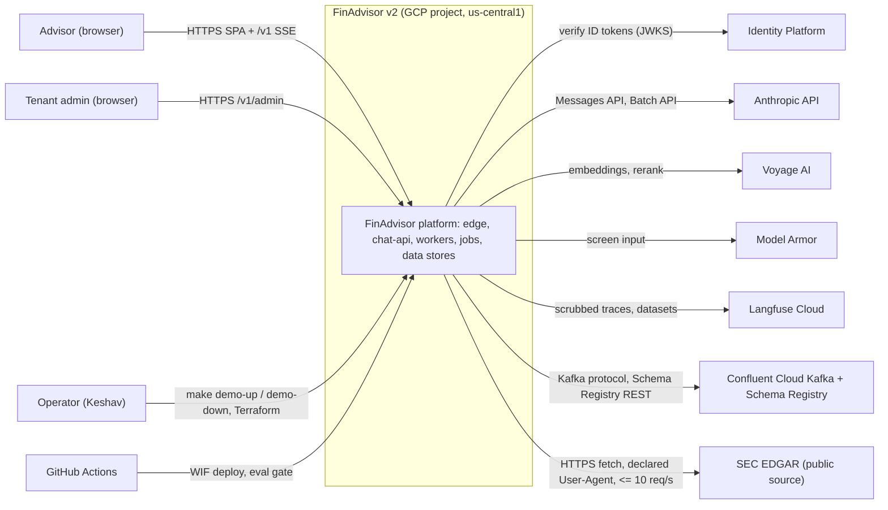

## 3. System context and boundaries

Boundaries:
- Users reach the system only through the external ALB (`/*` SPA, `/v1/*` API). Nothing else is internet-facing; Cloud Run services use ingress internal-and-cloud-load-balancing or internal.
- The tenant boundary is inside the database (RLS, §5.4), not at the network. All tenants share one deployment.
- Trust: browsers, SaaS responses, retrieved documents and tool outputs are untrusted. Identity comes only from a verified ID token (sub + IdP tenant); entitlements come from the DB.
- Data classification: synthetic data only. Redacted text may leave to Anthropic, Voyage, Langfuse, Confluent, BigQuery; raw documents leave only to GCS bronze.
- SEC EDGAR: at most 10 requests/s, declared User-Agent, nightly index about 10 pm ET (evidence-r2.md).
