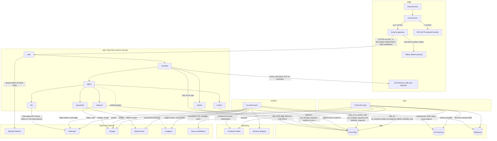
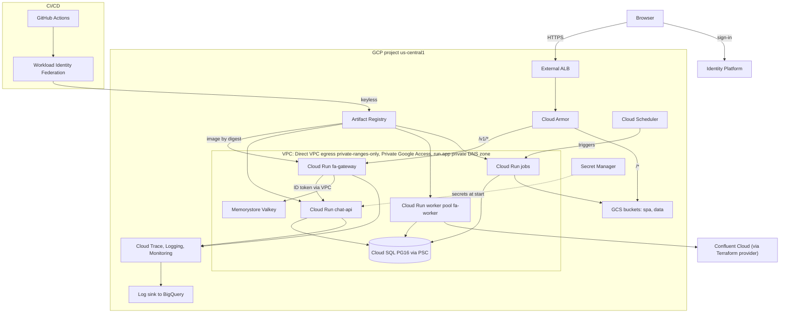

## 4. Components and responsibilities

Notes on the diagram: `chat-api` neither produces nor consumes Kafka; its events leave through the outbox rows that the `fa-worker` relay publishes. `chat-api` calls Kong's internal egress route to reach Anthropic only if the egress spike passes (§10); otherwise `llm` calls Anthropic directly. The SPA hosts no code that talks to anything but `/v1/*` on its own origin. ACL changes and deletions no longer ride Kafka: `acl-applier` and the `erasure-worker` poll Postgres tables (R4-D7, R4-D6; ADR-022 amended, ADR-029). `CELLS` is a static signed file, not a service (§4.24). `SRC` are the public and publisher sources reached by the source connectors (§4.15). Platform services (Cloud Scheduler, Secret Manager, Artifact Registry, VPC / PSC / Private Google Access, Cloud Trace / Logging / Monitoring, GitHub Actions + WIF) are in the deployment diagram (§4.12); Terraform is described there in a note. New round-4 components are specified in §4.15 to §4.27 (data-flow diagram in §4.15, deletion-flow diagram in §4.19).

Runtime shape (ADR-019): one Python image, entrypoints `api | worker | jobs`. `chat-api` is a Cloud Run service (SSE, explicit concurrency, request timeout 3600 s). `fa-worker` is a Cloud Run worker pool. Jobs are Cloud Run jobs. Local dev is docker compose with the same image. All Cloud Run services and jobs use Direct VPC egress in `private-ranges-only` mode with no Cloud NAT (ADR-024).

### 4.1 External ALB
- Purpose: single public entry point, same origin for SPA and API. URL map: `/*` to the GCS backend bucket (SPA, CDN); `/v1/*` to the `fa-gateway` serverless NEG. Managed certificate.
- Persistent (~$18-25/month with Cloud Armor) because certificate provisioning is slow; never torn down by `demo-down` (D7).
- `fa-gateway` has the Cloud Run invoker check disabled (the only service where it is), ingress internal-and-cloud-load-balancing, so `run.app` is unreachable from the internet and the ALB is the only path in; no `allUsers` binding anywhere (D15.1, D16.1; https://docs.cloud.google.com/run/docs/authenticating/public ). IAP was rejected: it replaces the caller identity and conflicts with end-user ID tokens. E10 checks the org policy `constraints/run.managed.requireInvokerIam` and that no service has an `allUsers` binding.
- Fixes G-02, G-13. Decision: ADR-012.

### 4.2 Cloud Armor
- Policy attached to the ALB backend services: DDoS / WAF preconfigured rules, geo rules, coarse per-IP throttle. Kong keeps the fine-grained limits; Cloud Armor keeps DDoS / WAF / geo (D12).
- Cost ~$0.75/1M requests + policy fee: exact cost UNVERIFIED (§10).

### 4.3 Kong (Cloud Run service `fa-gateway`)
- Image `kong:3.9.4`, DB-less, `_format_version: "3.0"`, admin API off, status listener for health. Ingress internal-and-cloud-load-balancing, invoker check disabled (§4.1). min instances 0 (demo), max 2. Binding per D12 (Keshav); ADR-011.
- Network: Direct VPC egress `private-ranges-only`, Private Google Access on the subnet, and a Cloud DNS private zone mapping `run.app` to `private.googleapis.com`, so Kong reaches `chat-api` (ingress internal) through the VPC (D16.12, ADR-024). Valkey endpoint comes from a Kong environment variable; `demo-up` deploys a new Kong revision with it.
- Responsibilities: rate limits (per client IP and per session key, `redis` policy on Valkey), request-size limit, CORS (SPA origin allow-list), `correlation-id` (`X-Request-Id`), OpenTelemetry (`traceparent`), Prometheus, `file-log` audit, bot-detection, `request-transformer` stripping client `X-User-Id`, `X-Tenant-Id`, `X-Serverless-Authorization`, `X-RL-Key`, and a `pre-function` that (a) sets `X-Serverless-Authorization: Bearer <Google ID token>` (from the metadata server, audience = chat-api URL, cached until near expiry), leaving the user's `Authorization` intact (Cloud Run IAM checks only that header when both are present; https://docs.cloud.google.com/run/docs/authenticating/service-to-service ), and (b) sets `X-RL-Key = sha256(Authorization)` so raw tokens never reach Valkey keys.
- Audit (D16.9, ADR-023): `file-log` to stdout with a field whitelist (no `Authorization`, no bodies, no query strings) to Cloud Logging, then a log sink to BigQuery `gateway_audit`. There is no `/internal/audit/gateway` route. Fixes G-48.
- Does not verify tokens, does not set identity headers, cannot key on the verified tenant (OSS limitation); per-tenant budgets and concurrency live in `chat-api`.
- SSE chat routes: `response_buffering: false`, `request_buffering: false`, service `read_timeout` 3,600,000 ms.
- Local: `kong:3.9.4` + Valkey in compose; `kong.yml` in git, validated in CI with `kong config parse`, smoke-tested with deck/curl.
- Full route and plugin table: §6.5. Spikes: SSE pass-through, `X-Serverless-Authorization` passthrough smoke test, private-DNS `run.app` egress, ai-proxy `preserve` egress, `X-RL-Key` behaviour (§10).

### 4.4 SPA (GCS backend bucket)
- Vite + React 19 + TypeScript single-page app, static files in a GCS bucket behind the ALB with CDN. Same origin as the API, so no CORS in the normal path and no BFF buffering hop.
- Behaviour: tenant discovery from `/t/<slug>`, Identity Platform sign-in for that IdP tenant, fetch-based SSE client with `Last-Event-ID` resume and `Idempotency-Key`, citations with excerpts, stale badges, conversation history, feedback, error states keyed by error code. Renders sanitized markdown only. Tests: vitest + Playwright. Epic E8.
- Replaces Next.js 14 (G-13, G-57).

### 4.5 chat-api modules (Cloud Run service `chat-api`)
Single deployable, modular monolith. Import-linter contracts enforce the boundaries below, plus a test. DB login role `fa_app`: SELECT only on content tables, no write on content tables anywhere in `chat-api`. Ingress internal; `run.invoker` granted only to the Kong service account (IAM checks the `X-Serverless-Authorization` header). Request timeout 3600 s, explicit concurrency (number set in E10 from the load test), one Uvicorn process per container. `chat-api` has no Kafka credentials: it neither produces nor consumes.

**`auth`**: verifies the `Authorization: Bearer <Identity Platform ID token>` with firebase-admin tenant-aware verification: the `firebase.tenant` claim names the IdP tenant, and `tenant_mgt.auth_for_tenant(tenant_id).verify_id_token(...)` checks signature, `aud`, `iss`, `exp` and raises `TenantIdMismatchError` on a tenant mismatch (D15.3; https://docs.cloud.google.com/identity-platform/docs/multi-tenancy-managing-tenants ). Output: `(sub, idp_tenant_id)`. Never reads identity from headers. The claim name is verified in the first E1 ticket. One token per firm: an advisor who belongs to two firms holds two Identity Platform users and sends exactly one firm's token per call; no identity merge (R4-D11, ADR-032). Fixes G-01.

**`principal`**: first checks the cell: the `idp_tenant_id` is looked up in the signed `cells.json` and its `home_cell` must equal this cell, otherwise it returns 421 with a cell hint and reads nothing from the tenant data (§4.24, ADR-031). Then maps `idp_tenant_id` to `tenants.id` (via `fa_tenant_lookup`, §5.4), loads `advisors` (tier, jurisdictions, licenses, role, `entitlement_version`) into a `Principal` object, cached <= 60 s per process; the TTL is the revocation bound (no Kafka invalidation). Owns the only function that sets the per-transaction settings `app.tenant_id`, `app.idp_uid`, `app.user_id`, `app.role`, `app.tier`, `app.jurisdictions` via `set_config(name, $n, true)` with bind parameters (the principal-load transaction sets `app.tenant_id` and `app.idp_uid` plus neutral values for the rest). Provides the tenant-scoped transaction context manager used by every module; transactions are short and never held across the LLM loop.

**`retrieval`**: `RetrievalService(principal)` is the single enforcement point (ADR-004). Only module allowed to touch content tables (`documents`, `document_versions`, `chunks`, `suitability_rules`), read-only. Methods: `resolve_as_of(question, ui_chip)` (§4.18), `search(query_text, query_vec, as_of)` (hybrid SQL + RRF), `rerank`, `gate`, `expand_parents`, `factsheet`, `suitability`, `fetch_chunks(ids)` (used by the citation verifier, the as-of validity check and the cache-hit path). Tools never pass tenant, tier, jurisdiction or `as_of`. Every SQL string in the module carries `valid_range @> $as_of::date AND upper_inf(system_range)` (CI test, §5.6) and inlines the tenant's `active_embed_model` from an allow-list so the per-model partial HNSW index is used (§4.27). Embeds via Voyage `voyage-4` (`input_type=query`), reranks via `rerank-2.5-lite`; a rerank timeout or 429 falls back to RRF order and marks the turn degraded (§6.2 `meta`). Also owns the `answer_cache` read/write (not a content table; key incl. `as_of`, `embed_model`, `source_epoch`, §5.7); turns that called a side-effect tool are never cached.

**`guardrails`**: input cap; Presidio (`presidio-analyzer` 2.2.x, spaCy `en_core_web_sm` for EN; DE and FR PII recall is measured before any claim is made) in-process pseudonymization before embed / LLM / traces / logs; Model Armor input screen (parallel with embed, fail closed; the timeout is fixed only after Model Armor latency is measured from the Cloud Run region, replacing the earlier 500 ms default); sentence-buffered output PII redaction; deterministic citation verifier (every `[n]` is in the retrieved chunk ids; quote overlap); the numeric grounding gate (§4.26); deterministic compliance checks (licence footers from `document_versions.attribution_text`, jurisdiction labels, as-of validity of every cited chunk, staleness); role policy as data, default deny; error-code mapping. Untrusted chunk text reaches the model only inside a JSON-encoded `tool_result` with a per-request random boundary nonce (JSON-encode spotlighting is the default; datamarking is an ablation arm only). No LLM-based rails on the hot path (ADR-009, amended by ADR-036). The ingest-time scan is a worker stage (§4.25). Presidio latency is benchmarked in E4 (no official figure).

**`agent`**: the retrieve-first orchestrator (ADR-007). Order: guard-in, `as_of` resolve, answer-cache lookup, embed + screen, retrieval, gate, then one streaming `llm` call with tools (`lookup_product_factsheet`, `lookup_suitability_rule`, `escalate_to_compliance`, `search_firm_kb` follow-up), max 3 iterations; sentences are released only after the numeric gate and the citation verifier pass. The answer states the `as_of` date it used. Conversation state: last 6 turns <= 3k tokens, follow-up condensation with Haiku only when history exists. Emits SSE events with sequence ids and persists them to `turn_events`; sets `messages.retrieval_degraded`. Persists escalations (G-18). On a sampled fraction of completed turns (`EVAL_SAMPLE_RATE`) writes an `eval.sample.v1` outbox row.

**`llm`**: `LLMClient` over the Anthropic SDK: streaming, explicit timeouts, retries with jitter, circuit breaker, same-provider fallback (`claude-sonnet-5-5` to `claude-sonnet-4-6`) enabled only if the eval gate passed against the fallback; model ids only from config; no `temperature`/`top_p`/`top_k`; prompt caching on system prompt + tools (tool definitions versioned with the prompt); `max_tokens` bound; CI and readiness fail on a retired or soon-retiring model. Base URL from config (`ANTHROPIC_BASE_URL`): direct, or Kong egress route (`key-auth` consumer `chat-api`). ADR-005, ADR-006.

**`events`**: transactional outbox writer: rows inserted in the same transaction as the business write (turn persist, escalation, admin change). It has no Kafka client and no listener: chat never depends on Kafka. Subject identifiers in events are the random `pseudonym_id` (§5.12), never `idp_uid` or email. ADR-013.

**`admin`**: tenant-admin endpoints (`/v1/admin/*`). Advisor entitlement changes are a direct `UPDATE advisors` (allowed to `tenant_admin` only by policy, bumping `entitlement_version`) plus an outbox event for analytics. Document ACL and reclassification changes never write content tables: `admin` inserts an `acl_change_requests` row and an `acl.changes.v1` outbox row (analytics and audit only) in one transaction and returns 202; the `acl-applier` worker polls the table and applies it (ADR-022 amended). `DELETE /v1/admin/documents/{id}` is a separate path: `admin` inserts a `deletion_requests` row (scope `document`) directly and returns 202; the `erasure-worker` executes it (ADR-029). `acl_change_requests` carries ACL and reclassification changes only. Data-subject erasure and tenant offboarding are `deletion_requests` rows inserted by `admin` (role `tenant_admin`) or by the operator command (§4.19). Role check `tenant_admin` through `principal`. Tenant onboarding (partition creation) is a job, not an endpoint (§4.8).

### 4.6 Valkey (Memorystore, shared-core-nano)
- Backing store for Kong `rate-limiting` counters (`policy: redis`, `sync_rate: 0` on the chat route). Local: valkey container in compose. In the cloud it is a fixed-name Memorystore instance created by `demo-up` and deleted by `demo-down` by the demo script, outside Terraform state (documented once here and in §2.6); `demo-up` passes its endpoint to Kong as an environment variable by deploying a new Kong revision. ~$23/month, ~$0.03/h only while up. Not used for anything else (no session or answer cache).

### 4.7 fa-worker (Cloud Run worker pool)
- Entrypoint `worker`; one image, roles selected by `WORKER_ROLES`: `outbox-relay`, `silver`, `contextualizer`, `indexer`, `acl-applier`, `erasure-worker`, `eval-judge`, `bq-sink`. DB login role `fa_worker`. Confluent: one service account and API key per service, Kafka ACLs per service account (ADR-013). Instance count 0 when the demo is down.
- Envelope check on every consumed message: if `envelope.tenant_id` differs from the message key, or the tenant is PUBLIC, the message goes to `dlq.v1` with a reason (PUBLIC is ingested in-process by `etl-public`, never through worker consumers). `bq-sink` is exempt for PUBLIC analytics events.
- Write guard in every sink (`silver`, `contextualizer`, `indexer`, `bq-sink`): before writing, an UNCACHED point read of `erasure_ledger` on `(tenant_id, doc_key, sha256)` inside the sink's own transaction or write path; a hit drops the message with a counted reason. There is no 60 s cache on this read (cached tombstones were the round-4 skeptic's main finding, S-skeptic-3 #2). A consumer that cannot read the ledger pauses. A Kafka replay after a bug fix therefore cannot resurrect erased data (§4.19).
- `outbox-relay`: per tenant, reads unpublished `outbox` rows in order, produces with an idempotent producer, marks `published_at`. At-least-once. No Debezium.
- `silver`: consumes `docs.bronze.v1`: Docling parse, then the ingest scan and contract checks (§4.25; a failure sets the version `quarantined`, copies the bytes to `quarantine/` and writes nothing to silver), Presidio scrub, structure-aware chunking (256-512-token children, ~1k-token parents, token counts from Voyage `count_tokens`), Pandera validation with `PANDERA_VALIDATION_DEPTH=SCHEMA_AND_DATA`, rejects to `ingest_rejects`, writes silver Parquet to the data bucket under `silver/tenant_id=<id>/doc_id=<id>/version=<id>/` (one document version per file set, so one document is deletable by prefix), emits `docs.silver.v1`. It checks the tombstone before and after writing Parquet and deletes its own output if a tombstone appeared.
- `contextualizer`: consumes `docs.silver.v1`: Haiku 5.5 Batch API contextual headers (behind flag `CONTEXTUAL_RETRIEVAL_ENABLED`, default OFF: contextual retrieval is an ablation arm, ADR-016 amended), suitability-rule extraction (Haiku structured output, validated) into `suitability_rules`, emits `chunks.contextualized.v1`.
- `indexer`: consumes `chunks.contextualized.v1` and is the only writer of `chunks`. Embeds with Voyage `voyage-4` outside any transaction (vectors reused by `(tenant_id, chunk_hash, embed_model)`), then publishes one document version atomically through `reconcile_lineage` (§4.16, §4.17): advisory lock, tombstone and gate checks, chunk insert / range merge / close, version `active`, `corpus_version` bump last, cache purge, `processed_events`, then emits `chunks.indexed.v1`.
- `acl-applier`: polls `acl_change_requests` in Postgres (ACL and reclassification changes only; document deletes go to `deletion_requests`) (`status = 'pending'`, `FOR UPDATE SKIP LOCKED`, own tenant); Kafka is not on this path (R4-D7, ADR-022 amended; §4.21). Applies the ACL-column UPDATE on `documents`, `document_versions` and `chunks` (own-tenant WITH CHECK, ACL columns only), marks the request `applied`, bumps `tenants.acl_version`, purges `answer_cache` rows that cite the document, and writes the `AclChangeApplied` outbox row (analytics and audit).
- `erasure-worker`: polls `deletion_requests` (`FOR UPDATE SKIP LOCKED`), writes the tombstone, deletes from every live store, records receipts, re-sweeps at the end of each store window, replays the ledger after a restore (§4.19). No Kafka on its path.
- `eval-judge`: consumes `eval.sample.v1` (a `EVAL_SAMPLE_RATE` sample, 5-10%), scores the redacted question / answer / cited excerpts with `claude-haiku-5-5` (judge differs from the answer model), writes scores to Langfuse and `eval_scores`, emits `JudgeScored` on `eval.events.v1`. Langfuse-side evaluators are not used.
- `bq-sink`: consumes audit, usage, eval, ingest and ACL topics; writes BigQuery with event-id dedupe; rows carry `pseudonym_id`, never `idp_uid` or email. Subject-bearing topics are delete-policy topics with `retention.ms` 7 d and `segment.ms` 1 d (§5.14).
- Every consumer: `processed_events` dedupe in the sink transaction, retries, then DLQ `dlq.v1`. Each message handled in a transaction with `app.tenant_id` set from the event key.
- The PUBLIC corpus is never written by `fa_worker` (§5.4).

### 4.8 Cloud Run jobs
All from the one image (`jobs` entrypoint). Triggered by Cloud Scheduler, by `demo-up`, or manually.

| Job | DB role | Purpose |
|---|---|---|
| `migrate` | `fa_owner` | Alembic upgrade before traffic; tenant onboarding (`--onboard-tenant <slug>`: LIST partition + indexes + the per-leaf `EXCLUDE` constraint on `chunks` (§5.10), `tenants` row incl. `cell_id`, IdP mapping; the IdP tenant itself is provisioned by an onboarding script in E1 and Terraform in E10); asserts role flags, FORCE RLS and that partitions carry no runtime grants |
| `maintenance` | `fa_maint` | Purges expired `answer_cache` and `turn_events` rows; creates `messages` partitions 3 months ahead and drops those past retention; hourly while the demo is up and run by `demo-up` (D16.8) |
| `etl` | `fa_etl` | Dagster run of tenant source connectors (§4.15: list, changes, fetch, `source_observations`, GCS by sha256, `document_versions`, publish `docs.bronze.v1`), backfills and replays. Daemon-less: `dagster asset materialize` in a Cloud Run job; run and event storage in Postgres (`dagster-postgres`, database `dagster` on the same Cloud SQL instance, owned by role `fa_dagster`, no access to app schemas); `dagster dev` locally |
| `etl-public` | `fa_etl_public` | Public ingest (eCFR, EUR-Lex CELLAR, legislation.gov.uk, SEC RR datasets, FCA API): runs every stage in-process and publishes only analytics topics (`ingest.analytics.v1`); the only writer of PUBLIC rows. One PUBLIC corpus per cell, ingested independently by that cell's job. FCA content never reaches Kafka or BigQuery (§4.20) |
| `purge-source` | `fa_etl_public` | `purge_source('fca_api')` and other source kill switches (§4.20): erases the source's PUBLIC rows, bumps `source_epoch`, fans out one `deletion_requests` row per firm tenant |
| `reconcile` | per tenant `fa_worker`; PUBLIC `fa_etl_public` | Counts and set-hashes at every hop, ANN self-hit canary, tombstone invariant, BigQuery dataset-setting check (§4.22); hourly while the system runs |
| `erasure-verify` | per tenant `fa_worker` | Probes each store after its window timer and issues receipt phase 2 (§4.19) |
| `erasure-canary` | `fa_worker` (canary tenant rows) | The canary drill at demo start (§4.23) |
| `embed-backfill` | per tenant `fa_worker` | Builds a new embedding generation (§4.27); own Voyage semaphore at 25% of the RPM limit |
| `move-tenant` | set in E13 (ADR-033) | Copy, verify, cutover, erase for a tenant move between cells (§4.24) |
| `dbt` | `fa_dbt` | dbt Core gold models on Postgres (`dbt-postgres`: views with `security_invoker = true`, or incremental models with a tenant predicate, never full rebuilds; `contract: enforced` where the materialization supports it) and BigQuery marts (`dbt-bigquery`); per tenant run on a dedicated connection |
| `eval` | `fa_eval` | Full or subset eval run (L1-L3) against the dedicated `eval` tenant; results to Langfuse and `eval.events.v1`; ablation runs use the Message Batches API (ADR-037) |
| `redteam` | `fa_eval` | promptfoo red team against the API |
| `demo-prewarm` | none | Runs inside the VPC after `demo-up`: calls `/readyz` and warms pools and caches (not run from the operator laptop) |
| `demo-ttl` | `fa_maint` | Hourly safety net: reads the outbox count and runs `demo-down` if the demo has been up longer than `DEMO_TTL_HOURS` (Cloud Run admin SA rights) |

### 4.9 Cloud SQL (PostgreSQL 16, pgvector 0.8.5)
- Enterprise, 2 vCPU / 8 GiB, zonal, private IP only (PSC), activation policy flipped by `demo-up` / `demo-down`; HA is a Terraform flag for `prod` and load tests (ADR-020). Databases: the app database and `dagster`. Schema, roles, RLS and indexes: §5. Extensions include `btree_gist` (needed for the `EXCLUDE` constraints, §5.9).
- Single store for relational data, vectors (halfvec + HNSW), full text (tsvector + GIN), conversation state, outbox, answer cache, the erasure ledger and the deletion queue.
- Automated backup retention 7 days; no on-demand backups are kept; PITR log retention is not documented and stays an open question (§5.14).
- `max_connections` is 400 on this tier; the pool budget (`DB_POOL_SIZE` x max instances over all services) must stay <= 300, leaving headroom for migrations, dbt and Dagster (D15.7). Managed connection pooling is Enterprise Plus only (transaction mode forbids `SET`).

### 4.10 GCS bronze
- Bucket (data) with prefix `bronze/{tenant_id}/{sha256}`: raw immutable bytes plus source URL and fetch time; the only place raw documents live (G-03). `silver/tenant_id=<id>/doc_id=<id>/version=<id>/` holds redacted chunk Parquet (versioned path, ADR-014 amended). `quarantine/` holds bytes of versions that failed the ingest scan or a contract check; it is never read by `silver`. Soft delete policy 0 and object versioning off on this bucket, so a delete is immediate (§5.14). The SPA bucket is separate.

### 4.11 BigQuery
- Analytics marts for audit, usage, eval and gateway events: tables partitioned by day, clustered by `tenant_id`; redacted text only, subjects as `pseudonym_id`; `maximum_bytes_billed` set on every query. Per-tenant authorized views are the primary isolation; row access policies per tenant are the second layer (they do not prune partitions and can bill more rows) (D15.5). Marts are built by `dbt-bigquery`. Fed by the `bq-sink` with event-id dedupe (Storage Write API default stream is at-least-once) and, for `gateway_audit`, by a Cloud Logging log sink. 1 TiB/month of queries free (evidence-r2.md). FCA content never enters BigQuery (§4.20). Every dataset, including the ones dbt creates, sets `max_time_travel_hours = 48`; the `reconcile` job checks this (§4.22). ADR-014, ADR-023, ADR-029.

### 4.12 Platform services and the deployment view

Terraform (google provider, plus Confluent provider) owns every resource in this view and the Confluent cluster, with state per env prefix, applied from GitHub Actions through WIF (plan on PR). The one exception is the Valkey instance lifecycle (§4.6). `lifecycle.ignore_changes` covers `activation_policy`, `min_instance_count`, `manual_instance_count`.

- **Cloud Scheduler**: triggers `etl`, `etl-public`, `dbt`, `maintenance`, `reconcile`, `erasure-verify`, `eval`, `redteam` and `demo-ttl`. `demo-down` pauses all except `demo-ttl`. The canary and the erasure job are run by `demo-up`, not by a cron (§4.23).
- **Secret Manager**: all secrets (DB passwords per role, Kafka and Schema Registry keys per service, Anthropic, Voyage, Langfuse keys, the Kong `key-auth` key for the egress route, the salt for ledger hashes). A Cloud KMS key signs the erasure receipts (HMAC). No secret defaults in code: missing config fails boot.
- **Artifact Registry**: images by digest; deploy references digests, never tags.
- **VPC / PSC / egress** (ADR-024): Cloud SQL private only (PSC); all services and jobs use Direct VPC egress in `private-ranges-only` mode (public SaaS APIs are reached directly; no Cloud NAT), Private Google Access on the subnet, and a Cloud DNS private zone mapping `run.app` to `private.googleapis.com`. Startup probe on Cloud Run. Per-service service accounts, least privilege (G-50). Fallback if the private-DNS spike fails: all-traffic egress + Cloud NAT (about +$32/month) with an ADR.
- **Cloud Trace / Logging / Monitoring**: §9. A log sink exports Kong's `file-log` audit to BigQuery.
- **GitHub Actions + WIF**: keyless deploy and CI (ADR-021).
- **Local (docker compose)**: Postgres (`pgvector/pgvector:0.8.5-pg16`, matching Cloud SQL), `apache/kafka:4.4.0` KRaft, Schema Registry (cp-schema-registry), `kong:3.9.4`, Valkey, api, worker, frontend dev image, `dagster dev`; env-driven host ports; healthchecks (G-49).

### 4.13 SaaS dependencies
- **Identity Platform** (multi-tenancy, one IdP tenant per firm; billing enabled for > 2 tenants; email/password free to 50k MAU). Verified by `auth` with firebase-admin; ADR-010, ADR-032. The same-email-in-two-tenants test is a spike that gates the Identity Platform tickets in E1 (§10).
- **Anthropic**: answer `claude-sonnet-5-5` ($2 / $10 per MTok); judge, headers, rule extraction, condensation, citation spot-checks `claude-haiku-5-5`; fallback `claude-sonnet-4-6`; Batch API for offline work and ablation runs. ADR-006.
- **Voyage**: `voyage-4` embeddings (halfvec(1024), `input_type` query / document), `rerank-2.5-lite`. Single provider, no fallback. Rerank timeout or 429 degrades to RRF order, flagged and counted. Private EU document text reaches Anthropic and Voyage (embed and rerank); the per-tenant flag `llm_egress_ack` must be true before private ingest (§5.12, ADR-038).
- **Model Armor**: REST screen of the redacted input at query time (detects, the app acts) and document screening at ingest (§4.25). Free to 2M tokens/month.
- **Langfuse Cloud Hobby** (Python SDK 5.x): free 50k units/month, 30-day retention; metadata, hashes, redacted text only, tagged by tenant; `capture_input` / `capture_output` off on sensitive spans and `mask_otel_spans` for export masking. Trace deletion is provider best effort ("usually within 15 minutes"), stated as provider-bound (§4.19). ADR-018.
- **Confluent Cloud Basic + Schema Registry (Essentials)**: cluster and registry in us-central1 (registry region is fixed by the first cluster). Kafka ACLs per service account (no RBAC), max 50 API keys, 1,000 ACLs, 1,500 partitions: one service account + key per service. Local: `apache/kafka:4.4.0` + cp-schema-registry. Schemas are Pydantic-derived JSON Schema with BACKWARD compatibility checked in CI.
- **Source publishers**: eCFR, SEC (EDGAR and RR datasets), EUR-Lex CELLAR, legislation.gov.uk, FCA Handbook API, and manually fetched publisher documents; reached only by the source connectors (§4.15), each with its own rate limit and declared user agent.
