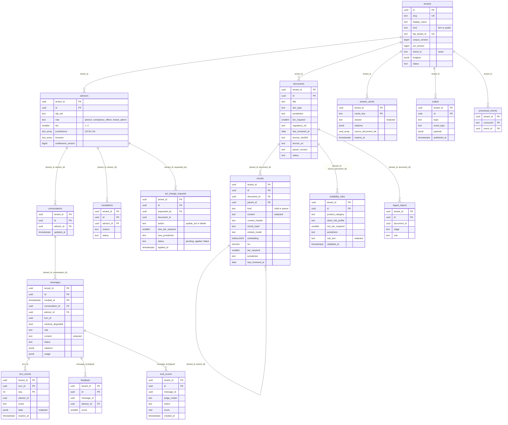

## 5. Data model and storage

One Postgres 16 database (Cloud SQL, pgvector 0.8.5). Every table carries `tenant_id uuid NOT NULL` (on `tenants` the key `id` is the tenant id). Managed by Alembic (baseline from MVP `schema.sql`, then versioned migrations run by the `migrate` job as `fa_owner`). Evidence for the pattern: PostgreSQL 16 RLS docs https://www.postgresql.org/docs/16/ddl-rowsecurity.html , AWS pgvector RLS https://aws.amazon.com/blogs/database/self-managed-multi-tenant-vector-search-with-amazon-aurora-postgresql/ .

### 5.1 Entity-relationship diagram



### 5.2 Tables

Types: `uuid` ids (time-ordered where possible), `timestamptz` times. All composite foreign keys start with `tenant_id` because FK checks bypass RLS (a single-column FK would let a tenant probe other tenants' ids).

| Table | Key | Columns (beyond key) and rules |
|---|---|---|
| `tenants` | `id` | `slug` unique, `display_name`, `kind` in (`firm`,`public`), `idp_tenant_id` unique, `corpus_version bigint` (bumped by the embed-indexer after the `chunks` upsert), `acl_version bigint` (bumped by the `acl-applier`), `budgets jsonb` (per-tenant token budget and concurrency; set in E4), `shard_id` (seam for silo / shard, D2), `status`, `created_at`. The reserved PUBLIC tenant has `kind='public'` and id `PUBLIC_TENANT_ID`. Policies in §5.4 |
| `advisors` | `(tenant_id, id)` | `idp_uid` (token `sub`), unique `(tenant_id, idp_uid)`; `display_name`, `role` in (`advisor`,`compliance_officer`,`tenant_admin`), `tier smallint CHECK 1..4`, `jurisdictions text[]` CHECK subset of (`US`,`EU`,`UK`), `licenses text[]`, `entitlement_version bigint`, `status`. UPDATE only by a `tenant_admin` (no self-escalation) |
| `documents` | `(tenant_id, id)` | `title`, `doc_type`, `jurisdiction`, `tier_required CHECK 1..4`, `regulatory_ref`, `last_reviewed_at`, `product_category`, `risk_level`, `source` (`edgar`,`synthetic`), `source_uri`, `bronze_uri`, `bronze_sha256`, `parser_version`, `status` (`active`,`superseded`,`deleted`), `created_at`. Unique `(tenant_id, bronze_sha256)`. No `raw_content` column (G-03) |
| `chunks` | `(tenant_id, id)` | LIST-partitioned by `tenant_id` (§5.5). `document_id` (FK `(tenant_id, document_id)` to `documents`), `parent_id` (self FK `(tenant_id, parent_id)`), `kind` in (`child`,`parent`), `chunk_index`, `content` (redacted), `context_header`, `chunk_hash`, `embed_model`, `embedding halfvec(1024)` (children only, NULL for parents), `tsv tsvector GENERATED ALWAYS AS (to_tsvector('simple', coalesce(context_header,'') \|\| ' ' \|\| content)) STORED`, `tier_required`, `jurisdiction`, `regulatory_ref`, `last_reviewed_at`, `source_title`, `section_path`, `token_count`, `created_at`. Unique `(tenant_id, chunk_hash, embed_model)`. ACL columns are denormalised from `documents` so the ANN query filters without a join |
| `suitability_rules` | `(tenant_id, id)` | `rule_name`, `product_category`, `client_risk_profile` CHECK 3 values, `min_tier_required`, `jurisdiction`, `regulatory_ref`, `rule_text` (redacted), `source_document_id` (composite FK), `extractor_model`, `validated_at`, `last_reviewed_at` |
| `conversations` | `(tenant_id, id)` | `advisor_id` (composite FK), `title` (redacted), `created_at`, `updated_at`, `deleted_at` |
| `messages` | `(tenant_id, id, created_at)` | RANGE-partitioned by `created_at`, monthly (D11), owned by `fa_maint`. `conversation_id` (composite FK), `advisor_id` (owner clause), `turn_id`, `role` (`user`,`assistant`), `content` (redacted), `status` (`pending`,`streaming`,`complete`,`refused`,`failed`), `model`, `prompt_version`, `citations jsonb`, `retrieval_chunk_ids uuid[]`, `retrieval_degraded boolean` (rerank timeout or 429 fell back to RRF order), `usage jsonb` (input / output / cache-read tokens), `refusal_code`. The `maintenance` job creates partitions 3 months ahead and drops those past retention; a DEFAULT partition catches misses (alert if non-empty) |
| `turn_events` | `(tenant_id, turn_id, seq)` | SSE replay buffer: `advisor_id` (owner clause), `event`, `data jsonb` (already redacted), `created_at`, `expires_at` (purged by `maintenance`; retention `SSE_REPLAY_TTL_S`, set in E4). `turn_id = uuid5(namespace, tenant_id \|\| advisor_id \|\| Idempotency-Key)`; inserting `seq 0` with `ON CONFLICT DO NOTHING` is what enforces idempotency |
| `escalations` | `(tenant_id, id)` | `advisor_id`, `reason`, `product_class`, `licenses` (copied from `advisors.licenses`, never from the model), `status` (`pending_review`,...), `message_id`, `created_at`. UUID id fixes the G-18 collision |
| `acl_change_requests` | `(tenant_id, id)` | `requested_by` (composite FK to `advisors`), `target_type` (`document`), `document_id`, `action` (`update_acl`,`delete`), `new_tier_required`, `new_jurisdiction`, `status` (`pending`,`applied`,`failed`), `error_code`, `requested_at`, `applied_at`. Written by `chat-api` `admin` with the outbox row in one transaction; applied by the `acl-applier` worker |
| `eval_scores` | `(tenant_id, id)` | `message_id` (logical), `judge_model`, `metric` (faithfulness, citation, ...), `score`, `rationale` (redacted), `created_at`. Written by the `eval-judge` worker; no grant to `fa_app` |
| `feedback` | `(tenant_id, id)` | `message_id` (logical reference: partitioned PK includes `created_at`, so no FK), `advisor_id` (owner clause), `score` (-1, 1), `comment` (redacted), `created_at` |
| `answer_cache` | `(tenant_id, cache_key)` | UNLOGGED (§5.7). Own RLS + FORCE |
| `outbox` | `(tenant_id, id)` | `topic`, `key`, `event_type`, `schema_version`, `payload jsonb` (minimised), `created_at`, `published_at`, `attempts`. `id` is the Kafka `event_id`. Partial index on `(tenant_id, created_at) WHERE published_at IS NULL` |
| `processed_events` | `(tenant_id, consumer, event_id)` | `processed_at`; written in the same transaction as the sink effect |
| `ingest_rejects` | `(tenant_id, id)` | `document_id`, `bronze_sha256`, `stage`, `rule` (Pandera check), `detail` (redacted), `created_at` |

Gold layer (dbt, `fa_dbt`, which owns schema `gold` and is exempt from the not-owner assertion): models `gold.documents_current`, `gold.stale_documents` and `gold.corpus_stats`; views with `security_invoker = true`, or incremental models with a tenant predicate (never full-table rebuilds) (D13n, D16.14). BigQuery marts are built by `dbt-bigquery`.

The factsheet tool returns document metadata plus up to `FACTSHEET_MAX_CHUNKS` redacted parent chunks through `retrieval.factsheet`, never raw content.

### 5.3 Roles (D13c, D16)

One login role per process; there are no `SET ROLE` calls and no second pool in one process. All are NOSUPERUSER, NOCREATEDB, NOCREATEROLE, NOBYPASSRLS. Runtime roles own nothing, with two explicit exemptions listed below.

| Role | Used by | Grants |
|---|---|---|
| `fa_owner` | `migrate` job only (owns all objects except schema `gold` and table `messages`; runtime never connects as it) | owner; creates partitions of `chunks`, policies, `fa_tenant_lookup`; policy `TO fa_owner` on `tenants` (SELECT, INSERT, UPDATE) for onboarding |
| `fa_lookup` | NOLOGIN; owns `fa_tenant_lookup` | policy `TO fa_lookup FOR SELECT USING (true)` on `tenants` only; no other grants |
| `fa_app` | `chat-api` | SELECT on `chunks`, `documents`, `suitability_rules` (read-only: no write grant on any content table); SELECT on `tenants` (own and PUBLIC rows; columns `id`, `slug`, `corpus_version`, `acl_version`, `budgets`); SELECT on `advisors`; UPDATE on `advisors` (tier, jurisdictions, licenses, role, status, `entitlement_version`; `tenant_id` immutable) allowed only when `app.role = 'tenant_admin'`; SELECT / INSERT / UPDATE on `conversations`, `messages`, `turn_events`, `escalations`, `feedback`, `answer_cache`, `outbox`; SELECT / INSERT on `acl_change_requests`; EXECUTE on `fa_tenant_lookup`. Content tables are touched only by the `retrieval` module (import-linter + test) |
| `fa_worker` | `fa-worker` pool | on `chunks`: SELECT, INSERT, DELETE, and UPDATE of ACL columns (`tier_required`, `jurisdiction`) only; on `documents`: SELECT, INSERT, DELETE, UPDATE (`tier_required`, `jurisdiction`, `status`, `parser_version`); on `suitability_rules`, `ingest_rejects`, `eval_scores`: SELECT, INSERT (and DELETE on `suitability_rules`); UPDATE (`status`, `applied_at`, `error_code`) on `acl_change_requests`; UPDATE (`corpus_version`, `acl_version`) on its own non-PUBLIC `tenants` row; DELETE on `answer_cache`; SELECT / INSERT / UPDATE on `outbox`; SELECT / INSERT on `processed_events`. Writes limited to its own non-PUBLIC tenant by policy |
| `fa_etl` | `etl` job | SELECT, INSERT, UPDATE (`status`, `parser_version`, `bronze_uri`) on `documents`; SELECT on `chunks`; own non-PUBLIC tenant only |
| `fa_etl_public` | `etl-public` job | write on content tables and UPDATE (`corpus_version`) on the PUBLIC tenant row only. The only role that can write PUBLIC rows |
| `fa_dbt` | `dbt` job | SELECT on content tables (own-tenant policy); owns schema `gold` (explicitly exempt from the not-owner assertion); no other owner rights |
| `fa_maint` | `maintenance` and `demo-ttl` jobs | owns table `messages` (Postgres requires ownership of the parent for partition DDL; explicitly exempt from the not-owner assertion; no row access because no policy applies to it); DELETE on `answer_cache` and `turn_events` limited by policy to expired rows; SELECT (`id`, `published_at`) on `outbox` limited to unpublished rows (outbox count) |
| `fa_eval` | `eval` and `redteam` jobs | the `fa_app` grants, with every policy pinned to the dedicated `eval` tenant (a literal uuid substituted by the migration) plus PUBLIC reads |
| `fa_dagster` | Dagster run / event storage | owner of database `dagster` on the same instance; no access to the app database |

Startup and `/readyz` assert, for the connected role: not superuser, not BYPASSRLS, not owner of any table (except the two exemptions above), FORCE ROW LEVEL SECURITY on every table in the tenant schemas including partitioned parents, pgvector version >= 0.8, the expected policies exist, and that the partitions of `chunks` and `messages` carry no grants to runtime roles (D16.3). A failure refuses to start (fail to boot).

Partitions get no grants: tenant partitions of `chunks` and the monthly partitions of `messages` are created without `GRANT ... ON ALL TABLES`; runtime roles reach them only through the partitioned parent, whose RLS applies. The leak matrix includes "direct SELECT / INSERT on a partition as `fa_app` / `fa_worker` gives permission denied".

### 5.4 Row-level security

All tenant tables: `ENABLE` and `FORCE ROW LEVEL SECURITY`. Settings are transaction-local, set only by `principal`: `SELECT set_config('app.tenant_id', $1, true), set_config('app.idp_uid', $2, true), set_config('app.user_id', $3, true), set_config('app.role', $4, true), set_config('app.tier', $5, true), set_config('app.jurisdictions', $6, true)` with bind parameters. Policies call `current_setting('app.x')` without `missing_ok`, so an unset setting raises an error (fail closed). `<PUBLIC>` below is the `PUBLIC_TENANT_ID` uuid literal substituted by the Alembic migration, so a request cannot change it.

SELECT is own tenant OR PUBLIC. INSERT / UPDATE / DELETE is own tenant only and never PUBLIC (D13a). Policy text for `chunks` (`documents` and `suitability_rules` are identical in shape; `suitability_rules` uses `min_tier_required`):

```sql
ALTER TABLE chunks ENABLE ROW LEVEL SECURITY;
ALTER TABLE chunks FORCE  ROW LEVEL SECURITY;

-- user-facing reads: tenant or PUBLIC, plus tier and jurisdiction
CREATE POLICY chunks_select_app ON chunks FOR SELECT TO fa_app
  USING ( (tenant_id = current_setting('app.tenant_id')::uuid OR tenant_id = '<PUBLIC>'::uuid)
          AND tier_required <= current_setting('app.tier')::int
          AND jurisdiction = ANY (string_to_array(current_setting('app.jurisdictions'), ',')) );

-- pipeline reads: own tenant only
CREATE POLICY chunks_select_pipe ON chunks FOR SELECT TO fa_worker, fa_etl, fa_etl_public, fa_dbt
  USING ( tenant_id = current_setting('app.tenant_id')::uuid );

-- writes by tenant pipelines: own tenant, never PUBLIC (column grants limit UPDATE to ACL columns)
CREATE POLICY chunks_ins_tenant ON chunks FOR INSERT TO fa_worker
  WITH CHECK ( tenant_id = current_setting('app.tenant_id')::uuid AND tenant_id <> '<PUBLIC>'::uuid );
CREATE POLICY chunks_upd_tenant ON chunks FOR UPDATE TO fa_worker
  USING      ( tenant_id = current_setting('app.tenant_id')::uuid AND tenant_id <> '<PUBLIC>'::uuid )
  WITH CHECK ( tenant_id = current_setting('app.tenant_id')::uuid AND tenant_id <> '<PUBLIC>'::uuid );
CREATE POLICY chunks_del_tenant ON chunks FOR DELETE TO fa_worker
  USING ( tenant_id = current_setting('app.tenant_id')::uuid AND tenant_id <> '<PUBLIC>'::uuid );

-- the only writer of PUBLIC
CREATE POLICY chunks_all_public ON chunks FOR ALL TO fa_etl_public
  USING ( tenant_id = '<PUBLIC>'::uuid ) WITH CHECK ( tenant_id = '<PUBLIC>'::uuid );
```

`fa_app` has no INSERT, UPDATE or DELETE policy on `chunks`, `documents` or `suitability_rules`; document ACL changes and deletes are applied by the `acl-applier` worker (ADR-022).

Other tables:
- `tenants`: `tenants_select_app TO fa_app FOR SELECT USING (id = current_setting('app.tenant_id')::uuid OR id = '<PUBLIC>'::uuid)`; `tenants_lookup TO fa_lookup FOR SELECT USING (true)`; `tenants_owner TO fa_owner` for SELECT, INSERT, UPDATE; `tenants_upd_worker TO fa_worker FOR UPDATE USING / WITH CHECK (id = app.tenant_id AND id <> <PUBLIC>)`; `tenants_upd_public TO fa_etl_public FOR UPDATE USING / WITH CHECK (id = <PUBLIC>)`. Column grants limit UPDATE to `corpus_version` and `acl_version`.
- `advisors`: SELECT `TO fa_app` when `tenant_id = app.tenant_id AND (id = app.user_id OR idp_uid = app.idp_uid OR app.role = 'tenant_admin')` (own row, or every row of the own tenant for a tenant admin); UPDATE `TO fa_app` only when `tenant_id = app.tenant_id AND app.role = 'tenant_admin'`, `WITH CHECK (tenant_id = app.tenant_id)`. No self-escalation: an advisor cannot raise their own tier or role (L0 test "advisor raises own tier / role gives denied").
- `conversations`, `messages`, `turn_events`, `feedback`: tenant match AND `advisor_id = current_setting('app.user_id')::uuid` (an advisor sees only their own rows).
- `escalations`: tenant match AND (`advisor_id = app.user_id` OR `app.role = 'compliance_officer'`).
- `acl_change_requests`: SELECT / INSERT `TO fa_app` when tenant matches and `app.role = 'tenant_admin'`; UPDATE of status columns `TO fa_worker` on the own non-PUBLIC tenant.
- `eval_scores`, `ingest_rejects`, `outbox`, `processed_events`: tenant match for the roles that hold grants (no PUBLIC clause). `answer_cache`: own RLS + FORCE (D13i), tenant match for `fa_app` and `fa_worker`; `fa_maint` may delete expired rows only; `outbox` is also readable by `fa_maint` for unpublished rows.
- `fa_eval` policies equal the `fa_app` policies with the tenant literal of the `eval` tenant.

`fa_tenant_lookup(p_slug text DEFAULT NULL, p_idp_tenant_id text DEFAULT NULL)` is the only `SECURITY DEFINER` function allowed in the database (D13m, D13n); CI fails on any other. It is owned by `fa_lookup` (a dedicated NOLOGIN role, not `fa_owner`), sets `search_path` explicitly, returns `(id, display_name, idp_tenant_id)`, and serves both slug discovery and the `idp_tenant_id` to `tenants.id` mapping (D14.4). `REVOKE EXECUTE ... FROM PUBLIC; GRANT EXECUTE ... TO fa_app;`. The public endpoint returns only display name and IdP tenant id. Policies and grants are covered by E1 tests.

The write split and the PUBLIC rule are tested by the L0 leak matrix: cross-tenant read, cross-tenant insert, update into PUBLIC, delete in PUBLIC, FK existence probes, direct partition access, advisor self-escalation, pooled-connection reuse (§8.5).

### 5.5 Partitioning and indexes

- `chunks`: `PARTITION BY LIST (tenant_id)`: one partition per tenant, one for PUBLIC, plus a DEFAULT partition (rows landing there are a bug and alert). Tenant onboarding (`migrate --onboard-tenant`) creates the partition; indexes are declared on the parent so each partition gets its own. Runtime pruning with the RLS `current_setting` policy was confirmed on a test ("Subplans Removed: 6 of 8"); the same check is repeated for LIST partitions in the E1 leak-matrix test. PUBLIC can be sub-partitioned by source later (trigger > 250k chunks). Why not HASH(8): 4 keys in 8 buckets collide ~59% (D13b, ADR-003).
- Per partition, on `chunks`: HNSW on `embedding halfvec_cosine_ops` with `m = 16`, `ef_construction = 64`, partial `WHERE kind = 'child'`; GIN on `tsv`; btree `(tenant_id, document_id)`, `(tenant_id, parent_id)`, `(tenant_id, tier_required, jurisdiction)`; unique `(tenant_id, chunk_hash, embed_model)`.
- Query-time settings, per transaction (`SET LOCAL`): `hnsw.iterative_scan = relaxed_order`, `hnsw.max_scan_tuples = 20000`, `hnsw.ef_search` ~80-100 (config `HNSW_EF_SEARCH`). Filtering is applied after the ANN scan in pgvector, so iterative scan is mandatory (https://github.com/pgvector/pgvector ). halfvec supports <= 4,000 dimensions.
- `messages`: RANGE by month, local indexes `(tenant_id, conversation_id, created_at)`; partitions created 3 months ahead by the `maintenance` job. Neither `chunks` nor `messages` partitions carry grants (§5.3).
- `advisors`: unique `(tenant_id, idp_uid)`. `conversations`: `(tenant_id, advisor_id, updated_at DESC)`. `outbox`: partial unpublished index. `answer_cache`: `(expires_at)` and GIN on `source_document_ids`. `documents`: unique `(tenant_id, bronze_sha256)`; `(tenant_id, doc_type, jurisdiction)`.

### 5.6 Hybrid retrieval statement

One statement, RLS applied to both legs, RRF with `k = 60` (`RRF_K`):

```sql
WITH dense AS (
  SELECT id, parent_id, row_number() OVER (ORDER BY embedding <=> $1::halfvec) AS r
  FROM chunks WHERE kind = 'child' AND embedding IS NOT NULL
  ORDER BY embedding <=> $1::halfvec LIMIT $2),
fts AS (
  SELECT id, parent_id, row_number() OVER (ORDER BY ts_rank(tsv, q) DESC) AS r
  FROM chunks, websearch_to_tsquery('simple', $3) q
  WHERE kind = 'child' AND tsv @@ q ORDER BY ts_rank(tsv, q) DESC LIMIT $2)
SELECT id, parent_id, sum(1.0 / (60 + r)) AS rrf
FROM (SELECT * FROM dense UNION ALL SELECT * FROM fts) u
GROUP BY id, parent_id ORDER BY rrf DESC LIMIT $4;
```

The RLS policy supplies the tenant / PUBLIC / tier / jurisdiction filter to both legs; partition pruning limits the scan to the caller's tenant and PUBLIC partitions. `ts_rank` is not BM25 (pg_textsearch needs PG17+, not on Cloud SQL PG16).

### 5.7 Answer cache (D9, D13i)

UNLOGGED table `answer_cache`, exact match only, single-turn requests only, TTL 24 h (`ANSWER_CACHE_TTL_S`). Turns that called a side-effect tool (`escalate_to_compliance`) are never cached. `cache_key = sha256(tenant_id, tier, sorted jurisdictions, corpus_version of the tenant and of PUBLIC, acl_version, entitlement_version of the user, prompt_version, model, normalized redacted question)`. Columns: `cache_key`, `answer` (redacted), `citations` (chunk ids, indexes), `source_document_ids uuid[]`, `created_at`, `expires_at`. On a hit the citation verifier re-runs against freshly fetched chunks under the caller's RLS and staleness is recomputed; any failure is a miss. Purged by the `acl-applier` on ACL change and document delete (GIN on `source_document_ids`) and by `maintenance` when expired. No semantic cache.

### 5.8 Object and analytics storage

- GCS data bucket: `bronze/{tenant_id}/{sha256}` (raw, immutable), `silver/tenant_id=<id>/dt=<date>/` (redacted chunk Parquet). Lifecycle rules are not specified by the brief.
- BigQuery dataset `fa_analytics`: tables `chat_audit`, `chat_usage`, `eval_events`, `gateway_audit` (from the Cloud Logging sink), `acl_changes`, `ingest_events`; day-partitioned, clustered by `tenant_id`; per-tenant authorized views (primary isolation) plus row access policies (second layer); `maximum_bytes_billed` on every query; dbt-bigquery marts.
- Conversation state in Postgres only (`conversations`, `messages`), last 6 turns <= 3k tokens sent to the model.
