## 5. Data model and storage

One Postgres 16 database (Cloud SQL, pgvector 0.8.5). Every table carries `tenant_id uuid NOT NULL` (on `tenants` the key `id` is the tenant id; the one exception is the global reference table `embed_generations`). Managed by Alembic (baseline from MVP `schema.sql`, then versioned migrations run by the `migrate` job as `fa_owner`). Evidence for the pattern: PostgreSQL 16 RLS docs https://www.postgresql.org/docs/16/ddl-rowsecurity.html , AWS pgvector RLS https://aws.amazon.com/blogs/database/self-managed-multi-tenant-vector-search-with-amazon-aurora-postgresql/ .

### 5.1 Entity-relationship diagram

```mermaid
erDiagram
    tenants ||--o{ advisors : "tenant_id"
    tenants ||--o{ documents : "tenant_id"
    documents ||--o{ chunks : "(tenant_id, document_id)"
    chunks ||--o{ chunks : "(tenant_id, parent_id)"
    documents ||--o{ suitability_rules : "(tenant_id, source_document_id)"
    advisors ||--o{ conversations : "(tenant_id, advisor_id)"
    conversations ||--o{ messages : "(tenant_id, conversation_id)"
    messages ||--o{ turn_events : "turn_id"
    messages ||--o{ feedback : "message_id (logical)"
    advisors ||--o{ escalations : "(tenant_id, advisor_id)"
    tenants ||--o{ answer_cache : "tenant_id"
    tenants ||--o{ outbox : "tenant_id"
    tenants ||--o{ processed_events : "tenant_id"
    documents ||--o{ ingest_rejects : "(tenant_id, document_id)"
    advisors ||--o{ acl_change_requests : "(tenant_id, requested_by)"
    messages ||--o{ eval_scores : "message_id (logical)"
    source_registry ||--o{ source_observations : "(tenant_id, source_id)"
    source_registry ||--o{ documents : "(tenant_id, source_id)"
    documents ||--o{ document_versions : "(tenant_id, doc_id)"
    document_versions ||--o{ chunks : "(tenant_id, version_first_id)"
    document_versions ||--o{ reconciliation_manifests : "(tenant_id, version_id)"
    document_versions ||--o{ lineage_edges : "version_id (logical)"
    embed_generations ||--o{ chunks : "embed_model"
    tenants ||--o{ deletion_requests : "tenant_id"
    deletion_requests ||--o{ erasure_steps : "(tenant_id, request_id)"
    deletion_requests ||--o{ erasure_receipts : "(tenant_id, request_id)"
    deletion_requests ||--o{ erasure_ledger : "(tenant_id, request_id)"
    advisors ||--o| pseudonym_map : "(tenant_id, advisor_id)"
    tenants {
        uuid id PK
        text slug UK
        text display_name
        text kind "firm or public"
        text idp_tenant_id UK
        bigint corpus_version
        bigint acl_version
        bigint source_epoch "PUBLIC row, cache key"
        text cell_id "home cell"
        bool llm_egress_ack "default false"
        text active_embed_model
        text shard_id "seam"
        jsonb budgets
        text status "incl moving, moved"
    }
    advisors {
        uuid tenant_id PK
        uuid id PK
        text idp_uid
        text role "advisor, compliance_officer, tenant_admin"
        smallint tier "1..4"
        text_array jurisdictions "US EU UK"
        text_array licenses
        bigint entitlement_version
    }
    documents {
        uuid tenant_id PK
        uuid id PK
        text doc_key "source_id + external_id"
        text source_id FK
        text title
        text doc_type
        text jurisdiction
        text language
        smallint tier_required
        text licence_class
        text source_class "law, qa, fca_api, publisher"
        bool authoritative
        text regulatory_ref
        date last_reviewed_at
        text status
    }
    document_versions {
        uuid tenant_id PK
        uuid version_id PK
        uuid doc_id FK
        text version_key "source version key"
        daterange valid_range "valid time"
        tstzrange system_range "system time"
        text bronze_sha256
        text content_hash
        text parser_version
        text attribution_text
        bool scan_passed
        bool contract_passed
        text status "ingesting, active, superseded, revoked, withdrawn, quarantined, known_pending, erased"
    }
    source_registry {
        uuid tenant_id PK
        text source_id PK
        text connector
        text source_class
        text on_withdraw "retire or erase"
        jsonb cursor
        int overlap_s "default 172800"
        timestamptz last_listing_at
        bool frozen
    }
    source_observations {
        uuid tenant_id PK
        uuid id PK
        text source_id FK "(tenant_id, source_id)"
        text external_id
        text version_key
        text content_sha256
        timestamptz source_ts
        timestamptz observed_at "DB clock"
        text state "present, revoked, withdrawn, pending"
        uuid listing_run_id
    }
    chunks {
        uuid tenant_id PK
        uuid id PK
        uuid document_id FK
        uuid version_first_id FK
        uuid version_last_id FK
        uuid parent_id FK
        text kind "child or parent"
        text provision_path
        int chunk_index
        text content "redacted"
        text context_header
        text chunk_hash
        date valid_from "identity"
        text parser_version "identity"
        text embed_model "generation, identity"
        daterange valid_range "valid time"
        tstzrange system_range "system time"
        halfvec1024 embedding
        tsvector tsv
        smallint tier_required
        text jurisdiction
        text language
        date last_reviewed_at
    }
    suitability_rules {
        uuid tenant_id PK
        uuid id PK
        text product_category
        text client_risk_profile
        smallint min_tier_required
        text jurisdiction
        text rule_text "redacted"
        timestamptz validated_at
    }
    conversations {
        uuid tenant_id PK
        uuid id PK
        uuid advisor_id FK
        timestamptz updated_at
    }
    messages {
        uuid tenant_id PK
        uuid id PK
        timestamptz created_at PK
        uuid conversation_id FK
        uuid advisor_id FK
        uuid turn_id
        bool retrieval_degraded
        text role
        text content "redacted"
        text status
        jsonb citations
        jsonb usage
    }
    turn_events {
        uuid tenant_id PK
        uuid turn_id PK
        int seq PK
        uuid advisor_id
        text request_hash
        text event
        jsonb data "redacted"
        timestamptz expires_at
    }
    tenant_usage {
        uuid tenant_id PK
        date day PK
        bigint tokens_in
        bigint tokens_out
    }
    escalations {
        uuid tenant_id PK
        uuid id PK
        uuid advisor_id FK
        text reason
        text status
    }
    feedback {
        uuid tenant_id PK
        uuid id PK
        uuid message_id
        uuid advisor_id FK
        smallint score
    }
    answer_cache {
        uuid tenant_id PK
        text cache_key PK
        text answer "redacted"
        jsonb citations
        uuid_array source_document_ids
        timestamptz expires_at
    }
    outbox {
        uuid tenant_id PK
        uuid id PK
        text topic
        text event_type
        jsonb payload
        timestamptz published_at
    }
    processed_events {
        uuid tenant_id PK
        text consumer PK
        uuid event_id PK
    }
    ingest_rejects {
        uuid tenant_id PK
        uuid id PK
        uuid document_id
        text stage
        text rule
    }
    acl_change_requests {
        uuid tenant_id PK
        uuid id PK
        uuid requested_by FK
        uuid document_id
        text action "update_acl"
        smallint new_tier_required
        text new_jurisdiction
        text status "pending, applied, failed"
        timestamptz applied_at
    }
    eval_scores {
        uuid tenant_id PK
        uuid id PK
        uuid message_id
        text judge_model
        text metric
        real score
        timestamptz created_at
    }
    deletion_requests {
        uuid tenant_id PK
        uuid id PK
        text scope "document, source, advisor, tenant"
        text subject_ref "doc_key, source_id or pseudonym"
        text reason "erasure, takedown, source_withdrawal, offboarding"
        text status
        timestamptz requested_at
    }
    erasure_ledger {
        uuid tenant_id PK
        text doc_key PK "salted hash"
        text sha256 PK
        uuid request_id FK
        text scope_type
        timestamptz requested_at
        timestamptz released_at "explicit release"
    }
    erasure_steps {
        uuid tenant_id PK
        uuid request_id PK
        text store PK
        text status
        bigint rows_affected
        text probe_result
        timestamptz window_closes_at
    }
    erasure_receipts {
        uuid tenant_id PK
        uuid request_id PK
        smallint phase PK "1 executed, 2 windows closed"
        jsonb receipt
        text hmac
    }
    pseudonym_map {
        uuid tenant_id PK
        uuid advisor_id PK
        uuid pseudonym_id UK "random"
    }
    reconciliation_manifests {
        uuid tenant_id PK
        uuid version_id PK
        text hop PK "bronze, silver, chunks, bigquery"
        text parser_version PK
        int n_chunks
        text chunk_set_hash
    }
    embed_generations {
        text model_id PK
        text status "building, validating, active, retired"
    }
    lineage_edges {
        uuid tenant_id PK
        uuid id PK
        text in_ref
        text out_ref
        text stage
        text parser_version
    }
```

### 5.2 Tables

Types: `uuid` ids (time-ordered where possible), `timestamptz` times. All composite foreign keys start with `tenant_id` because FK checks bypass RLS (a single-column FK would let a tenant probe other tenants' ids).

| Table | Key | Columns (beyond key) and rules |
|---|---|---|
| `tenants` | `id` | `slug` unique, `display_name`, `kind` in (`firm`,`public`), `idp_tenant_id` unique, `corpus_version bigint` (bumped by the indexer as the last step of a version publish, §4.17), `acl_version bigint` (bumped by the `acl-applier`), `source_epoch bigint` (meaningful on the PUBLIC row; bumped by `purge_source` and by any retire / erase of a PUBLIC source; part of the cache key), `cell_id` (home cell, equals `cells.json`), `llm_egress_ack boolean NOT NULL DEFAULT false` (must be true before private ingest, §5.12), `active_embed_model` (allow-listed `embed_generations.model_id`), `budgets jsonb` (per-tenant token budget and concurrency; set in E4), `shard_id` (seam for silo / shard, D2), `status` (`active`, `moving`, `moved`, ...), `created_at`. The reserved PUBLIC tenant has `kind='public'` and id `PUBLIC_TENANT_ID`. Policies in §5.4 |
| `advisors` | `(tenant_id, id)` | `idp_uid` (token `sub`), unique `(tenant_id, idp_uid)`; `display_name`, `role` in (`advisor`,`compliance_officer`,`tenant_admin`), `tier smallint CHECK 1..4`, `jurisdictions text[]` CHECK subset of (`US`,`EU`,`UK`), `licenses text[]`, `entitlement_version bigint`, `status`. UPDATE only by a `tenant_admin` (no self-escalation) |
| `documents` | `(tenant_id, id)` | One row per logical document. `doc_key` (`source_id` + `:` + `external_id`; unique `(tenant_id, doc_key)`), `source_id` (FK to `source_registry`; `synthetic` for the synthetic corpus), `title`, `doc_type`, `jurisdiction`, `language`, `tier_required CHECK 1..4`, `regulatory_ref`, `last_reviewed_at`, `product_category`, `risk_level`, `licence_class`, `source_class` (`law`, `qa`, `fca_api`, `publisher`), `authoritative boolean`, `source_uri`, `status` (`active`,`superseded`,`deleted`), `created_at`. Text, hashes and time ranges live in `document_versions` (§5.9); `bronze_sha256`, `bronze_uri` and `parser_version` moved there. No `raw_content` column (G-03) |
| `chunks` | `(tenant_id, id)` | LIST-partitioned by `tenant_id` (§5.5). `document_id` (FK `(tenant_id, document_id)` to `documents`), `version_first_id` and `version_last_id` (composite FKs to `document_versions`), `parent_id` (self FK `(tenant_id, parent_id)`), `kind` in (`child`,`parent`), `chunk_index`, `provision_path` (stable key of the provision; equals `section_path` for firm documents), `content` (redacted), `context_header`, `chunk_hash`, `valid_from date`, `parser_version`, `embed_model`, `valid_range daterange`, `system_range tstzrange`, `is_current` (generated: `upper_inf(valid_range)`), `embedding halfvec(1024)` (children only, NULL for parents), `tsv tsvector GENERATED ALWAYS AS (to_tsvector('simple', coalesce(context_header,'') \|\| ' ' \|\| content)) STORED`, `tier_required`, `jurisdiction`, `language`, `regulatory_ref`, `last_reviewed_at`, `source_title`, `section_path`, `token_count`, `created_at`. Identity (unique): `(tenant_id, document_id, provision_path, chunk_index, chunk_hash, valid_from, parser_version, embed_model)`; the old unique `(tenant_id, chunk_hash, embed_model)` becomes a plain index used to reuse vectors (§5.10). `EXCLUDE` per leaf partition (§5.10). ACL columns are denormalised from `documents` so the ANN query filters without a join |
| `suitability_rules` | `(tenant_id, id)` | `rule_name`, `product_category`, `client_risk_profile` CHECK 3 values, `min_tier_required`, `jurisdiction`, `regulatory_ref`, `rule_text` (redacted), `source_document_id` (composite FK), `extractor_model`, `validated_at`, `last_reviewed_at` |
| `conversations` | `(tenant_id, id)` | `advisor_id` (composite FK), `title` (redacted), `created_at`, `updated_at`, `deleted_at` |
| `messages` | `(tenant_id, id, created_at)` | RANGE-partitioned by `created_at`, monthly (D11), owned by `fa_maint`. `conversation_id` (composite FK), `advisor_id` (owner clause), `turn_id`, `role` (`user`,`assistant`), `content` (redacted), `status` (`pending`,`streaming`,`complete`,`refused`,`failed`), `model`, `prompt_version`, `citations jsonb`, `retrieval_chunk_ids uuid[]`, `retrieval_degraded boolean` (rerank timeout or 429 fell back to RRF order), `usage jsonb` (input / output / cache-read tokens), `refusal_code`. The `maintenance` job creates partitions 3 months ahead and drops those past retention; a DEFAULT partition catches misses (alert if non-empty) |
| `turn_events` | `(tenant_id, turn_id, seq)` | SSE replay buffer: `advisor_id` (owner clause), `event`, `data jsonb` (already redacted), `request_hash` (SHA-256 of the canonical JSON request body with sorted keys; the same `Idempotency-Key` with a different hash returns 409; ADR-025 R3, R48), `created_at`, `expires_at` (purged by `maintenance`; retention `SSE_REPLAY_TTL_S`, default 600, ADR-025 R49). `turn_id = uuid5(namespace, tenant_id \|\| advisor_id \|\| Idempotency-Key)`; inserting `seq 0` with `ON CONFLICT DO NOTHING` is what enforces idempotency |
| `tenant_usage` | `(tenant_id, day)` | `tokens_in`, `tokens_out` (counters for the daily UTC window against `TENANT_TOKEN_BUDGET`, ADR-025 R47). RLS own-tenant. Written by `chat-api`; no Valkey dependency |
| `escalations` | `(tenant_id, id)` | `advisor_id`, `reason`, `product_class`, `licenses` (copied from `advisors.licenses`, never from the model), `status` (`pending_review`,...), `message_id`, `created_at`. UUID id fixes the G-18 collision |
| `acl_change_requests` | `(tenant_id, id)` | `requested_by` (composite FK to `advisors`), `target_type` (`document`), `document_id`, `action` (`update_acl`; ACL and reclassification changes only), `new_tier_required`, `new_jurisdiction`, `status` (`pending`,`applied`,`failed`), `error_code`, `requested_at`, `applied_at`. Written by `chat-api` `admin` with the outbox row in one transaction; the `acl-applier` worker polls `status = 'pending'` (partial index, `FOR UPDATE SKIP LOCKED`; ADR-022 amended). Document deletes are not in this table: `DELETE /v1/admin/documents/{id}` inserts a `deletion_requests` row directly (§5.11, ADR-029) |
| `eval_scores` | `(tenant_id, id)` | `message_id` (logical), `judge_model`, `metric` (faithfulness, citation, ...), `score`, `rationale` (redacted), `created_at`. Written by the `eval-judge` worker; no grant to `fa_app` |
| `feedback` | `(tenant_id, id)` | `message_id` (logical reference: partitioned PK includes `created_at`, so no FK), `advisor_id` (owner clause), `score` (-1, 1), `comment` (redacted), `created_at` |
| `answer_cache` | `(tenant_id, cache_key)` | UNLOGGED (§5.7). Own RLS + FORCE. `cache_key` includes `as_of`, `embed_model` and the PUBLIC `source_epoch` |
| `outbox` | `(tenant_id, id)` | `topic`, `key`, `event_type`, `schema_version`, `payload jsonb` (minimised), `created_at`, `published_at`, `attempts`. `id` is the Kafka `event_id`. Partial index on `(tenant_id, created_at) WHERE published_at IS NULL` |
| `processed_events` | `(tenant_id, consumer, event_id)` | `processed_at`; written in the same transaction as the sink effect |
| `ingest_rejects` | `(tenant_id, id)` | `document_id`, `bronze_sha256`, `stage`, `rule` (Pandera check), `detail` (redacted), `created_at` |

Gold layer (dbt, `fa_dbt`, which owns schema `gold` and is exempt from the not-owner assertion): models `gold.documents_current`, `gold.stale_documents` and `gold.corpus_stats`; views with `security_invoker = true`, or incremental models with a tenant predicate (never full-table rebuilds) (D13n, D16.14). BigQuery marts are built by `dbt-bigquery`.

The factsheet tool returns document metadata plus up to `FACTSHEET_MAX_CHUNKS` redacted parent chunks through `retrieval.factsheet`, never raw content.

Round-4 tables (`source_registry`, `source_observations`, `document_versions`, the deletion family, `pseudonym_map`, `reconciliation_manifests`, `embed_generations`, `lineage_edges`) and the new `chunks` rules are specified in §5.9 to §5.14. Subject data (`conversations`, `messages`, `feedback`) is NOT bitemporal: plain rows, so erasure stays physical; bitemporality applies to the corpus only.

### 5.3 Roles (D13c, D16)

One login role per process; there are no `SET ROLE` calls and no second pool in one process. All are NOSUPERUSER, NOCREATEDB, NOCREATEROLE, NOBYPASSRLS. Runtime roles own nothing, with two explicit exemptions listed below.

| Role | Used by | Grants |
|---|---|---|
| `fa_owner` | `migrate` job only (owns all objects except schema `gold` and table `messages`; runtime never connects as it) | owner; creates partitions of `chunks`, policies, `fa_tenant_lookup`; policy `TO fa_owner` on `tenants` (SELECT, INSERT, UPDATE) for onboarding |
| `fa_lookup` | NOLOGIN; owns `fa_tenant_lookup` | policy `TO fa_lookup FOR SELECT USING (true)` on `tenants` only; no other grants |
| `fa_app` | `chat-api` | SELECT on `chunks`, `documents`, `document_versions`, `suitability_rules` (read-only: no write grant on any content table); SELECT on `tenants` (own and PUBLIC rows; columns `id`, `slug`, `corpus_version`, `acl_version`, `source_epoch`, `cell_id`, `active_embed_model`, `budgets`); SELECT on `advisors`; UPDATE on `advisors` (tier, jurisdictions, licenses, role, status, `entitlement_version`; `tenant_id` immutable) allowed only when `app.role = 'tenant_admin'`; SELECT / INSERT / UPDATE on `conversations`, `messages`, `turn_events`, `escalations`, `feedback`, `answer_cache`, `outbox`; SELECT / INSERT on `acl_change_requests`; INSERT on `deletion_requests` (tenant_admin only by policy); EXECUTE on `fa_tenant_lookup`. Content tables are touched only by the `retrieval` module (import-linter + test) |
| `fa_worker` | `fa-worker` pool | on `chunks`: SELECT, INSERT, DELETE, and UPDATE of ACL columns (`tier_required`, `jurisdiction`) and range columns (`valid_range`, `system_range`, `version_last_id`) only; on `documents`: SELECT, INSERT, DELETE, UPDATE (`tier_required`, `jurisdiction`, `status`); on `document_versions`: SELECT, INSERT, DELETE, UPDATE (`status`, `valid_range`, `system_range`, `scan_passed`, `contract_passed`, ACL columns); on `suitability_rules`, `ingest_rejects`, `eval_scores`: SELECT, INSERT (and DELETE on `suitability_rules`); UPDATE (`status`, `applied_at`, `error_code`) on `acl_change_requests`; the lifecycle tables of §5.13; UPDATE (`corpus_version`, `acl_version`) on its own non-PUBLIC `tenants` row; DELETE on `answer_cache`; SELECT / INSERT / UPDATE on `outbox`; SELECT / INSERT on `processed_events`. Writes limited to its own non-PUBLIC tenant by policy |
| `fa_etl` | `etl` job | SELECT, INSERT, UPDATE (`status`, `parser_version`, `bronze_uri`) on `documents` and `document_versions`; INSERT on `source_observations`; SELECT / UPDATE on `source_registry` rows of its tenant's sources; SELECT on `chunks`; own non-PUBLIC tenant only |
| `fa_etl_public` | `etl-public` and `purge-source` jobs | write on content tables, `source_observations`, `source_registry` and UPDATE (`corpus_version`, `source_epoch`) on the PUBLIC tenant row only; INSERT on `deletion_requests` of firm tenants only for the `purge_source` fan-out (policy pinned to that single action). The only role that can write PUBLIC rows |
| `fa_dbt` | `dbt` job | SELECT on content tables (own-tenant policy); owns schema `gold` (explicitly exempt from the not-owner assertion); no other owner rights |
| `fa_maint` | `maintenance` and `demo-ttl` jobs | owns table `messages` (Postgres requires ownership of the parent for partition DDL; explicitly exempt from the not-owner assertion; no row access because no policy applies to it); DELETE on `answer_cache` and `turn_events` limited by policy to expired rows; SELECT (`id`, `published_at`) on `outbox` limited to unpublished rows (outbox count) |
| `fa_eval` | `eval` and `redteam` jobs | the `fa_app` grants, with every policy pinned to the dedicated `eval` tenant (a literal uuid substituted by the migration) plus PUBLIC reads |
| `fa_dagster` | Dagster run / event storage | owner of database `dagster` on the same instance; no access to the app database |

Startup and `/readyz` assert, for the connected role: not superuser, not BYPASSRLS, not owner of any table (except the two exemptions above), FORCE ROW LEVEL SECURITY on every table in the tenant schemas including partitioned parents, pgvector version >= 0.8, the expected policies exist, and that the partitions of `chunks` and `messages` carry no grants to runtime roles (D16.3). A failure refuses to start (fail to boot).

Partitions get no grants: tenant partitions of `chunks` and the monthly partitions of `messages` are created without `GRANT ... ON ALL TABLES`; runtime roles reach them only through the partitioned parent, whose RLS applies. The leak matrix includes "direct SELECT / INSERT on a partition as `fa_app` / `fa_worker` gives permission denied".
