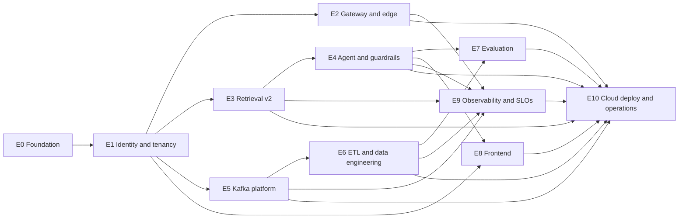

# finadvisor: implementation plan

High level. Epics and tickets live in `../tracker.json` and the GitHub Project. Architecture: `overview.md` (cited as `overview.md#n`), decisions: `decisions.md` (ADR-nnn). Spikes come first in their epic and their result is recorded as an ADR. "Done when" items are checks a verifier can run; numbers come from the decision (overview §2). Values the brief left open are set in the ticket that implements them, recorded in config and listed in overview §6.6 as "set in Ex".

## Phases

| Phase | Epics | Outcome |
|---|---|---|
| 0. Foundation | E0 | The repo is runnable and honest: typed config, no LiteLLM, CI that works, local compose, Alembic baseline |
| 1. Platform core | E1, then E2, E3, E5 in parallel | Identity and tenancy enforced in the DB; gateway and edge; retrieval v2; Kafka platform |
| 2. Product | E4, E6 | The agent with guardrails and streaming; the ETL and data engineering pipeline |
| 3. Quality and UI | E7, E8 | Evaluation gate and the React SPA |
| 4. Operate | E9, E10 | Observability and SLOs; Terraform v2, deploy pipeline, demo-up / demo-down, load test |

## Epic dependency graph

## Epics (in build order, with dependencies)

### E0 Foundation

- **Goal.** The repo is runnable and honest: it builds from lockfiles, boots only with real config, and CI can fail.
- **Scope.**
  - Single typed `Settings` (pydantic-settings), no secret defaults (fail to boot); model ids from config plus a retired-model check (CI and readiness).
  - Remove LiteLLM and the Kong/LiteLLM wiring; Langfuse Python SDK 5.x wrapper (`mask_otel_spans`, capture off on sensitive spans).
  - CI with lockfile installs, Postgres and Kafka service containers (`pgvector/pgvector:0.8.5-pg16` to match Cloud SQL); ruff, mypy, pytest, eslint, tsc, vitest, trivy, gitleaks, pip-audit.
  - docker compose with env-driven host ports, healthchecks, the same pgvector image, and a frontend dev image.
  - Alembic baseline created from `schema.sql`; `migrate` entrypoint.
- **Arch sections.** overview.md#1 (gap map), overview.md#6.6 (config keys), overview.md#4 (compute shape); ADR-005, ADR-006, ADR-018, ADR-019, ADR-021.
- **Dependencies.** none.
- **Spikes first.** none (confirm Langfuse Cloud accepts SDK 5.x as the first ticket).
- **Done when.**
  - CI is green on a clean clone using lockfiles only, and each of ruff, mypy, pytest, eslint, tsc, vitest, trivy, gitleaks, pip-audit runs and can fail a PR.
  - Starting the app with a missing required secret exits non-zero (test).
  - `claude-sonnet-4-20250514` in config makes CI and `/readyz` fail (test); the repo contains no LiteLLM service, config or dependency.
  - `docker compose up` brings every service healthy with no fixed host-port collisions; Alembic upgrade on an empty database equals the baseline schema.
  - Fixes G-05, G-08, G-09 (removal), G-15, G-25, G-28, G-49.

### E1 Identity and tenancy

- **Goal.** A caller is a verified person in a tenant, and the database refuses every cross-tenant read and write.
- **Scope.**
  - First ticket: verify the `firebase.tenant` claim name against a real Identity Platform tenant (D14.17).
  - `tenants` and `advisors`; Identity Platform multi-tenancy (one IdP tenant per firm); tenant-aware ID-token verification with firebase-admin (`auth`); `principal` with the 60 s entitlements cache and `entitlement_version`; IdP tenant provisioning script (Terraform comes in E10).
  - Schema for the whole target model in the baseline migration: `documents.raw_content` is dropped here (G-03 early); `acl_change_requests`, `eval_scores`, `turn_events`, `outbox` and `processed_events` tables are created (the outbox is written in E4 and relayed in E5).
  - RLS v2 on all tables: ENABLE + FORCE, SELECT own-or-PUBLIC, writes own-tenant only, PUBLIC writable only by `fa_etl_public`; roles `fa_app` (SELECT only on content), `fa_worker`, `fa_etl`, `fa_etl_public`, `fa_dbt`, `fa_owner`, `fa_lookup`, `fa_maint`, `fa_eval`, `fa_dagster`; `tenants` policies; `advisors` admin-only UPDATE; `advisor_id` owner clauses; `set_config(..., true)` in short transactions; composite FKs.
  - LIST partitions of `chunks` and monthly partitions of `messages` with no partition grants; tenant onboarding in the `migrate` job; `maintenance` job schema and role (scheduling in E10); startup / readiness role and RLS assertions.
  - Leak matrix: reads, writes, FK probes, direct partition access, advisor self-escalation, pooled-connection reuse, fail-closed. Tenant discovery endpoint and `fa_tenant_lookup` (owned by `fa_lookup`).
- **Arch sections.** overview.md#5, overview.md#8.2, overview.md#4.5 (`auth`, `principal`), overview.md#4.8; ADR-002, ADR-003, ADR-004, ADR-010.
- **Dependencies.** E0.
- **Spikes first.** Identity Platform multi-tenancy: confirm billing for > 2 tenants; LIST-partition pruning with the RLS `current_setting` policy plus planner cost at ~52 partitions.
- **Done when.**
  - The L0 leak matrix passes on every PR: cross-tenant read, cross-tenant insert, update and delete into PUBLIC, FK existence probes, direct SELECT / INSERT on a partition as `fa_app` / `fa_worker` gives permission denied, "advisor raises own tier / role" is denied, pooled-connection reuse, unset setting fails closed; leaks = 0.
  - Startup refuses to run when the role is superuser, BYPASSRLS or owner (except the `fa_dbt` and `fa_maint` exemptions), when any tenant table lacks FORCE RLS (including partitioned parents), or when a partition carries a runtime grant (tests).
  - A request with a forged, expired, wrong-audience or wrong-tenant token gets 401; a valid token for tenant A cannot read tenant B rows.
  - `EXPLAIN` shows partition pruning for LIST partitions under RLS.
  - `documents.raw_content` does not exist after the migration; the CI assertion that only `fa_tenant_lookup` is `SECURITY DEFINER` passes.
  - Fixes G-01, G-03, G-12, G-19, G-20, G-21, G-43.

### E2 Gateway and edge

- **Goal.** Traffic reaches the API only through the ALB, Cloud Armor and Kong, with limits that work and SSE that streams.
- **Scope.**
  - Kong 3.9.4 DB-less config + Valkey: per-IP and per-session `rate-limiting` (`X-RL-Key = sha256(Authorization)`), `request-size-limiting`, `cors`, `correlation-id`, `opentelemetry`, `prometheus`, `file-log` audit to Cloud Logging with a BigQuery log sink (G-48; no `/internal` routes), `bot-detection`, request-transformer stripping identity headers; route paths as prefixes or `~` regexes.
  - `pre-function` for `X-Serverless-Authorization` and `X-RL-Key`; `fa-gateway` Cloud Run service (invoker check disabled on this service only, ingress internal-and-cloud-load-balancing); ALB + Cloud Armor in Terraform; private `run.app` DNS zone, Private Google Access and Direct VPC egress `private-ranges-only`.
  - `llm-egress` route with `key-auth` + `ip-restriction` if its spike passes; `kong config parse` in CI; deck / curl smoke tests; kong + valkey in compose.
- **Arch sections.** overview.md#4.1 to #4.3, overview.md#4.6, overview.md#6.5, overview.md#8.3, overview.md#10 (items 1-5, 9); ADR-011, ADR-012, ADR-023, ADR-024.
- **Dependencies.** E1.
- **Spikes first.** (1) SSE pass-through ALB to Kong to chat-api; (2) `X-Serverless-Authorization` passthrough smoke test (user `Authorization` reaches FastAPI unchanged); (3) private-DNS `run.app` egress; (4) LLM egress with `ai-proxy` `route_type: preserve`; (5) `X-RL-Key` behaviour; (6) Cloud Armor cost. Each result is an ADR (conditional ADRs where a spike fails).
- **Done when.**
  - Spike results recorded as ADRs with measurements.
  - SSE through Kong adds <= 50 ms p95 over a direct chat-api stream (measured, `response_buffering: false`).
  - The Kong config parses; a smoke test shows 429 with `Retry-After` for the IP limit and the session-key limit, 413 over the size limit, and client-supplied `X-User-Id` / `X-Tenant-Id` / `X-Serverless-Authorization` / `X-RL-Key` never reaching chat-api; no raw bearer token appears in Valkey keys or in `file-log` output.
  - Gateway audit rows reach BigQuery `gateway_audit` through the log sink with no `Authorization`, body or query string.
  - `chat-api` rejects a call without the Kong service account's ID token (or the ADR fallback is in place); Kong reaches `chat-api` over private DNS with no Cloud NAT (or the ADR fallback is in place).
  - Fixes G-02, G-11, G-14, G-46, G-48.

### E3 Retrieval v2

- **Goal.** Filtered, hybrid, reranked retrieval that is fast, fail-closed and measured.
- **Scope.**
  - `voyage-4` embeddings with `input_type` query / document, `halfvec(1024)`, HNSW (m 16, ef_construction 64) + iterative scan, `max_scan_tuples` 20000, `ef_search` ~80-100.
  - FTS leg (`tsvector` + GIN, `websearch_to_tsquery`), RRF k=60 in one SQL statement with RLS on both legs.
  - `rerank-2.5-lite` with timeout; `RERANK_CANDIDATES` default 15 (range 10-30); a timeout or 429 falls back to RRF order and yields `retrieval_degraded` plus counters; CRAG-style confidence gate; parent expansion; server-side staleness.
  - The factsheet and suitability tools reimplemented on `RetrievalService` (no `raw_content`, escaped input, `LIMIT`).
  - Answer cache (UNLOGGED, own RLS, versioned key, verifier re-run on hit, side-effect turns excluded, purge by the applier and `maintenance`); `RetrievalService(principal)` as the only content-table accessor (import-linter + test); retrieval metrics.
- **Arch sections.** overview.md#5.5 to #5.7, overview.md#4.5 (`retrieval`), overview.md#6.3; ADR-004, ADR-008, ADR-015.
- **Dependencies.** E1.
- **Spikes first.** Rerank latency and TPM / tier (target rerank p95 < 700 ms; ~5 QPS on Tier 1); pgvector iterative scan with RLS and LIST partitions (result confirms D13b).
- **Done when.**
  - On a 10k-chunk synthetic corpus, retrieval first stage (embed + SQL) p95 < 300 ms and rerank p95 < 700 ms are measured against overview §2.1 (fail if above, or the ablation drops rerank and the ADR says why).
  - Queries return the requested number of rows under RLS (no short results) in a test using a restrictive tier / jurisdiction.
  - Import-linter fails when a non-`retrieval` module imports a content-table accessor; `fa_app` has no INSERT / UPDATE / DELETE on content tables (test).
  - Answer-cache tests: key changes with `acl_version`, `corpus_version`, entitlement version; a hit that fails the verifier is a miss; a turn that called `escalate_to_compliance` is never cached.
  - Rerank timeout and 429 increment `rerank_fallback_total{reason}` and set `retrieval_degraded`.
  - Fixes G-33, G-34, G-35, G-36 (single provider accepted), G-52.

### E4 Agent and guardrails

- **Goal.** A streamed, cited, guarded answer with resumable delivery and no data leaks to the client.
- **Scope.**
  - `LLMClient`: timeouts, retries with jitter, circuit breaker, same-provider fallback gated by evals, prompt caching, config-only model ids.
  - Retrieve-first orchestrator; Haiku follow-up condensation; Presidio (`en_core_web_sm`); Model Armor (500 ms, fail closed); JSON `tool_result`; citation verifier + server citation events; sentence-buffered output redaction.
  - SSE v2 contract with ids, `meta` event, resume (`turn_events`), `Idempotency-Key`; escalations persisted; `conversations` / `messages` (with `retrieval_degraded`); outbox rows written in the persist transaction (`chat.audit`, `chat.usage`, sampled `eval.sample`).
  - Admin endpoints: advisor updates (direct), document ACL-change and delete requests (`acl_change_requests` + outbox, 202) with the status endpoint; per-tenant token budget and concurrency; error codes.
- **Arch sections.** overview.md#4.5 (`guardrails`, `agent`, `llm`, `events`, `admin`), overview.md#6.1 to #6.3, overview.md#8.1; ADR-005, ADR-006, ADR-007, ADR-009, ADR-022.
- **Dependencies.** E3.
- **Spikes first.** Model Armor latency; Presidio latency and recall on the synthetic corpus (no official figure); Sonnet 5.5 prompt-cache hit behaviour with the versioned tools.
- **Done when.**
  - Client-visible events contain no tool payloads or exception text (test over all event types); every emitted `[n]` is in the retrieved chunk ids (verifier test).
  - A dropped connection resumes from `Last-Event-ID` and replays missing events; the same `Idempotency-Key` does not generate twice; a different body returns 409; `meta.retrieval_degraded` matches `messages.retrieval_degraded`.
  - Model Armor timeout (500 ms) fails closed; PII injected in a question never reaches Voyage, Anthropic, logs or Langfuse (test).
  - With the primary model forced to fail, the fallback is used only when `LLM_FALLBACK_ENABLED` is true; no temperature / top_p / top_k is sent.
  - An admin ACL-change request returns 202 and writes exactly one `acl_change_requests` row and one outbox row; `chat-api` holds no write grant on content tables.
  - TTFT p50 < 2.0 s and p95 < 3.5 s measured on the 10k-chunk synthetic corpus with a real LLM against overview §2.1 (fail if above).
  - Fixes G-04, G-16, G-17, G-18, G-22, G-23, G-31, G-32, G-38, G-42, G-45, G-53, G-55.

### E5 Kafka platform

- **Goal.** A tested event backbone that the product can lose without breaking chat.
- **Scope.**
  - Topic catalogue `*.v1`, Schema Registry with JSON Schema generated from Pydantic, producer / consumer framework (idempotent producer, `processed_events` dedupe, retries, DLQ `dlq.v1`, envelope-vs-key and PUBLIC rejection).
  - `outbox-relay` worker reading the E1 `outbox` table; `acl-applier` worker applying `acl_change_requests` (ACL-column UPDATE or delete, `acl_version` bump, `answer_cache` purge); per-service Confluent service accounts, API keys and Kafka ACLs; payload minimisation; traceparent in headers.
  - Local compose broker (`apache/kafka:4.4.0`) and Schema Registry; Confluent Cloud Basic cluster in us-central1 first (registry region).
- **Arch sections.** overview.md#6.4, overview.md#4.7, overview.md#5.2 (`outbox`, `processed_events`, `acl_change_requests`); ADR-013, ADR-022.
- **Dependencies.** E1.
- **Spikes first.** Confirm Confluent Basic idle cost in the console (UNVERIFIED estimate); decide partition counts and retention within 1,500 partitions.
- **Done when.**
  - With the broker stopped, a chat request still succeeds and its audit outbox rows are published after the broker returns, with no loss and no duplicates in the sink (integration test with Kafka service container).
  - Redelivering the same event changes no state (`processed_events`); a poison message and an event whose envelope tenant differs from its key land in `dlq.v1` with a redacted payload and a reason.
  - An ACL-change request is applied end to end: `chunks` ACL columns updated, request `applied`, `acl_version` bumped, `answer_cache` rows citing the document purged, zero embed calls; `acl_apply_lag_s` is emitted.
  - Every topic has a registered schema; a breaking schema change is rejected by the registry in CI; each service has its own API key and ACLs (no shared key).
  - Fixes G-48 (audit path is via logs, not Kafka), part of G-11 (service wiring for events).

### E6 ETL and data engineering

- **Goal.** A replayable, idempotent pipeline from raw documents to tenant-scoped, redacted, embedded chunks and analytics.
- **Scope.**
  - Bronze (GCS by sha256); silver (Docling, Presidio, structure-aware chunking with Voyage token counts, Pandera, rejects; Parquet partitioned tenant / dt); contextual headers (Haiku batch, flag); suitability-rule extraction and validation; embed-indexer upserts (unique `(tenant_id, chunk_hash, embed_model)`) that bump `corpus_version`.
  - Dagster assets / partitions run daemon-less as Cloud Run jobs from Scheduler, with Postgres run storage (`dagster` database, `fa_dagster`); `dagster dev` locally. Tenant stages run as worker consumers; PUBLIC (EDGAR 497K) runs all stages in-process in `etl-public` and publishes only analytics events. Synthetic per-tenant corpus.
  - dbt gold as `fa_dbt` (`security_invoker` views or incremental models, never full rebuilds); `dbt-bigquery` marts; BigQuery sink with per-tenant authorized views (primary) and row access policies (second layer).
  - ACL change as metadata UPDATE (applier from E5).
- **Arch sections.** overview.md#4.7 to #4.11, overview.md#4.14 (flow 2), overview.md#5.2, overview.md#5.8; ADR-014, ADR-016.
- **Dependencies.** E5.
- **Spikes first.** Docling on the 497K HTML and inline-XBRL tables (chunk sizes measured with Voyage `count_tokens`).
- **Done when.**
  - Re-running the same partition re-embeds zero unchanged chunks (count asserted); an ACL change updates metadata with zero embed calls.
  - Every Pandera failure appears in `ingest_rejects`; no raw document text exists outside GCS bronze (scan test of `documents`, `chunks`, events, BigQuery).
  - `suitability_rules` is populated and validated for the synthetic corpus; `lookup_suitability_rule` returns rows on a real DB.
  - dbt gold models pass the CI assertion that every tenant-schema table has RLS enabled, forced, with policies, and no dbt run does a full-table rebuild of a tenant table; only `fa_tenant_lookup` is `SECURITY DEFINER`.
  - The PUBLIC corpus is written only by `fa_etl_public` (test: a worker attempt is denied by policy and a PUBLIC event on a pipeline topic is sent to `dlq.v1`).
  - BigQuery tables are day-partitioned, clustered by `tenant_id`, with `maximum_bytes_billed` set; a tenant's authorized view returns only that tenant's rows.
  - Fixes G-07, G-39, G-62.

### E7 Evaluation

- **Goal.** A measured, blocking quality bar for retrieval, answers, refusal and leaks.
- **Scope.**
  - Golden set from 50 to ~300 questions (tenant-parameterised, adversarial, refusal).
  - L1 retrieval eval with dense / FTS / hybrid / rerank ablation (also sets `RERANK_CANDIDATES`); L2 Ragas collections with a Haiku judge calibrated on ~30 human labels (Cohen's kappa) and CI bounds.
  - CI gate: ~60-question PR subset, weekly full run, run against the fallback model; promptfoo red team; `eval` and `redteam` jobs as `fa_eval` against the `eval` tenant.
  - L4 online judging: the `eval-judge` worker consumes `eval.sample.v1` (5-10% sample, `EVAL_SAMPLE_RATE`), writes scores to Langfuse and `eval_scores`; thumbs feedback to `eval.events.v1`.
- **Arch sections.** overview.md#4.14 (flow 4), overview.md#4.7 (`eval-judge`), overview.md#8.1, overview.md#9.6; ADR-017, ADR-016, ADR-008.
- **Dependencies.** E4, E6.
- **Spikes first.** Judge calibration (kappa on ~30 labels) before the L2 numbers are trusted.
- **Done when.**
  - The PR gate fails a deliberate regression in each of: citation < 0.95, faithfulness < 0.90, a planted cross-tenant leak, recall drop > 2 points (four test PRs).
  - The weekly full run executes with CI lower bounds reported; the fallback model run exists and gates `LLM_FALLBACK_ENABLED`.
  - The ablation report records the decision on rerank and contextual retrieval (kept or dropped, with recall and latency).
  - The `eval-judge` scores at least one sampled turn end to end into Langfuse and `eval_scores` (tenant RLS applies; `fa_app` has no access to the table).
  - Fixes G-06, G-54, G-56.

### E8 Frontend

- **Goal.** An advisor can sign in to their firm, ask a question and see a streamed, cited, trustworthy answer.
- **Scope.**
  - Vite + React 19 + TypeScript SPA: tenant discovery (`/t/<slug>`) and Identity Platform sign-in, SSE client with `Last-Event-ID` resume and `Idempotency-Key`, `meta` (degraded retrieval) notice, citations with excerpts, stale badges, conversation history, feedback, error states keyed by error code, sanitized markdown only.
  - vitest unit tests and Playwright end-to-end tests.
- **Arch sections.** overview.md#4.4, overview.md#6.1, overview.md#6.2, overview.md#8.2; ADR-010, ADR-019.
- **Dependencies.** E1, E4.
- **Spikes first.** none (consumes the E4 contract).
- **Done when.**
  - A Playwright run covers sign-in for two tenants, a streamed cited answer, a mid-stream disconnect with resume, a 429 and a 401 handled without a crash, a stale badge and thumbs feedback.
  - No unsanitized HTML reaches the DOM (test with an injected payload); the token is not stored in `localStorage`.
  - Fixes G-13 (SPA), G-57.

### E9 Observability and SLOs

- **Goal.** One trace and a few numbers explain any slow or failed request.
- **Scope.**
  - OpenTelemetry end to end (Kong to API to workers, `traceparent` in Kafka headers), log-based metrics (TTFT, gate refusals, guard blocks, consumer lag, rerank fallbacks, degraded-turn ratio, ACL apply lag), dashboards.
  - Availability SLO (prod profile) and latency SLOs; burn-rate and budget alerts; `/readyz` completeness.
- **Arch sections.** overview.md#9, overview.md#6.1 (`/readyz`); ADR-018.
- **Dependencies.** E2, E3, E4, E5, E6.
- **Spikes first.** none.
- **Done when.**
  - A single trace spans Kong, chat-api, a DB query and an LLM call, and a Kafka event's consumer span links to its producer span.
  - Every metric in overview.md#9.2 is emitted and appears on a dashboard; no log line, span or trace contains request bodies, SQL parameters or unredacted PII (test).
  - Each alert in overview.md#9.5 fires in a drill (degraded turns > 5% in 15 min, rerank 429, outbox age, ACL applier lag, DEFAULT partition non-empty, readiness failure, budget).
  - Fixes G-40, G-41, G-44, G-15.

### E10 Cloud deploy and operations

- **Goal.** The system runs in GCP on demand, costs what the budget says, and is released safely.
- **Scope.**
  - Terraform v2: VPC (Direct VPC egress `private-ranges-only`, Private Google Access, `run.app` private zone), PSC Cloud SQL, Cloud Run services / worker pool / jobs, Secret Manager, per-service SAs, WIF, Artifact Registry, Confluent via provider, IdP tenant provisioning. Terraform does not own the Valkey instance (demo script).
  - Deploy pipeline: `migrate` job, tagged no-traffic revision, smoke test, traffic shift. `make demo-up`, `make demo-down` (exact reverse order, 10-minute drain timeout) and the hourly `demo-ttl` job (`fa_maint`); `maintenance` scheduling (hourly while up, run by `demo-up`); `demo-prewarm` job inside the VPC.
  - Load test with a stub LLM; measured Cloud SQL start time; connection budget check (`max_connections` 400, pool budget <= 300); `prod` profile (HA flag); org policy check `constraints/run.managed.requireInvokerIam`.
- **Arch sections.** overview.md#4.12, overview.md#4.14 (flows 5, 6), overview.md#7, overview.md#2.5, overview.md#8.3 to #8.4; ADR-019, ADR-020, ADR-021, ADR-012, ADR-024.
- **Dependencies.** E2 through E9.
- **Spikes first.** Cloud SQL start time and stopped-instance billing; Cloud Run worker pool scale to 0 and Terraform support; ALB forwarding-rule monthly price; Cloud Armor cost (overview §10).
- **Done when.**
  - `make demo-down` leaves the outbox empty (or logs the forced remainder after 10 minutes), consumer lag 0, worker pool 0, API and Kong min 0, Valkey deleted and Cloud SQL stopped, in that order; `make demo-up` runs the exact reverse, reaches a passing `/readyz` through `demo-prewarm` and prints the measured start time; the `demo-ttl` job brings a forgotten demo down.
  - `terraform plan` is clean (no drift) after a down / up cycle thanks to `ignore_changes`.
  - No `allUsers` binding on any service; the invoker check is disabled only on `fa-gateway`; Cloud SQL has no public IP; no secret value in Terraform state; the sum of pool sizes over max instances is <= 300.
  - A load test with a stub LLM runs at ~10 QPS peak and reports the p95 targets of overview §2.1 (excluding LLM time) against the 10k-chunk synthetic corpus numbers (fail if above).
  - Monthly cost for a demo month read from the billing export is within $100-200 (expected $110-160).
  - Fixes G-02, G-10, G-11, G-12, G-13, G-26, G-27, G-29, G-47, G-50, G-51.
