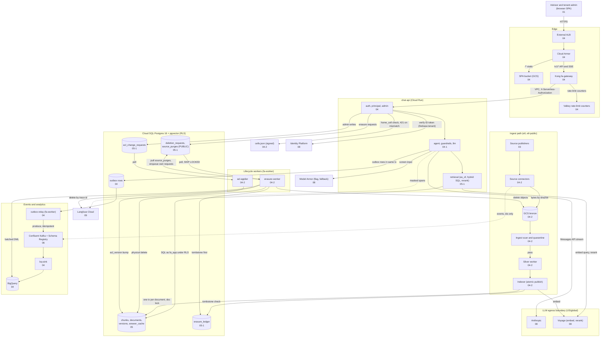

# finadvisor: architecture diagram

> Part of [architecture](architecture.md) · deep-dive index: [deep-dive/README.md](deep-dive/README.md)

The full flow of FinAdvisor v2 in one picture. Each component node ends with the deep-dive file (number) that holds its detail; the table below the diagram maps node, file and ADRs. Sources of this picture: the diagrams in `deep-dive/03`, `04`, `04-2` and `07` (one deployed cell shown; the second cell is designed and tested locally, see 07).

## Node map

| Node | Deep-dive file | ADRs |
|---|---|---|
| Advisor and tenant admin | `deep-dive/01-context-and-goals.md`, `deep-dive/03-system-context-and-boundaries.md` | ADR-010, ADR-032 |
| External ALB, Cloud Armor | `deep-dive/04-components-and-responsibilities.md` (4.1, 4.2) | ADR-012 |
| SPA bucket | `deep-dive/04-components-and-responsibilities.md` (4.4) | ADR-019 |
| Kong fa-gateway, Valkey | `deep-dive/04-components-and-responsibilities.md` (4.3, 4.6), `deep-dive/06-interfaces-and-contracts.md` (6.5) | ADR-011, ADR-023 |
| cells.json | `deep-dive/04-2-source-lifecycle-and-cells.md` (4.24), `deep-dive/07-scaling-failure-modes-and-recovery.md` (7.6) | ADR-031, ADR-033 |
| Identity Platform | `deep-dive/08-security-and-privacy.md` (8.2) | ADR-010, ADR-032 |
| auth, principal, admin | `deep-dive/04-components-and-responsibilities.md` (4.5) | ADR-002, ADR-004, ADR-010 |
| agent, guardrails, llm | `deep-dive/04-1-key-flows.md` (flow 1), `deep-dive/04-2-source-lifecycle-and-cells.md` (4.25, 4.26) | ADR-005, ADR-006, ADR-007, ADR-009, ADR-036 |
| retrieval | `deep-dive/05-1-rls-indexes-versioning-and-deletion.md` (5.6, 5.7) | ADR-004, ADR-008, ADR-015, ADR-027 |
| Model Armor | `deep-dive/08-security-and-privacy.md` (8.6) | ADR-009, ADR-036, ADR-039 |
| Cloud SQL, chunks, answer_cache | `deep-dive/05-data-model-and-storage.md` | ADR-002, ADR-003, ADR-027, ADR-035 |
| outbox rows, outbox-relay | `deep-dive/04-components-and-responsibilities.md` (4.7) | ADR-013 |
| deletion_requests, source_purges, acl_change_requests, erasure_ledger | `deep-dive/05-1-rls-indexes-versioning-and-deletion.md` (5.11) | ADR-022, ADR-029, ADR-030 |
| Source publishers, Source connectors | `deep-dive/03-system-context-and-boundaries.md`, `deep-dive/04-2-source-lifecycle-and-cells.md` (4.15) | ADR-026 |
| GCS bronze, Ingest scan and quarantine | `deep-dive/04-2-source-lifecycle-and-cells.md` (4.15, 4.25) | ADR-014, ADR-034, ADR-036 |
| Silver worker, Indexer | `deep-dive/04-2-source-lifecycle-and-cells.md` (4.16, 4.17) | ADR-014, ADR-027, ADR-028, ADR-035 |
| Confluent Kafka + Schema Registry | `deep-dive/06-interfaces-and-contracts.md` (6.4) | ADR-013, ADR-034 |
| bq-sink, BigQuery | `deep-dive/04-components-and-responsibilities.md` (4.11) | ADR-014, ADR-023 |
| erasure-worker | `deep-dive/04-2-source-lifecycle-and-cells.md` (4.19, 4.20) | ADR-029, ADR-030 |
| acl-applier | `deep-dive/04-2-source-lifecycle-and-cells.md` (4.21) | ADR-022 |
| Langfuse Cloud | `deep-dive/09-observability.md` | ADR-018 |
| Anthropic, Voyage | `deep-dive/08-security-and-privacy.md` (8.7) | ADR-005, ADR-006, ADR-038 |
