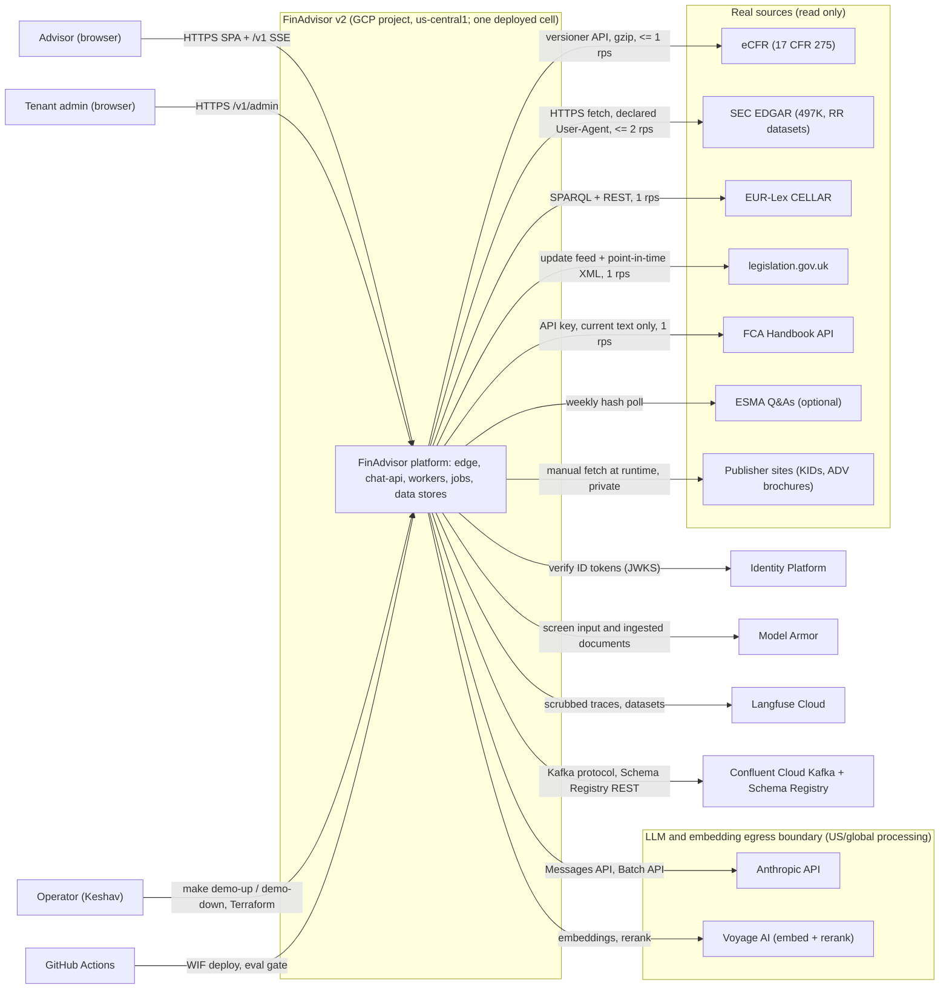

> Part of [architecture](../architecture.md) · [diagram](../architecture-diagram.md)
## 3. System context and boundaries

Boundaries:
- Users reach the system only through the external ALB (`/*` SPA, `/v1/*` API). Nothing else is internet-facing; Cloud Run services use ingress internal-and-cloud-load-balancing or internal.
- The tenant boundary is inside the database (RLS, §5.4), not at the network. All tenants of a cell share one deployment. A cell is the whole data plane of one region; the control plane is a signed static `cells.json` plus Identity Platform (§6.11, ADR-031). Only one cell is deployed; the second is designed and tested in a two-cell docker compose suite (K-R4-1).
- Trust: browsers, SaaS responses, retrieved documents and tool outputs are untrusted. Identity comes only from a verified ID token (sub + IdP tenant); entitlements come from the DB. Fetched source documents are untrusted until the ingest scan and the contract gates pass (§8.1).
- LLM and embedding egress boundary (ADR-038): data at rest (database, search index, document store, warehouse, event streams, traces) stays in the tenant's home cell, except the declared global data (ADR-031). Prompt text and embedding and rerank inputs are processed by Anthropic and Voyage, which are US/global (Anthropic first-party `inference_geo` is `global` or `us` only: https://platform.claude.com/docs/en/build-with-claude/data-residency ; Voyage region undocumented: https://docs.voyageai.com/docs/faq). Private text crosses this boundary on three paths: the Anthropic prompt, Voyage embedding (ingest and query) and Voyage rerank. A per-tenant flag `llm_egress_ack` (default false) must be true before private ingest. Cells do not isolate an LLM-provider outage. Model Armor is a Google Cloud service with a regional endpoint per cell and is not one of the three egress paths.
- Data classification: no real client data. Real public documents (PUBLIC tenant) and private demo publisher documents (firm tenant only, never in the public repo or public eval sets, K-R4-3) are in scope. Redacted text may leave to Anthropic, Voyage and Langfuse; Confluent and BigQuery receive ids, hashes, scores and flags only, never answer or excerpt text (R4-D19 M5); raw documents leave only to GCS bronze. FCA Handbook API content lives only in the PUBLIC tenant and never enters Kafka or BigQuery (ADR-026).
- Global data declared in the privacy notice (ADR-031): user id, email, firm membership, tenant-to-cell map, PUBLIC manifest hashes, aggregate metrics without tenant text.

Source systems (all read-only; one connector interface, ADR-026; contracts in §6.7):

| Source | Access and limit | Goes to | Class on withdrawal |
|---|---|---|---|
| eCFR 17 CFR 275 | versioner API, `Accept-Encoding: gzip` (else 406), <= 1 rps (limit UNVERIFIED); site is an unofficial compilation, labelled non-authentic (https://www.ecfr.gov/api/versioner/v1) | PUBLIC | retire |
| SEC RR quarterly datasets and EDGAR 497K | declared User-Agent; EDGAR cap 10 req/s, we run at 2 rps; nightly index about 10 pm ET (https://www.sec.gov/search-filings/edgar-search-assistance/accessing-edgar-data). RR datasets feed structured `fund_rr_facts`; 497K is a publisher document | RR facts: PUBLIC; 497K: firm tenant, `private_demo` | RR: retire; 497K: erase |
| EUR-Lex CELLAR (PRIIPs, MiFID in EN/DE/FR) | SPARQL + REST, 1 rps (limits undocumented); consolidated text is not authentic (https://eur-lex.europa.eu/content/legal-notice/legal-notice.html) | PUBLIC | retire |
| legislation.gov.uk | `/update` feed, `hasVersion`, point-in-time XML, 1 rps (https://legislation.github.io/data-documentation/reuse-licence.html) | PUBLIC | retire |
| FCA Handbook API (COBS 9A, 6) | API key, current and future text only, 1 rps; revocable, terms require deleting copies on revocation (cl.13); no crawling (cl.35.3) (https://handbook.fca.org.uk/footer-widget/terms-and-conditions) | PUBLIC (UK) only | erase (kill switch) |
| ESMA Q&As (optional) | weekly hash poll; transformed text carries the ESMA disclaimer (https://www.esma.europa.eu/about-esma/legal-notice-and-data-protection) | PUBLIC | retire |
| Publisher sites (fund KIDs, ADV brochures) | manual fetch at runtime, small set, attribution | firm tenant, `private_demo` | erase on request |

FINRA is not a source (terms forbid bulk copy and ML use: https://www.finra.org/terms-of-use).
