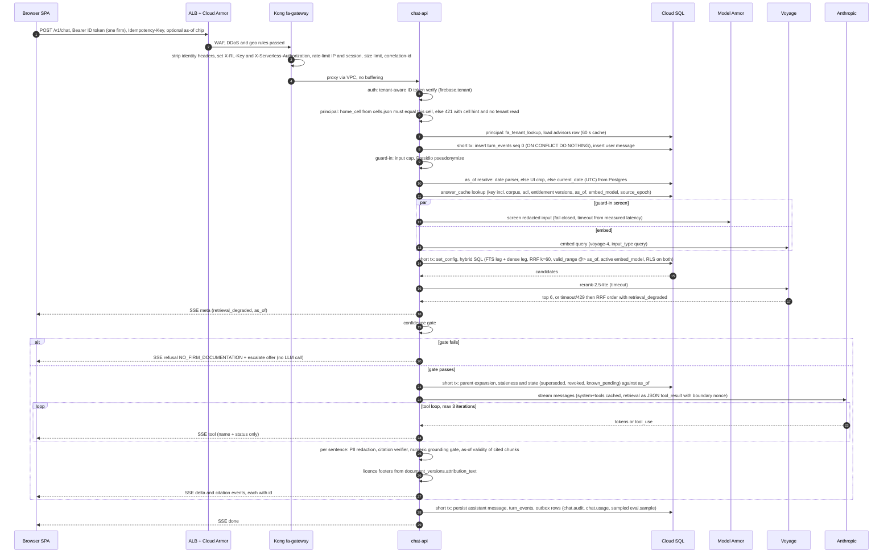
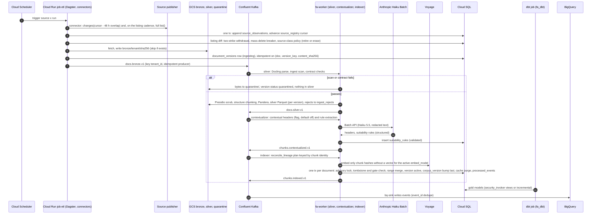
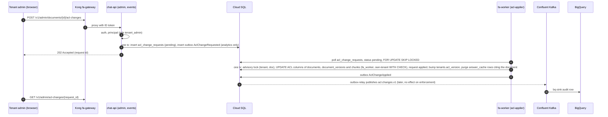
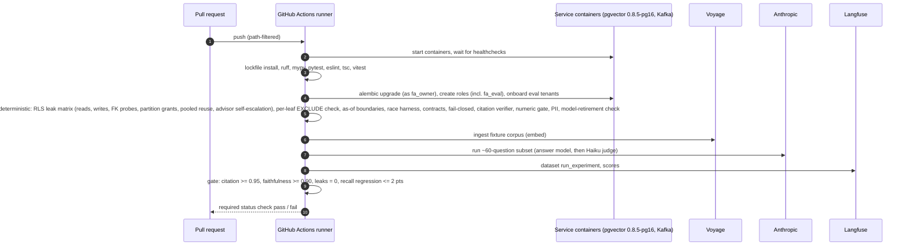
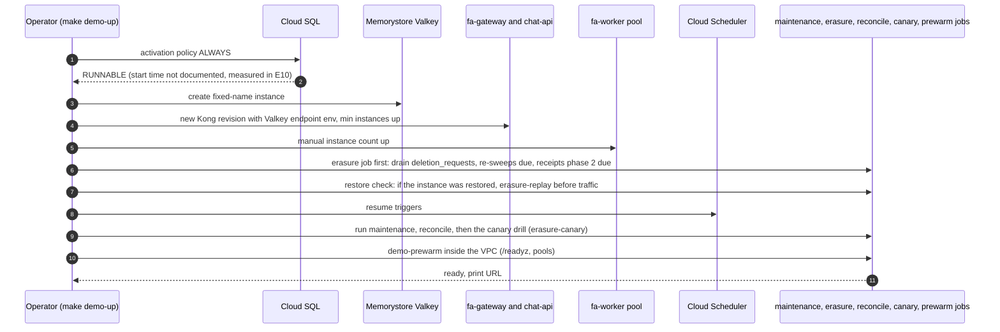
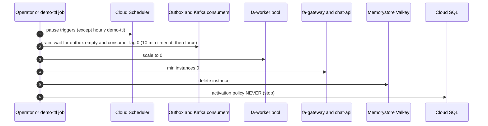

> Part of [architecture](../architecture.md) · [diagram](../architecture-diagram.md)
### 4.14 Key flows

#### Flow 1: chat request

Notes:
1. The cache lookup comes after Presidio (the key uses the normalized redacted question). On a hit the screen and embed are skipped; the cited chunks are re-fetched through `retrieval.fetch_chunks` under the caller's RLS, the citation verifier and the as-of validity check are re-run and staleness is recomputed. A chunk no longer visible turns the hit into a miss. Turns that call `escalate_to_compliance` are never written to the cache.
2. The database is never held open across the LLM call: each `D` step is its own transaction with `set_config(..., true)`.
3. Langfuse spans (masked) and OpenTelemetry spans are emitted asynchronously and never block the stream.
4. Failure at any step produces one SSE `error` event with a code (§6.2), never exception text.
5. The relay publishes the outbox rows later (`outbox-relay`, §4.7); chat does not wait for Kafka.
6. A sentence with a number and no `[n]`, or an ungrounded number, withholds the answer (§4.26); a missing licence footer blocks release; a cited chunk whose `valid_range` does not contain `as_of` blocks release (§4.18).

#### Flow 2: ingest

Notes: every consumer commits offsets after the DB transaction that wrote `processed_events`; poison messages and envelope mismatches go to `dlq.v1`. A backfill, a re-embed or a replay after a parser fix is `reconcile_lineage` run again: Dagster re-publishes `docs.bronze.v1` for the partition (bronze is immutable), `parser_version` is part of the chunk identity so the replay re-parses (no "same bytes means no-op"), and unchanged chunk hashes keep their vectors. The PUBLIC corpus (eCFR, EUR-Lex, legislation.gov.uk, SEC RR datasets, FCA API) runs all stages in-process in the `etl-public` job as `fa_etl_public`, calls the same `reconcile_lineage`, bumps the PUBLIC `corpus_version` itself, and publishes only analytics events (`ingest.analytics.v1`); worker consumers reject PUBLIC, and FCA content never reaches Kafka or BigQuery (§4.20). Docling on 497K and inline-XBRL tables is a spike (§10).

#### Flow 3: ACL change (asynchronous, polling)

Document delete is not part of this flow: `DELETE /v1/admin/documents/{id}` writes a `deletion_requests` row directly and the `erasure-worker` runs the deletion flow (§4.19).

Notes: no re-embedding (Notion pattern, evidence-r2.md); the change is a metadata UPDATE. Until the applier runs, the old ACL still applies (the lag is the poll interval). Enforcement no longer depends on Kafka, so a tightening during a Kafka outage still lands (R4-D7; test: stop Kafka, tighten the ACL, the answer is refused within 60 s). When the applier commits, the bump of `acl_version` makes every earlier cached answer unreachable, and a cache hit that raced the bump is re-verified against freshly fetched chunks under the caller's RLS (D13i), so a cached answer cannot cite a chunk the caller can no longer see. The applier takes the same per-document advisory lock as the indexer and the erasure-worker (§4.17), so a reclassification cannot race an ingest. Advisor entitlement changes are a direct `UPDATE advisors` by a `tenant_admin` (no worker); `chat-api` does not consume Kafka, so the 60 s `principal` cache TTL is the revocation bound.

#### Flow 4: eval gate in CI

Notes: the PR runs the ~60-question path-filtered subset; the 200-item golden set (public slice committed, private slice only where its bucket is mounted; ADR-037) runs weekly and before demos, and also once against the fallback model (fallback is enabled only if it passes). L1 retrieval metrics (recall@k, MRR, nDCG, dense / FTS / hybrid / rerank ablation) and L2 Ragas metrics run in the same job; L3 cross-tenant refusal and the promptfoo red team run in the `redteam` job. Fixes G-05, G-06.

#### Flow 5: demo-up

The exact reverse of the demo-down order (D16.13), then the lifecycle checks that must run before the demo is announced ready.

In demo-on-demand the system is stopped between demos, so nothing runs while it is down: the erasure job runs first at every start, and the 24 h live-store promise is counted in time the system is running (R4-D9). The canary drill replaces a weekly cron (§4.23).

#### Flow 6: demo-down

After a forced down, remaining outbox rows are logged and delivered on the next `demo-up`. Terraform uses `lifecycle.ignore_changes` on `activation_policy`, `min_instance_count` and `manual_instance_count`, so `apply` never fights the script. The ALB, Cloud Armor, Confluent cluster and storage stay (idle cost, §2.5).
