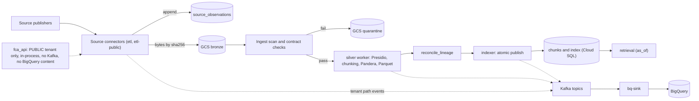
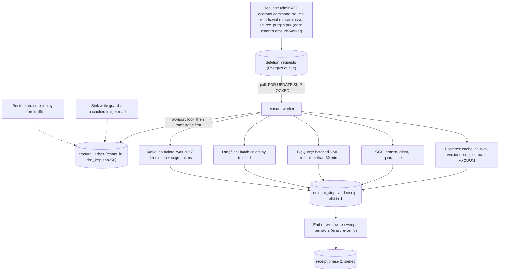

> Part of [architecture](../architecture.md) · [diagram](../architecture-diagram.md)
### 4.15 Source connector framework (R4-D1, R4-D2; ADR-026)

Runs inside the `etl` (firm tenants) and `etl-public` (PUBLIC, per cell) jobs. One interface for every source: `list() -> [ListingItem]`, `changes(cursor) -> [Observation]`, `fetch(item) -> bytes`, `classify(item) -> {jurisdiction, tier, licence_class, language, authoritative}`. Connectors run against recorded fixtures (VCR) in the PR gate; live source smoke runs weekly.

Six connectors (ESMA / JC Q&A is an optional seventh, with the ESMA disclaimer on transformed text):

| Connector | Source | Target tenant | Source class | On withdraw |
|---|---|---|---|---|
| `ecfr` | eCFR versioner API, 17 CFR 275 (`Accept-Encoding: gzip`, <= 1 rps), point-in-time per version; labelled non-authentic | PUBLIC | `law` | retire |
| `sec` | two feeds: SEC RR quarterly datasets (structured facts into `fund_rr_facts`, not chunks) and EDGAR 497K (per-CIK submissions, declared user agent, <= 2 rps) | RR facts: PUBLIC. 497K: firm tenant | RR facts: public data, retire. 497K: `publisher` | RR facts: retire. 497K: erase |
| `eurlex` | EUR-Lex CELLAR (SPARQL + REST, <= 1 rps), PRIIPs / MiFID, EN, DE, FR; labelled "not authentic" | PUBLIC | `law` | retire |
| `legislation_gov_uk` | `/update` feed, `hasVersion`, point-in-time XML (<= 1 rps) | PUBLIC | `law` | retire |
| `fca_api` | FCA Handbook API, current text only (COBS 9A, 6; no Handbook crawling) | PUBLIC only | `fca_api` | erase |
| `publisher` | manually fetched publisher documents: KIDs, 497K, ADV brochures | firm tenant only (`private_demo`, never in the public repo or public eval sets) | `publisher` | erase |

Evidence for sources, rates and licences: evidence-r4.md §1.1-1.4; FINRA is dropped (terms).

Change capture rules (every source):
- **`source_observations`** is append-only, system time from the DB clock: `(source_id, external_id, version_key, content_sha256, source_ts, observed_at, state in {present, revoked, withdrawn, pending}, listing_run_id)` (§5.9). Cursor and overlap live in `source_registry`, updated in the same transaction as the observations they cover (Google Changes pattern, evidence-r4.md §2.1).
- **Feeds only accelerate; the full-listing diff is the truth for deletes.** Every incremental read starts at `cursor - 48 h` (safe because versions are idempotent on `(tenant, doc, version_key, content_sha256)`).
- **Order by the source's version key, never arrival time.** A version older than the current head is accepted and slotted into the valid-time line by `reconcile_lineage` (§4.16).
- **Silent edit:** same `version_key`, different bytes, is a `silent_edit` event: a new `document_versions` row with the same valid range and a new system range, alert.
- **Two-strike withdrawal:** an item is withdrawn only after two consecutive complete listings omit it. **Mass-delete breaker:** if one listing drops more than 5 items or more than 10% of a source, nothing is applied, the connector is frozen (`source_registry.frozen`) and a page is raised; a listing with 0 items is always a failure.
- **Source classes decide what a withdrawal does:** `law` and Q&A are RETIRED (`valid_to` set, text kept so as-of questions still work); `fca_api` and `publisher` are ERASED (a `deletion_requests` row, §4.19).
- Contracts at the boundary: `SourceObservation`, `docs.*` and `chunks.*` events are Pydantic-derived JSON Schemas in Schema Registry (BACKWARD, CI check); a source returning 200 with an HTML error page fails the contract and is quarantined (R4-D12, ADR-034).
- FCA content lives only in the PUBLIC tenant and never enters Kafka or BigQuery (R4-D8): the `fca_api` path runs in-process in `etl-public`; ingest analytics for it carry source id, counts and opaque ids, never text or titles.

#### Data-flow view

The solid path is the same for tenant and PUBLIC ingest; for tenants the stages are connected by Kafka topics (§4.7), for PUBLIC they run in-process in `etl-public` (ADR-014). The dotted path is analytics only: events carry ids and redacted metadata, never raw text, and the FCA source never feeds it with content. `retrieval` reads `chunks` as `fa_app` under RLS (§5.4); the as-of predicate is part of the retrieval SQL (§5.6).

### 4.16 reconcile_lineage (R4-D3; ADR-027; from P-simplicity D5)

One idempotent function `reconcile_lineage(document_id)`, called by the tenant path (`indexer`) and the PUBLIC path (`etl-public`) so the two paths cannot drift.
- Input: every non-withdrawn, non-quarantined `document_versions` row of the document in `valid_range` order, plus its silver Parquet. Output: the target chunk set keyed by chunk identity `(tenant_id, document_id, provision_path, chunk_index, chunk_hash, valid_from, parser_version, embed_model)` (§5.10).
- Applied as a diff in one transaction under the document's advisory lock (§4.17): insert missing rows (embedding only hashes that have no vector yet for the active `embed_model`), extend `valid_range` where the same chunk hash continues into the next version (no embed call), close superseded rows (`valid_range` upper and `system_range` upper set, never overwritten), delete extras.
- Late, out-of-order, withdrawn and replayed versions, a parser bump and a backfill are all "run it again". Because `valid_from` and `parser_version` are in the identity, replay after a parser fix re-parses (it is not a no-op on equal bytes), the old parse is closed in the same transaction as the new one is opened, and A-B-A text (a reverted or reinstated provision) is representable as two rows with disjoint ranges.
- Tests: feed versions in all permutations (identical final valid-time line), a reversion sequence, parser bump then replay (no chunk of the old parse is retrievable), replay twice (hash equals a single run).

### 4.17 Indexer atomic publish and lock order (R4-D5; ADR-028)

- The indexer is the only writer of `chunks`. It embeds first, outside any transaction, then runs ONE transaction per document: (1) `pg_advisory_xact_lock(hash(tenant_id, doc_id))`; (2) check there is no ledger tombstone for `(tenant_id, doc_key, sha256)` (uncached point read) and that the version has `contract_passed AND scan_passed`; (3) apply the `reconcile_lineage` diff; (4) set the version `active`; (5) delete `answer_cache` rows whose `source_document_ids` contain the document; (6) write `processed_events`; (7) bump the tenant's `corpus_version` row last. A chunk that exists therefore means its version passed every gate; Dagster blocking checks are advisory only, because their behaviour across runs is undocumented (evidence-r4.md §2.2).
- **Lock order for publish and erasure alike: one document per transaction, advisory lock first, tenant `corpus_version` row last,** retry with jitter. `pg_advisory_xact_lock` only (safe under pooling). A multi-document erasure is a series of single-document transactions, so it cannot deadlock with an indexer waiting on the `corpus_version` row (S-skeptic-3 #10). The `acl-applier` takes the same lock.
- Delete during ingest has two outcomes only: the indexer wins the lock (rows exist, the erasure then deletes them) or the erasure wins (the indexer sees the tombstone and writes nothing); the silver worker checks before and after writing Parquet.

### 4.18 as_of resolver (R4-D4; ADR-027)

- `retrieval.resolve_as_of` takes the date from, in order: an explicit date or year found in the question by a deterministic parser; the UI as-of chip; otherwise `current_date` read from Postgres in UTC inside the transaction. The model never sets, changes or sees a tool argument for `as_of`.
- Ranges are half-open `[from, to)`; dates are UTC calendar days. The answer echoes the `as_of` date it used, and the SSE `meta` event carries it.
- The retrieval SQL filters `valid_range @> $as_of::date AND upper_inf(system_range)`; a CI test requires the predicate in every SQL string of the module. RLS is isolation, not time, so a second independent check runs after generation: every cited chunk's `valid_range` must contain `as_of`, else the answer is blocked (also on a cache hit).
- System-time queries (`known_at`) exist for admin, audit and eval only; past answers are reproducible from `known_at` because older beliefs are closed, not overwritten (§5.9).
- The answer-cache key adds `as_of`, `embed_model` and the PUBLIC `source_epoch` (amends ADR-015; §5.7).

### 4.19 Erasure worker (R4-D6, R4-D9; ADR-029, ADR-030)

Role `erasure-worker` in `fa-worker` (role `fa_worker` plus DELETE on the extra tables, §5.13). Physical delete on every live store; no Kafka on the delete path; no per-subject KMS keys (cost per key, undocumented effect on backups; the quota objection was corrected by the skeptic and is not the reason).

#### Deletion flow

- **Queue:** Postgres `deletion_requests` (scopes `document`, `source`, `advisor`, `tenant`), polled with `FOR UPDATE SKIP LOCKED`. A Kafka outage cannot delay a delete: Postgres steps still run, the other stores stay pending and drain on recovery.
- **Tombstone ledger:** keyed on `(tenant_id, doc_key, sha256)`, written before any delete under the document's advisory lock; an explicit operator `release` action (`released_at`) is the only way a legitimate re-ingest (a firm re-uploading a document, a withdrawn then reinstated FCA module) passes the guard (S-skeptic-3 #3). Tombstones are tenant-scoped, so erasing Firm A's copy never blocks Firm B.
- **Write guards in every sink use UNCACHED point reads of the ledger** (§4.7), and the worker **re-sweeps each store at the end of its window**, so a late write or a replayed message that resurrected a row is found and deleted; a resurrection restarts that store's receipt clock.
- **Subject rows** in slow stores carry a random `pseudonym_id` (§5.12); deleting the mapping row unlinks them at once while physical deletion runs inside the windows. Unlinking alone is not claimed as erasure (Presidio recall on free text is unmeasured).
- **Scope resolver** = `lineage_edges` (bronze sha256 to version to chunk to cited message to BigQuery event): "everything derived from X" is a query (§5.11). Postgres step order: `answer_cache` rows by `source_document_ids`, `chunks`, `suitability_rules`, `ingest_rejects`, `document_versions`, `documents` (children first, no temporal-FK cascade exists); for an advisor: `messages`, `turn_events`, `feedback`, `escalations`, `conversations`, `eval_scores`, then the `advisors` and `pseudonym_map` rows; then `VACUUM` of the affected partitions. BigQuery erasure enumerates every table and view in the dataset (INFORMATION_SCHEMA), including dbt-created ones.
- **Receipts in two phases:** phase 1 "executed" (hours) from `erasure_steps`; phase 2 "windows closed" after each store's window timer, when `erasure-verify` runs the probes and signs the JSON receipt (HMAC with a KMS key; stored in GCS and hashed in the ledger). A receipt never says "erased everywhere" before phase 2.
- **Restore replay:** after ANY restore (backup, PITR, move target) `erasure-replay` re-applies the ledger before traffic is allowed. The ledger is also exported daily to an append-only GCS object, so entries newer than the restored backup are still replayed. Backup retention then only bounds residual bytes.
- **Documented promise (wording, not "instant"):**

| Store | Window after request | Mechanism |
|---|---|---|
| Live: Postgres, search index, answer cache, GCS | within 24 h of the system running; in demo-on-demand the erasure job runs first at every start | physical delete, `VACUUM` |
| Analytics and streams: BigQuery, Kafka | within 14 d | BigQuery 48 h time travel + 7 d fail-safe (fixed, not observable); Kafka 7 d retention + `segment.ms` 1 d |
| Backups | within 7 d, plus ledger replay on restore | retention only; no per-row purge |
| Langfuse traces | provider best effort ("usually within 15 minutes"), stated as provider-bound | batch delete by trace id, retry, alert at 24 h |

Evidence: store windows evidence-r4.md §2.3; BigQuery https://docs.cloud.google.com/bigquery/docs/time-travel ; GCS https://cloud.google.com/storage/docs/soft-delete ; Cloud SQL https://docs.cloud.google.com/sql/docs/postgres/backup-recovery/backups ; Confluent https://docs.confluent.io/cloud/current/topics/manage.html . Model providers (Anthropic, Voyage) retain under their own terms and are outside the promise; text already shown to an advisor is not recalled.

### 4.20 purge_source('fca_api'): pull model with a PUBLIC `source_purges` table (R4-D8, R4-D19 M6; ADR-026, ADR-029)

- Runs as the PUBLIC owner role (`fa_etl_public`, job `purge-source`): erases every FCA version, chunk, bronze and silver object, found through `lineage_edges`, with a receipt; suspends the connector (it also auto-suspends on 401 / 403 or a revocation notice).
- In the same transaction it bumps `source_epoch` on the PUBLIC tenant row, which makes every earlier cached answer unreachable (cache key, §5.7), and writes one row to the PUBLIC table `source_purges` (`purge_id`, `source_id`, `requested_at`; §5.11). Every tenant may read PUBLIC rows (SELECT own-or-PUBLIC).
- Pull, not push: each firm tenant's `erasure-worker` run, under THAT tenant's own role (`fa_worker`), polls `source_purges` for purges it has not yet handled and inserts its own `deletion_requests` row (scope `source`, source `fca_api`, `subject_ref` = `purge_id`; idempotent on `(tenant_id, purge_id)`), then executes it as any other request: it deletes the messages and cached answers that quote FCA text. A stopped tenant catches up at its next run (`demo-up` runs the erasure job first).
- `fa_etl_public` has no INSERT on firm tenants' tables and there is no cross-tenant role (ADR-002 D13a stands unchanged; the one-exception alternative was rejected, ADR-039).
- FCA content never entered Kafka or BigQuery (§4.15), and chat events carry no answer or excerpt text (§6.4), so those stores need no step. A quarterly drill runs the purge on fixtures and checks every store.

### 4.21 acl-applier, polling (R4-D7; ADR-022 amended)

- Polls `acl_change_requests` (partial index on `status = 'pending'`) with `FOR UPDATE SKIP LOCKED`; Kafka (ADR-013) keeps analytics and audit events only. Behaviour is in §4.7 and Flow 3; it handles ACL and reclassification changes only, document deletes are `deletion_requests` rows written by `admin` (§4.19). It takes the per-document advisory lock of §4.17 so a reclassification cannot race an ingest or an erasure.
- Test: stop Kafka, tighten an ACL: the answer is refused within 60 s.

### 4.22 Reconciliation job (R4-D12; ADR-034)

Job `reconcile`, hourly only while the system runs. It compares only versions idle for more than 30 minutes, and manifests are keyed on `parser_version`, so a parser bump produces a planned re-baseline event, not an alert storm.

| Pair | Check | Alert |
|---|---|---|
| source to bronze | every `present` observation has a GCS object whose sha256 equals the observation | ticket after 2 runs |
| bronze to silver | `n_chunks` and `chunk_set_hash = sha256(sorted(chunk_hash))` per version equal | ticket |
| silver to Postgres | same count and hash recomputed from `chunks`; every child has an embedding for the active `embed_model` | ticket |
| index | ANN self-hit canary: 50 sampled chunks queried with their own vectors return themselves in the top 5; `ann_selfhit_rate >= 0.99` | page below 0.95 |
| Postgres to BigQuery | per day `count` and `md5(string_agg(event_id ORDER BY event_id))` of published outbox rows vs `ingest_events` | ticket |
| cell to cell | PUBLIC manifest (document count + `chunk_set_hash` per version) equal across cells | ticket |
| tombstones | `tombstone_violations_total` is 0: absence in Postgres, GCS, BigQuery (current), Langfuse and cache | page |
| BigQuery settings | the project default `default_max_time_travel_hours` and every dataset have `max_time_travel_hours = 48` | page |

Quality rules that quarantine a version instead of indexing it (dbt contracts and tests, Pandera, Dagster blocking checks): licence class and attribution non-null; jurisdiction and tier non-null; eCFR part has the expected section ids; every CELEX arrives with all language versions or none; chunk token bounds; no empty `provision_path`; scan passed. More than 5% of a batch quarantined pauses the connector. OpenLineage is dropped (stale package); `lineage_edges` is our own table.

### 4.23 Canary drill at demo start (R4-D9; ADR-030)

- Run by `demo-up` (Flow 5) after the erasure job, not by a weekly cron: a synthetic canary advisor with unique tokens is driven through chat, a trace, events and BigQuery, then erased; the time each OBSERVABLE store reaches zero is recorded (Postgres, index, cache, GCS, Langfuse, Kafka topic scan, BigQuery current rows). Stores with multi-day windows (Kafka, BigQuery) are recorded at the first later demo start after their window closes.
- BigQuery fail-safe, Cloud SQL PITR logs and provider retention are documented windows, not observable; the canary does not claim to measure them. Published numbers are the maxima over recorded canaries, replacing the draft wording only for the observable stores.
- Compose runs the same drill minus provider windows.

### 4.24 Cell directory, 421 handling and tenant move (R4-D10, R4-D11; ADR-031, ADR-032, ADR-033, ADR-038)

- A cell is the whole data plane of one region: Cloud Run services, Cloud SQL, GCS, BigQuery dataset (location per cell), Confluent cluster, Langfuse account, KMS keyring. Only `us-central1` is deployed; a second cell exists as a two-cell docker compose suite (`docker-compose.cells.yml`: networks `cell-us` and `cell-eu`, separate Postgres, Kafka, schema registry, a router container serving `cells.json`). A real second region and Claude on Vertex EU are costed options only.
- **Cell directory:** a signed static `cells.json` (entries: slug, `tenant_id`, `idp_tenant_id`, `home_cell`, endpoints), kept in GCS with a baked fallback, read at start and refreshed every 60 s; no control-plane database. It changes only through onboarding or the move protocol.
- **421 handling:** `principal` (§4.5) compares `home_cell` with this cell before any tenant read; a mismatch returns 421 with a cell hint and no DB read. Each cell holds only its own tenants' rows, so a routing bug cannot read another region's tenant. The SPA resolves the cell from the directory and calls that cell's hostname.
- **PUBLIC** is ingested independently per cell by its own `etl-public`; the reconcile job compares PUBLIC manifests across cells (§4.22). No Kafka links, no replication, no cross-region queries.
- **Residency = data at rest** (K-R4-1). Private EU text reaches Anthropic AND Voyage (embed and rerank); the tenant flag `llm_egress_ack` must be true before private ingest (§5.12). Cells do not isolate an LLM-provider outage; ADR-038 says so.
- **Multiple logins:** one Identity Platform tenant per firm, one token per firm, no identity merge (§4.5 `auth`). The same-email-in-two-tenants test is a spike ticket that gates the Identity Platform tickets in E1.
- **Tenant move** (`move-tenant` job): `active`, `freezing`, `copying`, `verifying`, `cutover`, `draining`, `source_erased`. Freeze = chat disabled for the tenant and outbox drained; copy per table into the target cell; verify by row counts and per-table hashes; cutover = publish a new signed `cells.json`; the source tenant answers 421 and is erased after a grace period through the erasure flow (§4.19). A failure before cutover unfreezes the source and deletes partial target rows. Langfuse traces do not move.

### 4.25 Guardrail ingest scan and quarantine (R4-D14; ADR-036)

A stage of the `silver` worker (in-process in `etl-public` for PUBLIC), after parse and before anything is written to silver:
1. Parse-time sanitiser: drop script and style, comments, hidden or off-screen text, zero-width and bidi characters, long base64 runs; keep a per-document diff count.
2. Deterministic pattern list: instruction-override phrases, role markers, tool-call syntax, URLs outside an allow-list.
3. Model Armor document screening, windowed under the documented prompt-injection token limit and file cap; `EXECUTION_SKIPPED` is treated as a failure (fail closed); its own throttle stays below the shared project quota. Latency is measured from the Cloud Run region before the timeout is fixed.
4. Any failure: version `status = quarantined`, bytes under `quarantine/`, never silver, never chunks; a compliance officer sees a summary (never raw quarantined text) and an operator records `release` or `reject`.
Classifier arms (Prompt Guard 2, InjecGuard-class) are ablation arms only. Evidence: Model Armor https://docs.cloud.google.com/model-armor and quotas https://docs.cloud.google.com/model-armor/quotas ; evidence-r4.md §4.

### 4.26 Numeric grounding gate (R4-D14; ADR-036)

Deterministic, per sentence, in `guardrails`, before release. It extracts numbers and dates with locale-aware patterns (EN `1,234.56`; DE / FR `1.234,56`, `1 234,56` including the narrow no-break space; percent, basis points, currency; EN / DE / FR dates) into `(Decimal, unit)`. Each must appear in a cited span of THAT sentence's `[n]`, compared against the ORIGINAL chunk text fetched by id (any datamarking is stripped before comparison). Rounding is allowed only to the precision the answer states; bps and percent are whitelisted as equivalent; identifiers (CELEX numbers, article and rule numbers) are excluded by pattern; the as-of date is exempt; derived figures only through a deterministic `calc` tool whose inputs are grounded. A sentence with a number and no `[n]`, or an ungrounded number, withholds the answer with "figure X not found in cited sources" and an escalate offer (counted by reason). A failing sentence is withheld and the answer ends with `ANSWER_WITHHELD` plus the reason; sentences already released before it stay released (R4-D20). `acl.changes.v1` is an analytics topic only; the ACL path polls Postgres (ADR-022 amended). No paper tests a plain regex gate (evidence-r4.md §E5), so our own false-reject rate is measured and gated (release gate, ADR-037).

### 4.27 Embedding generations and embed-backfill (R4-D13; ADR-035)

- A generation is a set of `chunks` rows with a given `embed_model`, beside the active one; `embed_generations` tracks `building`, `validating`, `active`, `retired`, and `tenants.active_embed_model` selects the one queries use (§5.10). The `embed-backfill` job embeds every distinct chunk content with the new model (Voyage batch) under its own semaphore at 25% of the RPM limit; recomputed time is about 20 min at 100k chunks and 200 min at 1M (ceilings, not measurements).
- While building, the indexer writes both generations; erasure and withdrawal delete by `doc_id`, so they hit both.
- Cutover is per tenant (the `eval` tenant first): validate counts and `chunk_set_hash`, ANN self-hit >= 0.99, recall@10 non-inferior on the golden set and p95 within +20%; flip `active_embed_model`, which bumps `corpus_version` (the cache key includes `embed_model`). The old generation is kept for rollback, then erased with the same count-recording as any erasure.
