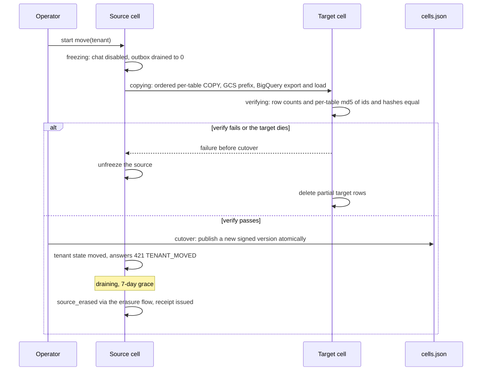

> Part of [architecture](../architecture.md) · [diagram](../architecture-diagram.md)
## 7. Scaling, failure modes and recovery

### 7.1 Failure modes

Principle: chat depends on Cloud SQL, Voyage, Anthropic, Model Armor and Identity Platform; it never depends on Kafka, BigQuery, Langfuse or Valkey-backed features other than Kong rate limiting. `chat-api` has no Kafka client. Deletes and ACL changes depend on Postgres, not Kafka (R4-D6, R4-D7).

| Failure | Detection | Behaviour | Recovery |
|---|---|---|---|
| Kafka or Schema Registry down | producer errors, `outbox_oldest_age_s` | Chat unaffected. Outbox rows accumulate in Postgres; relay retries with backoff. Consumers idle. ACL changes and erasure still run (they poll Postgres) | Relay drains on recovery; sinks dedupe by `event_id`. Alert on outbox age |
| Poison or invalid message, envelope mismatch, PUBLIC event on a pipeline topic | consumer exception, envelope check | Message to `dlq.v1` (redacted, with reason); consumer continues | Fix, then operator re-publishes from DLQ |
| Consumer crash or duplicate delivery | consumer lag, restarts | At-least-once; `processed_events` makes sinks idempotent | Worker pool restarts consumers from committed offsets |
| ACL change not yet applied (applier lag or failure) | `acl_apply_lag_s`, request status `pending` / `failed` | The old ACL still applies until the applier commits; then `acl_version` bumps and cached answers become unreachable; a racing cache hit is re-verified under RLS. A Kafka outage no longer delays it: the applier polls `acl_change_requests` | Applier retries (idempotent on `request_id`); failed requests surface through `GET /v1/admin/acl-changes/{id}` |
| Entitlement bump during a streaming turn | `entitlement_version` re-read before each retrieval or tool step and before `done` | Turn aborts with `ENTITLEMENT_CHANGED`, message `refused`, no further citations; text already streamed cannot be recalled (exposure bounded to one answer, p95 8 s) | Client asks again under the new entitlement |
| Cloud SQL stopped, down or failing over | `/readyz` DB check, connection errors | `demo`: by design off; `prod`: HA failover. Requests fail with `RETRIEVAL_UNAVAILABLE` / 503, stream `error` event. Erasure requests wait for the next start | `demo-up` (erasure job runs first); HA failover; start time is unmeasured (§10) |
| Cloud SQL connection exhaustion | pool errors, `max_connections` metric | Budget keeps pools <= 300 of 400; excess requests wait or fail with `RETRIEVAL_UNAVAILABLE` | Lower `DB_POOL_SIZE` or max instances |
| Anthropic error, 429, timeout | `LLMClient` exceptions | Timeouts, retries with jitter, circuit breaker; if `LLM_FALLBACK_ENABLED` then `claude-sonnet-4-6` (50% pricier, own cache, 1,024-token cache minimum); else SSE `error LLM_UNAVAILABLE`. Never a different provider. Hits every cell (cells do not isolate a provider outage, ADR-038) | Breaker half-opens; alert on fallback use |
| Retired or soon-retiring model id | readiness check, CI check, `demo-up` preflight 1-token call per pinned model | `/readyz` fails; CI blocks | Change config; rerun gate (also against the fallback) |
| Voyage embed failure | embed exception | No fallback model (single provider accepted). `RETRIEVAL_UNAVAILABLE` error event. Hits every cell | Retry by client; alert |
| Voyage rerank timeout or 429 (Tier-1 2M TPM, ~5 QPS) | rerank timeout, 429 counter | Fall back to RRF order and mark the turn degraded: SSE `meta {retrieval_degraded: true}`, `messages.retrieval_degraded = true`, `rerank_fallback_total{reason}` and `rerank_429_total` increment. Counted and visible, never silent | Alert when > 5% of turns are degraded in 15 min; request a Voyage tier upgrade before load tests |
| Model Armor timeout or error at query time | timeout (value set from measurement, ADR-036) | Fail closed: SSE `error GUARD_UNAVAILABLE`, request not answered | Retry; alert |
| Model Armor down, or `EXECUTION_SKIPPED`, at ingest | scan result | Fail closed: the version is quarantined, never indexed | Operator `release` or `reject` after the fix |
| Presidio error | exception | Fail closed (no unredacted text goes onward) | Fix; alert |
| Confidence gate fails | gate score | `refusal NO_FIRM_DOCUMENTATION` + escalate offer, no LLM call; counted | n/a (expected behaviour) |
| Citation verifier rejects, numeric gate rejects, licence footer missing, cited chunk outside `as_of` | verifier and gate results | Answer is not released: `refusal ANSWER_WITHHELD {reason}` with an escalate offer; counted by reason | Eval tracks the rate; numeric-gate false rejects measured (ADR-036) |
| Source down, HTML error page returned with 200, or contract violated | connector error, contract check | Retry with backoff; no deletes inferred (an empty listing is a failure); a bad document is quarantined | Fix the parser or wait; operator `release` / `reject` |
| Listing shrinks (> 5 items or > 10% of a source) or a connector quarantines > 5% of a batch | breaker | Nothing applied, connector frozen (`source_registry.frozen`), page | Operator inspects, unfreezes |
| FCA API returns 401 / 403 or revocation notice | connector status | Connector suspends; operator runs `purge_source('fca_api')`; UK COBS disappears from retrieval | Reinstatement needs an operator ledger `release` and re-ingest |
| Erasure target store down (BigQuery, Langfuse, Kafka) | `erasure_steps` pending, `erasure_oldest_pending_age_s` > 4 h pages | Postgres steps done, other stores pending, receipt stays phase 1 | Steps drain on recovery; Langfuse retry with alert at 24 h |
| Restore from backup | restore procedure | `erasure-replay` re-applies the ledger before traffic | Counts verified 0 for erased subjects |
| Tombstone violation (resurrected row) | `tombstone_violations_total` > 0 | Page; the store's receipt window restarts; the end-of-window re-sweep deletes it | Find the writer that skipped the uncached guard |
| `cells.json` unreadable or badly signed | signature check | Last good copy, then the baked fallback | Republish the signed file |
| Request reaches the wrong cell | `principal` home-cell check | 421 `WRONG_CELL` with a cell hint, zero DB reads | Client follows the hint |
| One cell down | router / ALB health | That cell's tenants get 503 `CELL_UNAVAILABLE`; other cells unaffected; no cross-cell failover | Restore the cell |
| Tenant move fails mid-copy | `move-tenant` state | Source unfrozen, partial target rows deleted | Retry the move |
| Embedding generation half built | `embed_generations.status` | Queries stay on the active model (blue) until the per-tenant flip | Rollback = flip back within 7 days |
| Valkey down (Kong counters) | Kong errors | Plugin `fault_tolerant` setting decided in E2. Cloud Armor and FastAPI limits remain | Recreate with `demo-up` |
| Identity Platform verifier cannot refresh keys | auth exception | Use cached keys (firebase-admin caches); with no cached keys, 503 | Keys refresh |
| Langfuse or OTel exporter down | exporter errors | Dropped asynchronously; never blocks a request | n/a |
| `eval-judge` or its topic down | judge lag | No effect on chat; sampled turns judged later | Replay from `eval.sample.v1` |
| BigQuery sink error | sink exception | Retries, then DLQ; idempotent by `event_id` | Replay |
| SSE connection drop | client | Client reconnects with `Last-Event-ID`; server replays persisted events | n/a |
| chat-api instance dies mid-turn | no `done`, lease expiry | Replay endpoint emits `error TURN_INTERRUPTED` | Client resubmits with a new `Idempotency-Key` |
| Pooled connection reuse leak | L0 leak matrix | Prevented: only transaction-local `set_config(.., true)`; unset setting raises (fail closed) | Test blocks merge |
| Hot tenant | per-tenant concurrency / token budget | `RATE_LIMITED` / `TENANT_BUDGET_EXCEEDED` for that tenant | Adjust `tenants.budgets` |
| Rows land in DEFAULT `chunks` or `messages` partition | alert on non-empty | Treated as a bug (missing onboarding or maintenance) | Onboard the partition, move rows |
| Migration failure | `migrate` job exit code | Deploy halts before traffic shift | Fix forward or roll back image |
| Bad deploy | smoke test on tagged no-traffic revision | Traffic not shifted | Shift back to previous revision |
| Zone or region outage | n/a | `demo`: zonal, accepted. `prod`: HA is zonal failover only. A second cell isolates tenants of another region, not a provider outage | No regional DR in scope (RPO / RTO not set) |

10x load (r4/P-reliability.md §16): the new work is offline (ingest, reconcile, erasure). The chat path adds one equality predicate, one entitlement read per tool step and two regex gates. The Voyage backfill is capped at 25% of RPM so 10x ingest cannot starve queries. BigQuery allows 2 concurrent plus 20 queued DML statements per table, so erasure runs one batched DELETE per hour and 10x subjects still means one statement.

### 7.2 Scale triggers

| Trigger | Action | Source |
|---|---|---|
| One tenant > 250k chunks, or total > 2M chunks, or ANN p95 > 100 ms | Grow partitions / silo a tenant through the `tenants.shard_id` seam | D2, D13b |
| PUBLIC partition > 250k chunks | Sub-partition PUBLIC by source | D13b |
| Superseded rows hurt recall or p95 under iterative scan (E3 spike with 30% superseded rows) | Partial index `WHERE is_current` | ADR-027 |
| Separate scaling of retrieval needed, or a second consumer of retrieval | Extract `retrieval` into its own Cloud Run service with its own DB role | D1, D13c |
| > 10 tenants, or a sensor is needed | Run a Dagster daemon in the cloud (today daemon-less) | D3, D15.4 |
| Real client data | Confluent Standard RBAC (per-tenant ACLs); self-host Langfuse v4 or drop third-party tracing; revisit BigQuery and trace controls. (Real public documents and private demo publisher documents are already allowed, ADR-038) | D13j, D13l |
| Rerank at ~5 QPS on Voyage Tier 1 | Request a tier upgrade before load tests | D13e |
| Schema Registry > 100 schemas, or Confluent limits (50 keys, 1,000 ACLs, 1,500 partitions) approached | Move off the free tier / consolidate | evidence-r2.md, D15.8 |
| Need for log-based CDC outbox | Optional Debezium outbox connector (learning epic) | D4 |
| Always-on availability required | Switch to the `prod` profile: HA Cloud SQL flag, min instances >= 1 (~$300+/month) | D13g, D13r |
| Revocation lag above the 60 s TTL becomes unacceptable | Add a push-invalidation path (a new ADR); today there is none | D14.9 |
| Kong limits (OSS cannot key on a verified tenant) become a problem | Move per-tenant limits further into FastAPI or revisit the gateway | D12 |
| Private-DNS `run.app` egress spike fails | All-traffic egress + Cloud NAT (about +$32/month) with an ADR | D16.12 |
| A customer needs a deployed second region | Deploy cell 2: two Confluent clusters, two Langfuse accounts, two BigQuery locations; ALB host rules are an unpriced spike. Costed option only: ESTIMATE $15-40/month on demand or $90-150 standing, UNVERIFIED (verified prices do not exist, evidence-r4.md §3.3) | ADR-031 |
| A customer needs processing residency, or Anthropic or Voyage offers an EU region | Claude on Vertex AI in an EU region (availability UNVERIFIED; costed option) and a new ADR | ADR-038 |
| The 14 d analytics bound is unacceptable | Keep no subject-linked rows in BigQuery (aggregates only): the bound becomes 24 h, at the cost of per-conversation audit queries | ADR-029 |
| A tenant above 250k chunks, or HNSW memory over budget during a re-embed | Re-embed per tenant, or shared-parent generations | ADR-035 |
| A tenant too large to freeze for a move | Revisit the move protocol | ADR-033 |
| Weekly eval cost above the budget alert | Cut the eval cadence; `EVAL_BUDGET_USD` caps runs | R4-D16, ADR-037 |

Scaling levers: `chat-api` concurrency and max instances (Cloud Run), `fa-gateway` max 2, worker pool instance count (no autoscaling), Cloud SQL tier (2 vCPU / 8 GiB; HA flag), partition per tenant. Connection budget: `max_connections` is 400 on 8 GiB; pool per instance x max instances over all services must stay <= 300, leaving headroom for migrations, dbt and Dagster (managed pooling is Enterprise Plus only).

### 7.3 Recovery

- Ingest is replayable: bronze is immutable, stages are idempotent, chunks are unique on `(tenant_id, chunk_hash, embed_model)` and chunk identity includes `valid_from` and `parser_version`; replay after a parser fix re-parses, and `reconcile_lineage` makes late, out-of-order, withdrawn and replayed versions converge. A replay never resurrects a tombstone (uncached ledger guards). Re-embedding is a per-tenant generation flip, not a replay (ADR-035).
- Analytics are rebuildable from Kafka and the Postgres outbox; BigQuery sinks dedupe by `event_id`.
- Backups: Cloud SQL automated backups with 7 d retention (R4-D6). PITR log retention days are UNVERIFIED (§10). After any restore (backup, PITR, move target) `erasure-replay` re-applies the erasure ledger, also exported daily to an append-only GCS object, before traffic is allowed. RPO / RTO are not specified by the brief; they are set in E10 when the `prod` profile is built.
- Quarantine: an operator records `release` or `reject` on a quarantined version; `release` on a ledger tombstone is the only path for a legitimate re-ingest.
- At every demo start `demo-up` runs the erasure job first, then the canary (§9.8).
- Deploys: tagged no-traffic revision, smoke test, then shift; rollback is a traffic shift to the previous revision; images by digest.

### 7.4 Edge-case catalogue (ADR-026 to ADR-038)

Tiers: PR = docker compose on every pull request (budget under 12 min); nightly = on main, compose; weekly or demo start = uses providers or real sources, the cloud, or runs from `demo-up`. Items 1-10 are the brief's Track C.3 list in its order; numbering is the one the ADRs cite as "#N". Connectors run against recorded fixtures (VCR) in PR; live source smoke, the golden-200 run, guardrail sets, ablation arms, the canary and the restore drill run weekly or at demo start.

| # | Scenario | Control | Proving test | Tier |
|---|---|---|---|---|
| 1 | Delete during ingest | per-document advisory lock, tombstone first, indexer re-check in the transaction, silver post-write check, uncached ledger guard (ADR-028) | race harness: N interleavings of erase vs indexer, including a tombstone committed just before the sink write; end state has zero rows or objects | PR |
| 2 | ACL change during a streaming chat | `entitlement_version` re-read per retrieval step and before `done`; abort `ENTITLEMENT_CHANGED` (ADR-033) | slow fake LLM, ACL change at token 20: abort, message `refused`, no citations released | PR |
| 3 | PUBLIC document updated while cached | publish bumps `corpus_version` and purges cache by `source_document_ids`; key has `as_of`, `embed_model`, `source_epoch`; hit-time verifier (ADR-027) | cache a cited answer, publish a new version, same question: miss and new text; race variant: a hit inside the publish transaction is re-verified | PR |
| 4 | Duplicate document in two firms (and firm + PUBLIC) | per-tenant bronze and chunks, tenant-scoped ledger key, exact-hash dedupe at fusion prefers PUBLIC | erase from firm A: firm B still answers, A's cache and BigQuery rows purged, B's untouched; counts per tenant | PR |
| 5 | Poison document | ingest scan, contract gates, quarantine, batch circuit breaker, DLQ for a parse crash (ADR-034, ADR-036) | corpus of malformed HTML/PDF, oversized files, injection payloads, `EXECUTION_SKIPPED`: none indexed, all in quarantine or DLQ, consumers continue | PR |
| 6 | Partial region outage | cell isolation; 421 not fallback; no cross-cell failover, stated (ADR-031) | compose: stop cell-eu: US passes, EU tenants get 503 with a clear code, no US data touched. Variant: provider outage returns `LLM_UNAVAILABLE` in every cell, not a cell failure | nightly |
| 7 | Kafka outage during deletes | Postgres steps, ledger and queue are durable; `erasure_oldest_pending_age_s` pages > 4 h (ADR-029, ADR-030) | stop Kafka, issue an erasure: Postgres done, other stores pending; restart: all done, phase-1 receipt issued once. Variant: stop Kafka, tighten an ACL: applier still applies it | PR |
| 8 | Replay after a bug fix | idempotent keys, `valid_from` and `parser_version` in chunk identity, tombstone-aware sinks, atomic publish | replay the fixture corpus twice after a parser bump: end state hash equals a single run, zero duplicates, zero resurrected tombstones; no chunk of the old parse is retrievable | PR |
| 9 | Clock skew on `as_of` | `as_of` from the DB date in UTC; half-open ranges; system time only `clock_timestamp()` (ADR-027) | boundary days (valid_from, valid_to, day before and after), app clock +/-2 h and a DST day: same chunks returned | PR |
| 10 | Model retirement during a demo | readiness model probe, `demo-up` preflight call per pinned model, fallback model tested weekly | fake provider returns 404 mid-stream: SSE `LLM_UNAVAILABLE`, breaker opens, fallback path when the flag is on; deprecation date check | PR; weekly for the real fallback |
| 11 | Late or back-dated upstream version | order by the source's version key; range slotted under lock; `reconcile_lineage` | feed `v3, v1, v2` in all permutations, plus an A-B-A reversion: identical final valid-time line | PR |
| 12 | Upstream withdraws many items (glitch) | two-listing rule, mass-delete breaker (> 5 items or 10%), empty listing is a failure | listing returns 0 or drops 30%: nothing applied, connector frozen, page | PR |
| 13 | Silent edit, same version key, new bytes | `silent_edit` event and a new system-time row | mutate fixture bytes: new row, alert, old row closed, as-of reproducible with `known_at` | PR |
| 14 | Restore resurrects erased data | ledger replay before traffic | restore a backup taken before an erasure into scratch, replay: counts 0 | nightly (compose); weekly or demo start (cloud drill) |
| 15 | FCA revocation | `purge_source('fca_api')` as the PUBLIC owner role, fan-out per firm tenant under its own role, no cross-tenant role | purge on fixtures: PUBLIC empty, firm messages and cache rows quoting FCA text erased per tenant, leak matrix shows no cross-tenant role, FCA content absent from Kafka and BigQuery | nightly; drill quarterly |
| 16 | Misrouted token (wrong cell) | `home_cell` check before any DB read | wrong-cell request: 421, DB query log empty | PR |
| 17 | Advisor in two firms | one token per firm; tenant claim vs URL vs cell map (ADR-032) | token A on firm B's resource: 403 or 421; two sessions in one browser context keep separate `currentUser` | PR |
| 18 | Tenant move fails mid-copy | copy, verify, cutover, erase with rollback (ADR-033) | kill the target mid-copy: source intact and unfrozen, target empty; success path counts and hashes equal | nightly |
| 19 | Embedding generation mixing | `embed_model` literal per tenant, query model asserted (ADR-035) | green half-built: queries still blue; flip: green; wrong-model query raises | PR |
| 20 | Erase mid re-embed | delete by `doc_id` across generations | start the backfill, erase a document: zero rows in both generations, receipt | nightly |
| 21 | Injection in a real chunk | ingest scan, JSON-encode and nonce, tool allow-list, numeric and citation gates (ADR-036) | slice G plus LLMail-wrapped chunks: ASR line of §2.4 | weekly |
| 22 | Licence footer missing | `licence_footer` block | matrix over licence classes: each cited class yields the required text; removing it blocks release | PR |
| 23 | BigQuery DML on the streaming buffer | batch DML on refs older than 30 min | erase a subject within 5 min of events: rows removed on the next batch, none left | nightly |
| 24 | Langfuse delete not honoured | retry, alert at 24 h, receipt stays phase 1 | stub returns 202 without deleting: alert fires, receipt stays phase 1 | PR |
| 25 | UK source asked as of a date never observed | `valid_from_basis = 'observed'`; refuse a pre-observation date | FCA question as of 2019: refusal "no version history for this source" | PR |
| 26 | Private ingest without `llm_egress_ack` | per-tenant flag checked before private ingest (ADR-038) | flag false: ingest refused with zero provider calls; stub providers record that private text leaves only when the flag is true, on all three egress paths | PR |
| 27 | Exclusion constraint missing on a chunks leaf | the constraint is in the per-tenant partition-creation migration (PG16 cannot declare it on the partitioned parent; ADR-027) | L0: every `chunks` leaf carries the `EXCLUDE` constraint | PR |
| 28 | Planted bad row in silver; broken index | Pandera depth `SCHEMA_AND_DATA`; ANN self-hit canary (ADR-034) | planted bad row fails; deliberately broken index pages | PR |
| 29 | Concurrent multi-document erasures plus an ingest storm | lock order: advisory lock, then `corpus_version` row last, one document per transaction | no deadlock loss, lock order held | nightly |
| 30 | Ledger tombstone vs legitimate re-ingest | explicit `release` action (ADR-028) | FCA module revoked then reinstated re-ingests only after `release` | PR |
| 31 | Backups after the instance is stopped | automated backups 7 d | test that backups expire on schedule while Cloud SQL is stopped; every BigQuery dataset has `max_time_travel_hours = 48` | weekly or demo start |
| 32 | `cells.json` unreadable or stale | last good copy, then baked fallback; version only increases | corrupt the file: the last good copy serves; an older version is refused | PR |
| 33 | Role calls a tool with no policy row | `policy.py` default deny; a tool without a row fails CI | role x tool matrix generated from `policy.py` | PR |

PR-gate additions to L0 (the leak matrix stays): contracts, race harness, as-of boundaries, numeric-gate property tests over locale formats (EN `1,234.56`, DE/FR `1.234,56` and `1 234,56`), footer matrix, role x tool matrix, replay idempotence, reconcile on fixtures per pair, cell isolation.

### 7.5 Scale envelope: provider limits and re-embed times

All values are documented limits (read 2026-11-02), not measurements. Which Anthropic and Voyage tier the account has is not known; the Start tier is shown for Anthropic.

| Provider limit | Value | Source |
|---|---|---|
| Anthropic Sonnet 5.5 and Haiku 5.5, Start tier | 4,000 RPM, 2,000,000 ITPM, 400,000 OTPM | https://platform.claude.com/docs/en/api/rate-limits |
| Same, Build / Scale tier | 10,000 / 13,000 RPM; 5M / 10M ITPM; 1M / 2M OTPM | same |
| Anthropic monthly spend cap | Start $500, Build $1,000; at the cap requests return 429 until the 1st (UTC) | same |
| Anthropic token accounting | `cache_read_input_tokens` do not count toward ITPM for most models; `cache_creation` tokens do (cold-cache bulk contextualization is charged at creation tokens); acceleration limits can 429 on sharp growth | same |
| Message Batches | 100,000 requests or 256 MB per batch; Start 1,000 RPM and 200,000 queued; 24 h expiry; 50% price; not ZDR-eligible (batch facts not checked by the skeptic) | same; pricing https://platform.claude.com/docs/en/about-claude/pricing |
| Voyage RPM | 2,000 RPM, all models | https://docs.voyageai.com/docs/rate-limits |
| Voyage TPM | voyage-4 8M; voyage-4-large 3M; voyage-context-4 3M; rerank-2.5 and rerank-3 2M; rerank-2.5-lite and rerank-3-lite 4M. Tier 2 needs >= $100 paid (free tokens do not count) | same |
| Voyage batch | 33% off, 12 h window, up to 100K inputs, no free credits on batch | same |
| Model Armor | 1,200 QPM per project, shared with prompt checks; 65,536 tokens and 4 MB per document; ingest scan throttled to <= 300 QPM; free 2M tokens/month | https://docs.cloud.google.com/model-armor/quotas |
| BigQuery DML | 2 concurrent + 20 queued per table | evidence-r4.md §2.3 |

Re-embed (ADR-035), at 400 tokens per chunk (ASSUMPTION) and with the backfill client capped at 25% of RPM, i.e. 25% of the voyage-4 TPM:

| Chunks | Tokens | At full 8M TPM | At the 25% cap (2M TPM) | Cost (list; batch -33%) |
|---|---|---|---|---|
| 25k (first real set) | 10M | 1.25 min (derived) | 5 min (derived) | $0.60, inside the 200M free tokens |
| 100k | 40M | 5 min | 20 min | $2.40 ($1.60 batch); possibly $0 from free tokens (batch gets none) |
| 1M | 400M | 50 min | 200 min | $24 ($16 batch) |

These are ceilings, not measurements; HNSW build time at 100k to 1M chunks is unmeasured (E3 spike). Two generations double HNSW memory during the overlap; 1M chunks does not fit the 8 GiB instance and 250k per tenant does.

Why contextual retrieval stays an ablation arm (default OFF): per 1k real 497K filings, voyage embedding is about $1.6 and the Model Armor scan about $2.6, Haiku batch headers with chunk-only context about $3, but whole-document context per chunk uncached is about $78 (1.56B input tokens at $0.05 per MTok), a 26x spread (r4/P-reliability.md §0). The first full ingest (about 7M tokens) exceeds the Model Armor free tier of 2M tokens by about 5M tokens, an overage of about $0.50 once (r4/S-skeptic-3.md).

### 7.6 Regional cells, control plane and tenant move

Control plane: the signed `cells.json` (GCS with a baked fallback, refreshed every 60 s), the global ALB and Identity Platform. No database in the control plane. Data plane: everything else, once per cell. Nothing is shared or replicated between cells: no Kafka cluster links (the destination must be Dedicated or Enterprise: https://docs.confluent.io/cloud/current/multi-cloud/cluster-linking/index.html), no replication, no cross-location BigQuery joins (https://docs.cloud.google.com/bigquery/docs/locations). Cloud Run behind a global ALB routes by latency and has no cross-region failover (https://docs.cloud.google.com/run/docs/multiple-regions), so the router pins by per-cell hostname. Only the `us` cell is deployed; the `eu` cell is designed and tested in `docker-compose.cells.yml` (K-R4-1).

```mermaid
flowchart TB
    subgraph cp["Control plane (global)"]
        cellsjson["cells.json (signed, GCS + baked fallback)"]
        alb["Global ALB"]
        idp["Identity Platform (one tenant per firm)"]
    end
    llm["Anthropic + Voyage (US/global, all cells)"]
    subgraph cellus["Cell us (deployed, us-central1)"]
        runus["Cloud Run: fa-gateway, chat-api, fa-worker"]
        squs[("Cloud SQL")]
        gcsus[("GCS")]
        bqus[("BigQuery dataset")]
        kfus["Confluent cluster + Schema Registry"]
        lfus["Langfuse account"]
        kmsus["KMS keyring"]
        maus["Model Armor endpoint"]
    end
    subgraph celleu["Cell eu (designed, local compose only)"]
        runeu["Cloud Run: fa-gateway, chat-api, fa-worker"]
        sqeu[("Cloud SQL")]
        gcseu[("GCS")]
        bqeu[("BigQuery dataset")]
        kfeu["Confluent cluster + Schema Registry"]
        lfeu["Langfuse account"]
        kmseu["KMS keyring"]
        maeu["Model Armor endpoint"]
    end
    alb -->|"HTTPS, per-cell hostname"| runus
    alb -->|"HTTPS, per-cell hostname"| runeu
    cellsjson -.->|"read every 60 s"| runus
    cellsjson -.->|"read every 60 s"| runeu
    idp -->|"ID token, firebase.tenant"| runus
    idp -->|"ID token, firebase.tenant"| runeu
    runus --> squs
    runus --> gcsus
    runus --> bqus
    runus --> kfus
    runus --> lfus
    runus --> maus
    runeu --> sqeu
    runeu --> gcseu
    runeu --> bqeu
    runeu --> kfeu
    runeu --> lfeu
    runeu --> maeu
    runus -->|"prompt, embed, rerank"| llm
    runeu -->|"prompt, embed, rerank"| llm
```

The KMS keyrings (`kmsus`, `kmseu`) sign receipts and hold the tenant keys of their cell; they are not drawn with edges for readability.

Tenant-move protocol (ADR-033). States: `active`, `freezing`, `copying`, `verifying`, `cutover`, `draining`, `source_erased`.

Rules: the same `tenant_id` and the same `embed_model` are kept and embeddings are copied as-is; Langfuse traces do not move (deleted at the source, the target starts clean); a person moving firm moves no data, each firm erases under its own policy; an advisor's jurisdiction or tier change is an `entitlement_version` bump effective within 60 s (§7.1); a document reclassification keeps ADR-022 and takes the per-document advisory lock of ADR-028 so it cannot race an ingest.
