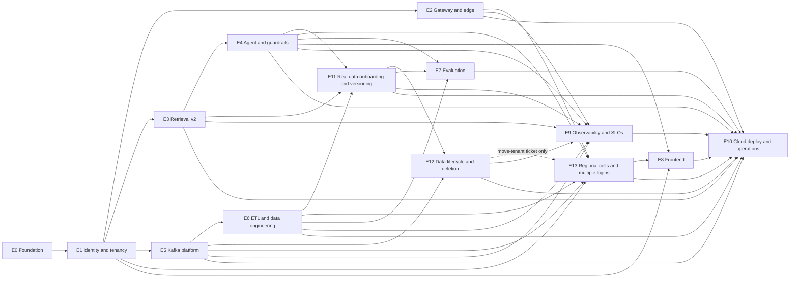

# finadvisor: implementation plan

High level. Epics and tickets live in `epic/<E>-<slug>/` (epic.md and tickets/) and the GitHub Project. Architecture: `arch/architecture.md` (cited as `deep-dive/<file>.md#n`), decisions: `decision-logs.md` (ADR-nnn). Spikes come first in their epic and their result is recorded as an ADR. "Done when" items are checks a verifier can run; numbers come from the decision (deep-dive/02-quality-attributes.md §2). Values the brief left open are set in the ticket that implements them, recorded in config and listed in deep-dive/06-interfaces-and-contracts.md §6.6 as "set in Ex".

**Round 4 (2026-11-02).** Source: `projects/finadvisor/library/research/r4/decision-r4.md` (R4-D1 to R4-D19), ADR-026 to ADR-039 and the round-4 amendments of ADR-009, 013, 014, 015, 016, 017, 022; the validation changes of 2026-11-07 are in ADR-039 and in the "Validation" bullets below. Status fact: `epic/ ticket files` has 203 tickets, all `todo`; nothing is built. "E0 to E3 complete" in earlier notes meant fully PUBLISHED, not built. So every "Round 4 changes" entry below is an `update` of a published ticket (a line in the publish diff), not a new ticket, except the new epics E11 to E13. Each epic below ends with a dated "Round 4 changes" list; where a round-4 line replaces an older bullet it says "Supersedes". The edge-case catalogue (`#n`) is `deep-dive/07-scaling-failure-modes-and-recovery.md` section 7.4 (33 cases, gate tiers PR = every pull request, N = nightly, W = weekly or demo start).

## Phases

| Phase | Epics | Outcome |
|---|---|---|
| 0. Foundation | E0 | The repo is runnable and honest: typed config, no LiteLLM, CI that works, local compose, Alembic baseline |
| 1. Platform core | E1, then E2, E3, E5 in parallel | Identity and tenancy enforced in the DB; gateway and edge; retrieval v2; Kafka platform |
| 2. Product | E4, E6 | The agent with guardrails and streaming; the ETL and data engineering pipeline |
| 3. Real data and lifecycle (R4) | E11 and E13 (core) in parallel, then E12; E13's move-tenant ticket after E12 | Real sources with change capture and versions; physical deletion with proof and reconciliation; regional cells and one login per firm |
| 4. Quality and UI | E7, E8 | Evaluation gate (200-item real golden set) and the React SPA |
| 5. Operate | E9, E10 | Observability and SLOs; Terraform v2, deploy pipeline, demo-up / demo-down, erasure canary, load test |

Phase 3 is new in round 4; the old phases 3 and 4 are renumbered 4 and 5.

**Epic order (acyclic).** E0, E1, then E2, E3, E5; then E4 (after E3) and E6 (after E5); then E11 (after E3, E4, E6); then E12 (after E11, E5); then E13 (core after E1, E2, E4, E5, E6; move-tenant ticket after E12); then E7 (after E4, E6, E11), E8 (after E1, E4, E13), E9 (after E2 to E6, E11, E12) and E10 (after all).

## Epic dependency graph

## Epics (E0 to E10 as before, then the round-4 epics E11 to E13 at the end; build order is the epic order line above)

### E0 Foundation

- **Goal.** The repo is runnable and honest: it builds from lockfiles, boots only with real config, and CI can fail.
- **Scope.**
  - Single typed `Settings` (pydantic-settings), no secret defaults (fail to boot); model ids from config plus a retired-model check (CI and readiness).
  - Remove LiteLLM and the Kong/LiteLLM wiring; Langfuse Python SDK 5.x wrapper (`mask_otel_spans`, capture off on sensitive spans).
  - CI with lockfile installs, Postgres and Kafka service containers (`pgvector/pgvector:0.8.5-pg16` to match Cloud SQL); ruff, mypy, pytest, eslint, tsc, vitest, trivy, gitleaks, pip-audit.
  - docker compose with env-driven host ports, healthchecks, the same pgvector image, and a frontend dev image.
  - Alembic baseline created from `schema.sql`; `migrate` entrypoint.
- **Arch sections.** deep-dive/01-context-and-goals.md#1 (gap map), deep-dive/06-interfaces-and-contracts.md#6.6 (config keys), deep-dive/04-components-and-responsibilities.md#4 (compute shape); ADR-005, ADR-006, ADR-018, ADR-019, ADR-021.
- **Dependencies.** none.
- **Spikes first.** none (confirm Langfuse Cloud accepts SDK 5.x as the first ticket).
- **Done when.**
  - CI is green on a clean clone using lockfiles only, and each of ruff, mypy, pytest, eslint, tsc, vitest, trivy, gitleaks, pip-audit runs and can fail a PR.
  - Starting the app with a missing required secret exits non-zero (test).
  - `claude-sonnet-4-20250514` in config makes CI and `/readyz` fail (test); the repo contains no LiteLLM service, config or dependency.
  - `docker compose up` brings every service healthy with no fixed host-port collisions; Alembic upgrade on an empty database equals the baseline schema.
  - Fixes G-05, G-08, G-09 (removal), G-15, G-25, G-28, G-49.

- **Round 4 changes (2026-11-02).**
  - Test helpers join the foundation: recorded-fixture (VCR-style) HTTP replay for connectors, a race-harness helper (erase vs indexer interleavings), and a compose profile that stops Kafka (for #7). The PR gate stays under 12 min (ADR-017, ADR-026, ADR-028).
  - CI asserts the local and CI Postgres image major version equals Cloud SQL (PG16, `pgvector/pgvector:0.8.5-pg16`); PG18 is rejected (ADR-027).
  - The two-cell compose suite is NOT here; it moves to E13 (r4/P-reliability.md section 14 had put `docker-compose.cells.yml` in E0).

### E1 Identity and tenancy

- **Goal.** A caller is a verified person in a tenant, and the database refuses every cross-tenant read and write.
- **Scope.**
  - First ticket: verify the `firebase.tenant` claim name against a real Identity Platform tenant (D14.17).
  - `tenants` and `advisors`; Identity Platform multi-tenancy (one IdP tenant per firm); project-level ID-token verification with firebase-admin and the `firebase.tenant` check (`auth`, ADR-032); `principal` with the 60 s entitlements cache and `entitlement_version`; IdP tenant provisioning script (Terraform comes in E10).
  - Schema for the whole target model in the baseline migration: `documents.raw_content` is dropped here (G-03 early); `acl_change_requests`, `eval_scores`, `turn_events`, `outbox` and `processed_events` tables are created (the outbox is written in E4 and relayed in E5).
  - RLS v2 on all tables: ENABLE + FORCE, SELECT own-or-PUBLIC, writes own-tenant only, PUBLIC writable only by `fa_etl_public`; roles `fa_app` (SELECT only on content), `fa_worker`, `fa_etl`, `fa_etl_public`, `fa_dbt`, `fa_owner`, `fa_lookup`, `fa_maint`, `fa_eval`, `fa_dagster`; `tenants` policies; `advisors` admin-only UPDATE; `advisor_id` owner clauses; `set_config(..., true)` in short transactions; composite FKs.
  - LIST partitions of `chunks` and monthly partitions of `messages` with no partition grants; tenant onboarding in the `migrate` job; `maintenance` job schema and role (scheduling in E10); startup / readiness role and RLS assertions.
  - Leak matrix: reads, writes, FK probes, direct partition access, advisor self-escalation, pooled-connection reuse, fail-closed. Tenant discovery endpoint and `fa_tenant_lookup` (owned by `fa_lookup`).
- **Arch sections.** deep-dive/05-data-model-and-storage.md#5, deep-dive/08-security-and-privacy.md#8.2, deep-dive/04-components-and-responsibilities.md#4.5 (`auth`, `principal`), deep-dive/04-components-and-responsibilities.md#4.8; ADR-002, ADR-003, ADR-004, ADR-010.
- **Dependencies.** E0.
- **Spikes first.** (0, gating, R4) Identity Platform same-email-in-two-tenants spike (about a 5-minute live test, ADR-032): it gates every Identity Platform ticket of this epic (tenant provisioning script, project-level verification with the `firebase.tenant` check, the `advisors` mapping); the docs check of 2026-11-07 found the pages silent, so the live test stays a gate (R4-D18 V5); its result is recorded as an ADR addendum before those tickets start, and a failure switches onboarding to per-firm email aliases with a new ADR. Then: Identity Platform multi-tenancy: confirm billing for > 2 tenants; LIST-partition pruning with the RLS `current_setting` policy plus planner cost at ~52 partitions.
- **Done when.**
  - The L0 leak matrix passes on every PR: cross-tenant read, cross-tenant insert, update and delete into PUBLIC, FK existence probes, direct SELECT / INSERT on a partition as `fa_app` / `fa_worker` gives permission denied, "advisor raises own tier / role" is denied, pooled-connection reuse, unset setting fails closed; leaks = 0.
  - Startup refuses to run when the role is superuser, BYPASSRLS or owner (except the `fa_dbt` and `fa_maint` exemptions), when any tenant table lacks FORCE RLS (including partitioned parents), or when a partition carries a runtime grant (tests).
  - A request with a forged, expired, wrong-audience or wrong-tenant token gets 401; a valid token for tenant A cannot read tenant B rows.
  - `EXPLAIN` shows partition pruning for LIST partitions under RLS.
  - `documents.raw_content` does not exist after the migration; the CI assertion that only `fa_tenant_lookup` is `SECURITY DEFINER` passes.
  - Fixes G-01, G-03, G-12, G-19, G-20, G-21, G-43.

- **Round 4 changes (2026-11-02).**
  - Same-email-in-two-tenants spike gates the Identity Platform tickets (see Spikes first; ADR-032, R4-D11). One IdP tenant per firm, one token per firm, no identity merge; `advisors` has one row per `(tenant_id, idp_uid)`.
  - `tenants` gains `cell_id`, `residency_class`, `llm_egress_ack` (default false) and `active_embed_model`; subject rows (advisors, conversations, messages) carry a random `pseudonym_id` with its mapping table (ADR-031, ADR-038, ADR-035, ADR-029).
  - `principal` compares `home_cell` with this cell and returns 421 plus a cell hint with zero DB reads on a mismatch (ADR-031); the test belongs to E13 (#16).
  - `CREATE EXTENSION btree_gist` (availability on Cloud SQL PG16 UNVERIFIED: check first) and the per-tenant partition-creation migration gives every `chunks` leaf its range columns and its EXCLUDE constraint; new L0 test: every leaf partition has the constraint (ADR-027, R4-D3).
  - Tables owned by E11 to E13 (`document_versions`, `source_registry`, `source_observations`, `deletion_requests`, `erasure_steps`, `lineage_edges`, `embed_generations`) are created by the migration of the epic that owns them, not by this baseline; the startup and CI RLS assertions of this epic cover them automatically (to confirm at planning).
  - Existing done-when bullets stand; the demo multi-tenant setup stays.
  - Validation (2026-11-07, ADR-039): tables with no other owner are named here: E1 owns `pseudonym_map` (created with `advisors`); E11 owns `fund_rr_facts`; E12 owns `erasure_receipts`, `reconciliation_manifests`, `reconciliation_findings` and the PUBLIC `source_purges` table (proposed owners, confirmed at stage 4). `fa_etl_public` gets no write on any firm tenant table: the leak matrix asserts it (ADR-002 D13a stands, ADR-039).

### E2 Gateway and edge

- **Goal.** Traffic reaches the API only through the ALB, Cloud Armor and Kong, with limits that work and SSE that streams.
- **Scope.**
  - Kong 3.9.4 DB-less config + Valkey: per-IP and per-session `rate-limiting` (`X-RL-Key = sha256(Authorization)`), `request-size-limiting`, `cors`, `correlation-id`, `opentelemetry`, `prometheus`, `file-log` audit to Cloud Logging with a BigQuery log sink (G-48; no `/internal` routes), `bot-detection`, request-transformer stripping identity headers; route paths as prefixes or `~` regexes.
  - `pre-function` for `X-Serverless-Authorization` and `X-RL-Key`; `fa-gateway` Cloud Run service (invoker check disabled on this service only, ingress internal-and-cloud-load-balancing); ALB + Cloud Armor in Terraform; private `run.app` DNS zone, Private Google Access and Direct VPC egress `private-ranges-only`.
  - `llm-egress` route with `key-auth` + `ip-restriction` if its spike passes; `kong config parse` in CI; deck / curl smoke tests; kong + valkey in compose.
- **Arch sections.** deep-dive/04-components-and-responsibilities.md#4.1 to #4.3, deep-dive/04-components-and-responsibilities.md#4.6, deep-dive/06-interfaces-and-contracts.md#6.5, deep-dive/08-security-and-privacy.md#8.3, deep-dive/10-open-questions.md#10 (items 1-5, 9); ADR-011, ADR-012, ADR-023, ADR-024.
- **Dependencies.** E1.
- **Spikes first.** (1) SSE pass-through ALB to Kong to chat-api; (2) `X-Serverless-Authorization` passthrough smoke test (user `Authorization` reaches FastAPI unchanged); (3) private-DNS `run.app` egress; (4) LLM egress with `ai-proxy` `route_type: preserve`; (5) `X-RL-Key` behaviour; (6) Cloud Armor cost. Each result is an ADR (conditional ADRs where a spike fails).
- **Done when.**
  - Spike results recorded as ADRs with measurements.
  - SSE through Kong adds <= 50 ms p95 over a direct chat-api stream (measured, `response_buffering: false`).
  - The Kong config parses; a smoke test shows 429 with `Retry-After` for the IP limit and the session-key limit, 413 over the size limit, and client-supplied `X-User-Id` / `X-Tenant-Id` / `X-Serverless-Authorization` / `X-RL-Key` never reaching chat-api; no raw bearer token appears in Valkey keys or in `file-log` output.
  - Gateway audit rows reach BigQuery `gateway_audit` through the log sink with no `Authorization`, body or query string.
  - `chat-api` rejects a call without the Kong service account's ID token (or the ADR fallback is in place); Kong reaches `chat-api` over private DNS with no Cloud NAT (or the ADR fallback is in place).
  - Fixes G-02, G-11, G-14, G-46, G-48.

- **Round 4 changes (2026-11-02).**
  - Per-cell hostnames and the `GET /resolve?slug=` route on Kong and the ALB host rules; an ALB host-rule spike is added (its failure is a trigger in ADR-031). The content of `cells.json` is E13's; Kong's other routes and plugins are unchanged (ADR-031).

### E3 Retrieval v2

- **Goal.** Filtered, hybrid, reranked retrieval that is fast, fail-closed and measured.
- **Scope.**
  - `voyage-4` embeddings with `input_type` query / document, `halfvec(1024)`, HNSW (m 16, ef_construction 64) + iterative scan, `max_scan_tuples` 20000, `ef_search` ~80-100.
  - FTS leg (`tsvector` + GIN, `websearch_to_tsquery`), RRF k=60 in one SQL statement with RLS on both legs.
  - `rerank-3-lite` (default) with timeout; `RERANK_CANDIDATES` default 15 (range 10-30); a timeout or 429 falls back to RRF order and yields `retrieval_degraded` plus counters; CRAG-style confidence gate; parent expansion; server-side staleness.
  - The factsheet and suitability tools reimplemented on `RetrievalService` (no `raw_content`, escaped input, `LIMIT`).
  - Answer cache (UNLOGGED, own RLS, versioned key, verifier re-run on hit, side-effect turns excluded, purge by the `acl-applier` on ACL change, by the `erasure-worker` on document delete, and by `maintenance` when expired); `RetrievalService(principal)` as the only content-table accessor (import-linter + test); retrieval metrics.
- **Arch sections.** deep-dive/05-1-rls-indexes-versioning-and-deletion.md#5.5 to #5.7, deep-dive/04-components-and-responsibilities.md#4.5 (`retrieval`), deep-dive/06-interfaces-and-contracts.md#6.3; ADR-004, ADR-008, ADR-015.
- **Dependencies.** E1.
- **Spikes first.** Rerank latency and TPM / tier (target rerank p95 < 700 ms on `rerank-3-lite`; Tier 1 is 4M TPM, about 11 QPS for the lite model and 2M TPM, about 5 QPS for `rerank-3`); pgvector iterative scan with RLS and LIST partitions (result confirms D13b).
- **Done when.**
  - On a 10k-chunk synthetic corpus, retrieval first stage (embed then hybrid SQL, serial) p95 <= 600 ms and rerank p95 < 700 ms are measured against deep-dive/02-quality-attributes.md §2.1 (fail if above, or the ablation drops rerank and the ADR says why); TTFT targets 2.0 s p50 and 3.5 s p95 are unchanged (R4-D19 M3; the MVP's 300 ms was rejected).
  - Queries return the requested number of rows under RLS (no short results) in a test using a restrictive tier / jurisdiction.
  - Import-linter fails when a non-`retrieval` module imports a content-table accessor; `fa_app` has no INSERT / UPDATE / DELETE on content tables (test).
  - Answer-cache tests: key changes with `acl_version`, `corpus_version`, entitlement version; a hit that fails the verifier is a miss; a turn that called `escalate_to_compliance` is never cached.
  - Rerank timeout and 429 increment `rerank_fallback_total{reason}` and set `retrieval_degraded`.
  - Fixes G-33, G-34, G-35, G-36 (single provider accepted), G-52.

- **Round 4 changes (2026-11-02).**
  - Every retrieval statement carries the `as_of` predicate `valid_range @> as_of` (half-open ranges), takes `as_of` as an input from the caller, and merges adjacent chunk ranges on read; a CI check fails any retrieval SQL without the predicate (ADR-027, R4-D4).
  - Queries inline the `embed_model` literal from an allow-list so the per-model partial HNSW index is used (ADR-035).
  - New spike: pgvector iterative scan (`strict_order` or `relaxed_order`) under RLS and LIST partitions with 30% superseded rows, and HNSW build time; the partial index `WHERE is_current` is the trigger, and the mode and `max_scan_tuples` are set from the result (ADR-027, evidence-r4.md section 2.2: no documented recall guarantee).
  - Answer cache key adds `as_of`, `embed_model` and the PUBLIC `source_epoch`; any publish, supersede, retire, withdraw or erase deletes `answer_cache` rows by `source_document_ids` (GIN index); the hit-time verifier also requires every cited chunk's `valid_range @> as_of` (ADR-015 amended). Supersedes the E3 cache-key bullet "key changes with `acl_version`, `corpus_version`, entitlement version" (those stay; three inputs are added).
  - Reranker model ids stay config-only so ablation arm 3 (`rerank-3` vs `rerank-3-lite`, the default) needs no code change (ADR-037, ADR-008).
  - Added to Done when: #9 (boundary days: valid_from, valid_to, day before and after; app clock +/-2 h and the DST day; same chunks returned; tier PR); the as-of SQL predicate check; a test that the answer cache misses after a new version is published (the same question returns the new text; #3 core).

### E4 Agent and guardrails

- **Goal.** A streamed, cited, guarded answer with resumable delivery and no data leaks to the client.
- **Scope.**
  - `LLMClient`: timeouts, retries with jitter, circuit breaker, same-provider fallback gated by evals, prompt caching, config-only model ids.
  - Retrieve-first orchestrator; Haiku follow-up condensation; Presidio (`en_core_web_sm`); Model Armor (behind a feature flag with a Presidio + heuristics fallback, see Validation below); JSON `tool_result`; citation verifier + server citation events; sentence-buffered output redaction.
  - SSE v2 contract with ids, `meta` event, resume (`turn_events`), `Idempotency-Key`; escalations persisted; `conversations` / `messages` (with `retrieval_degraded`); outbox rows written in the persist transaction (`chat.audit`, `chat.usage`, sampled `eval.sample`).
  - Admin endpoints: advisor updates (direct), document ACL-change and delete requests (`acl_change_requests` + outbox, 202) with the status endpoint (SUPERSEDED for delete: deletes are `deletion_requests`, see Round 4 changes); per-tenant token budget and concurrency; error codes.
- **Arch sections.** deep-dive/04-components-and-responsibilities.md#4.5 (`guardrails`, `agent`, `llm`, `events`, `admin`), deep-dive/06-interfaces-and-contracts.md#6.1 to #6.3, deep-dive/08-security-and-privacy.md#8.1; ADR-005, ADR-006, ADR-007, ADR-009, ADR-022.
- **Dependencies.** E3.
- **Spikes first.** Model Armor latency; Presidio latency and recall on the synthetic corpus (no official figure); Sonnet 5.5 prompt-cache hit behaviour with the versioned tools.
- **Done when.**
  - Client-visible events contain no tool payloads or exception text (test over all event types); every emitted `[n]` is in the retrieved chunk ids (verifier test).
  - A dropped connection resumes from `Last-Event-ID` and replays missing events; the same `Idempotency-Key` does not generate twice; a different body returns 409; `meta.retrieval_degraded` matches `messages.retrieval_degraded`.
  - Model Armor timeout falls back to Presidio + heuristics (prompts fail open with an audit flag, ADR-036 amended); PII injected in a question never reaches Voyage, Anthropic, logs or Langfuse (test).
  - With the primary model forced to fail, the fallback is used only when `LLM_FALLBACK_ENABLED` is true; no temperature / top_p / top_k is sent.
  - An admin ACL-change request returns 202 and writes exactly one `acl_change_requests` row and one outbox row; `chat-api` holds no write grant on content tables.
  - TTFT p50 < 2.0 s and p95 < 3.5 s measured on the 10k-chunk synthetic corpus with a real LLM against deep-dive/02-quality-attributes.md §2.1 (fail if above).
  - Fixes G-04, G-16, G-17, G-18, G-22, G-23, G-31, G-32, G-38, G-42, G-45, G-53, G-55.

- **Round 4 changes (2026-11-02).**
  - Deterministic date parser resolves `as_of` (parser, UI chip, or the Postgres date in UTC, never the model); the answer echoes the parsed `as_of`; a post-generation check requires every cited chunk's `valid_range @> as_of`; a UK question before the observed date is refused ("no version history for this source", #25) (ADR-027, R4-D4).
  - Numeric grounding gate per sentence, locale-aware (EN `1,234.56`, DE/FR `1.234,56` and `1 234,56`; rounding to stated precision, bps to % whitelisted, identifiers and the as-of date excluded, derived figures only from the `calc` tool); an ungrounded number withholds the answer with an escalate offer. Hypothesis property tests over locale formats (ADR-036).
  - Licence footer from `attribution_text` per licence class (a missing footer blocks release), jurisdiction label per citation with a mixed-jurisdiction warning, as-of validity, staleness by state for law; role policy as data in `policy.py`, default deny, a tool without a policy row fails CI (ADR-036).
  - Entitlement re-read before each retrieval or tool step and before `done`; a bump aborts the turn with `ENTITLEMENT_CHANGED` and the message `refused` (#2) (ADR-033).
  - Prompt guards: JSON-encode spotlighting plus a per-request random nonce by default; datamarking only as the exploratory flag A-INJ-2; citation verifier and numeric gate compare against the original chunk text fetched by id (ADR-036, ADR-009 amended). Presidio English only; DE/FR recall measured before any claim.
  - Supersedes the fixed "Model Armor (500 ms, fail closed)" in Scope and Done when: the timeout is set from latency measured from the Cloud Run region (spike first), fail closed stays, and a guard adding more than 150 ms p95 on the critical path moves async or is dropped. First visible text is the first complete sentence, so TTFT p50 < 2.0 s and p95 < 3.5 s are measured to the first complete sentence.
  - Admin endpoints: `DELETE /v1/admin/documents/{id}` writes one `deletion_requests` row and returns 202 (executed in E12); `acl_change_requests` carries ACL and reclassification changes only (ADR-029, ADR-022 amended, R4-D17). Supersedes "document ACL-change and delete requests (`acl_change_requests` + outbox, 202)".
  - Model-retirement guard: a fake provider returning 404 mid-stream gives SSE `LLM_UNAVAILABLE`, the breaker opens, and the fallback is used only when the flag is on (#10, tiers PR and W). No `temperature`, `top_p` or `top_k` is sent (removed in API version 2026-10-21).
  - Contextual headers stay off: `CONTEXTUAL_RETRIEVAL_ENABLED` default false (ADR-016 amended). The Model Armor client built here is reused by E11 for document screening.
  - Validation (2026-11-07, ADR-039): Model Armor is behind a feature flag (name set in E4) with a documented fallback, because no GA status, SLA or latency is published: Presidio plus heuristic injection patterns, ingest documents fail closed into quarantine, prompts fail open with an audit flag on the turn; the timeout still comes from the latency spike (ADR-036 and ADR-009 amended, R4-D18 V3). Chat outbox rows (`chat.audit`, `eval.sample`) carry ids, chunk ids, hashes, scores and flags only, never answer or excerpt text (ADR-013 amended, R4-D19 M5). The Model Armor client and flag are reused by E11.
  - Added to Done when: #10 (model retirement, named in the change list above), #2 (slow fake LLM, ACL change at token 20: abort, message `refused`, no citations released); the as-of echo and validity check; numeric-gate property tests; footer matrix over licence classes (#22: each cited class yields the required text, removing it blocks release); role x tool matrix generated from `policy.py`.

### E5 Kafka platform

- **Goal.** A tested event backbone that the product can lose without breaking chat.
- **Scope.**
  - Topic catalogue `*.v1`, Schema Registry with JSON Schema generated from Pydantic, producer / consumer framework (idempotent producer, `processed_events` dedupe, retries, DLQ `dlq.v1`, envelope-vs-key and PUBLIC rejection).
  - `outbox-relay` worker reading the E1 `outbox` table; `acl-applier` worker applying `acl_change_requests` (ACL-column UPDATE, `acl_version` bump, `answer_cache` purge; delete is superseded: document deletes are `deletion_requests` executed by the `erasure-worker`, E12); per-service Confluent service accounts, API keys and Kafka ACLs; payload minimisation; traceparent in headers.
  - Local compose broker (`apache/kafka:4.4.0`) and Schema Registry; Confluent Cloud Basic cluster in us-central1 first (registry region).
- **Arch sections.** deep-dive/06-interfaces-and-contracts.md#6.4, deep-dive/04-components-and-responsibilities.md#4.7, deep-dive/05-data-model-and-storage.md#5.2 (`outbox`, `processed_events`, `acl_change_requests`); ADR-013, ADR-022.
- **Dependencies.** E1.
- **Spikes first.** Confirm Confluent Basic idle cost in the console (UNVERIFIED estimate); decide partition counts and retention within 1,500 partitions.
- **Done when.**
  - With the broker stopped, a chat request still succeeds and its audit outbox rows are published after the broker returns, with no loss and no duplicates in the sink (integration test with Kafka service container).
  - Redelivering the same event changes no state (`processed_events`); a poison message and an event whose envelope tenant differs from its key land in `dlq.v1` with a redacted payload and a reason.
  - An ACL-change request is applied end to end: `chunks` ACL columns updated, request `applied`, `acl_version` bumped, `answer_cache` rows citing the document purged, zero embed calls; `acl_apply_lag_s` is emitted.
  - Every topic has a registered schema; a breaking schema change is rejected by the registry in CI; each service has its own API key and ACLs (no shared key).
  - Fixes G-48 (audit path is via logs, not Kafka), part of G-11 (service wiring for events).

- **Round 4 changes (2026-11-02).**
  - Kafka leaves the delete path and the ACL path: the `acl-applier` polls `acl_change_requests` in Postgres with `FOR UPDATE SKIP LOCKED`, takes the per-document advisory lock first and the tenant `corpus_version` row last; the outbox row and `acl.changes.v1` stay for analytics only (ADR-022 amended, ADR-028, R4-D7). Supersedes the applier wording in Scope and the first ACL bullet of Done when; the end-to-end result bullet stays, and a new test stops Kafka, tightens an ACL, and requires the answer to be refused within 60 s.
  - Subject-bearing topics are delete policy with `retention.ms` 7 d and `segment.ms` 1 d, payloads minimised to ids and `pseudonym_id` (about an 8 d window); FCA content never enters Kafka, and a producer or sink check rejects the `fca_api` source on pipeline topics (ADR-013 amended, ADR-029, ADR-026).
  - Validation (2026-11-07, ADR-039): the outbox writer enforces that `chat.audit.v1` and `eval.sample.v1` events carry no answer, question or excerpt text (ids, chunk ids, hashes, scores, flags only); the producer or sink check also rejects the `fca_api` source, and test #15 asserts both against Kafka and BigQuery. The `eval-judge` reads redacted text from Postgres `messages` by `message_id` and skips erased messages. Topic tables carry an owner-epic column and a per-topic retention column (deep-dive 06 §6.4); `acl.changes.v1` carries `pseudonym_id`, not `advisor_id`.
  - `source_observations`, `docs.*` and `chunks.*` events are Schema Registry contracts, BACKWARD, checked in CI (ADR-034).
  - Tombstone ledger table keyed `(tenant_id, doc_key, sha256)` and the tombstone-aware sink helper: every sink guard is an UNCACHED point read of the ledger, and the sink pauses if it cannot read it (ADR-028). The ledger is used by E6 and E12.
  - Spike: Confluent Basic `segment.ms` editability and any `retention.ms` cap (`max.compaction.lag.ms` minimum is 7 d on Basic); the E5 partition and retention plan stays within 1,500 partitions.
  - r4/P-reliability.md section 14 listed an `erasure.requested.v1` topic; the decision (R4-D6) puts no Kafka on the delete path, so none is built (flagged in Planning notes).

### E6 ETL and data engineering

- **Goal.** A replayable, idempotent pipeline from raw documents to tenant-scoped, redacted, embedded chunks and analytics.
- **Scope.**
  - Bronze (GCS by sha256); silver (Docling, Presidio, structure-aware chunking with Voyage token counts, Pandera, rejects; Parquet partitioned tenant / dt); contextual headers (Haiku batch, flag); suitability-rule extraction and validation; embed-indexer publishes (chunk identity is the unique 8-column key of deep-dive 05-1 §5.10 including `valid_from`, `parser_version` and `embed_model`; `(tenant_id, chunk_hash, embed_model)` is a non-unique reuse index) and bumps `corpus_version` last.
  - Dagster assets / partitions run daemon-less as Cloud Run jobs from Scheduler, with Postgres run storage (`dagster` database, `fa_dagster`); `dagster dev` locally. Tenant stages run as worker consumers; PUBLIC (EDGAR 497K) runs all stages in-process in `etl-public` and publishes only analytics events. Synthetic per-tenant corpus.
  - dbt gold as `fa_dbt` (`security_invoker` views or incremental models, never full rebuilds); `dbt-bigquery` marts; BigQuery sink with per-tenant authorized views (primary) and row access policies (second layer).
  - ACL change as metadata UPDATE (applier from E5).
- **Arch sections.** deep-dive/04-components-and-responsibilities.md#4.7 to #4.11, deep-dive/04-1-key-flows.md#4.14 (flow 2), deep-dive/05-data-model-and-storage.md#5.2, deep-dive/05-1-rls-indexes-versioning-and-deletion.md#5.8; ADR-014, ADR-016.
- **Dependencies.** E5.
- **Spikes first.** Docling on the 497K HTML and inline-XBRL tables (chunk sizes measured with Voyage `count_tokens`).
- **Done when.**
  - Re-running the same partition re-embeds zero unchanged chunks (count asserted); an ACL change updates metadata with zero embed calls.
  - Every Pandera failure appears in `ingest_rejects`; no raw document text exists outside GCS bronze (scan test of `documents`, `chunks`, events, BigQuery).
  - `suitability_rules` is populated and validated for the synthetic corpus; `lookup_suitability_rule` returns rows on a real DB.
  - dbt gold models pass the CI assertion that every tenant-schema table has RLS enabled, forced, with policies, and no dbt run does a full-table rebuild of a tenant table; only `fa_tenant_lookup` is `SECURITY DEFINER`.
  - The PUBLIC corpus is written only by `fa_etl_public` (test: a worker attempt is denied by policy and a PUBLIC event on a pipeline topic is sent to `dlq.v1`).
  - BigQuery tables are day-partitioned, clustered by `tenant_id`, with `maximum_bytes_billed` set; a tenant's authorized view returns only that tenant's rows.
  - Fixes G-07, G-39, G-62.

- **Round 4 changes (2026-11-02).**
  - Silver path is `silver/tenant_id=/doc_id=/version=` (was tenant / dt), so erasure deletes by prefix and a parser bump re-parses; chunk identity includes `valid_from` and `parser_version` (ADR-014 amended, ADR-027). Supersedes the "partitioned tenant / dt" wording and the "re-running the same partition re-embeds zero unchanged chunks" bullet: replay after a parser bump re-parses, and unchanged chunk hashes extend `valid_to` with no embed call.
  - Atomic publish: the indexer is the only writer of `chunks`; it embeds outside any transaction, then one transaction per document: advisory lock first, tombstone check, `contract_passed AND scan_passed`, insert or extend chunks, version `active`, cache purge, `processed_events`, `corpus_version` row last (ADR-028, R4-D5; one transaction per document). Every sink (`bq-sink`, silver, contextualizer, indexer) guards with the E5 ledger helper; the silver worker checks before and after writing Parquet.
  - Ingest scan stage in the silver worker: parse-time sanitiser (script and style, comments, hidden or off-screen text, zero-width and bidi characters), deterministic pattern list, then quarantine (`status=quarantined`, bytes under `quarantine/`, never silver or chunks). Model Armor document screening is added by E11 (ADR-036).
  - Quality: Pandera with `PANDERA_VALIDATION_DEPTH=SCHEMA_AND_DATA`; dbt `contract: enforced` on gold tables; Dagster blocking checks are advisory only (the atomic gate is the control; cross-run behaviour UNVERIFIED, tested here); BigQuery `max_time_travel_hours=48` on every dataset including dbt-created ones (idempotent repo-managed DDL plus an assertion); OpenLineage dropped (ADR-014 amended, ADR-034).
  - Validation (2026-11-07, ADR-039): BigQuery time travel is set by the project default `default_max_time_travel_hours = 48` (dbt sets no dataset options), with the per-dataset setting as an assertion (ADR-029 amended). Chunk identity and embedding generations follow ADR-035 as amended (R4-D19 M1).
  - Contextual headers are an ablation arm, default OFF; the baseline B0 is the free structural prefix (title plus section path) written by the chunker (ADR-016 amended). Presidio runs English only.
  - Real connectors move to E11; `source_observations` is E11's table.
  - Added to Done when: #1 with a test double that commits a tombstone immediately before the sink write (N interleavings: zero rows or objects; E12 repeats it with the real worker); #5 on synthetic poison (malformed HTML and PDF, a zip-bomb-like size, injection payloads: none indexed, all in quarantine or the DLQ, consumers continue); #8 (replay a fixture corpus twice after a parser bump: the hash equals a single run, zero resurrection); a planted bad row fails Pandera; the BigQuery `max_time_travel_hours` assertion.

### E7 Evaluation

- **Goal.** A measured, blocking quality bar for retrieval, answers, refusal and leaks.
- **Scope.**
  - Golden set from 50 to ~300 questions (tenant-parameterised, adversarial, refusal).
  - L1 retrieval eval with dense / FTS / hybrid / rerank ablation (also sets `RERANK_CANDIDATES`); L2 Ragas collections with a Haiku judge calibrated on ~30 human labels (judge-human rho^2 >= 0.4 gates the judge; Cohen's kappa is superseded) and CI bounds.
  - CI gate: ~60-question PR subset, weekly full run, run against the fallback model; promptfoo red team; `eval` and `redteam` jobs as `fa_eval` against the `eval` tenant.
  - L4 online judging: the `eval-judge` worker consumes `eval.sample.v1` (5-10% sample, `EVAL_SAMPLE_RATE`), writes scores to Langfuse and `eval_scores`; thumbs feedback to `eval.events.v1`.
- **Arch sections.** deep-dive/04-1-key-flows.md#4.14 (flow 4), deep-dive/04-components-and-responsibilities.md#4.7 (`eval-judge`), deep-dive/08-security-and-privacy.md#8.1, deep-dive/09-observability.md#9.6; ADR-017, ADR-016, ADR-008, ADR-037.
- **Dependencies.** E4, E6, E11 (the real golden set needs the first real corpus; the harness, the synthetic slice and the judge calibration start after E4 and E6).
- **Spikes first.** Judge calibration (judge-human rho^2 on ~30 labels) before the L2 numbers are trusted.
- **Done when.**
  - The PR gate fails a deliberate regression in each of: citation < 0.95, faithfulness < 0.90, a planted cross-tenant leak, recall drop > 2 points (four test PRs).
  - The weekly full run executes with CI lower bounds reported; the fallback model run exists and gates `LLM_FALLBACK_ENABLED`.
  - The ablation report records the decision on rerank and contextual retrieval (kept or dropped, with recall and latency).
  - The `eval-judge` scores at least one sampled turn end to end into Langfuse and `eval_scores` (tenant RLS applies; `fa_app` has no access to the table).
  - Fixes G-06, G-54, G-56.

- **Round 4 changes (2026-11-02).** Supersedes the "50 to ~300 questions" golden-set bullet, and the ablation-report bullet in Done when (the report now records the four confirmatory arms, not rerank and contextual retrieval only).
  - Pilot first (spikes first): Keshav labels a 30-item pilot (K-R4-4); the detectable effect is computed from it and recorded before any arm runs; only then are the remaining items labelled (ADR-037, R4-D15). This pilot is separate from the judge calibration (about 30 labels, rho^2), which also stays a spike.
  - Golden set: 200 items labelled by Keshav (ESTIMATE 39-56 h of labelling), public/private split; private items (497K, KIDs, ADV brochures) run only where the private bucket is mounted (K-R4-3). Cluster unit is the PROVISION or PRODUCT (a CFR section, an EU article or annex, a COBS section, a legislation.gov.uk provision, or one fund, KID or brochure): at least 40 clusters, at most 5 items per cluster (R4-D17). It starts as soon as E11 delivers the first corpus.
  - Analysis at cluster level (per-cluster aggregation then sign-flip permutation; exact McNemar for binary metrics; no fixed n_eff claim; slices under 30 items exact or exploratory). At most 4 confirmatory arms with Holm, fixed in a pre-registration before the first run: (1) LLM contextual retrieval vs the free section-path prefix; (2) `voyage-context-4` vs plain chunks; (3) `rerank-3` vs `rerank-3-lite` (the default; the full model enters only with a measured gain); (4) structured lookup (SEC RR facts, KID fee tables) vs table chunks. Exploratory only: datamarking, single-shot query decomposition, cross-lingual query translation; an exploratory arm cannot enter the default pipeline alone. The temporal validity filter is a correctness control, not an arm. Ablation runs use the Message Batches API; `EVAL_BUDGET_USD` caps a run (ADR-037, ADR-016).
  - Tier-1 deterministic metrics first (evidence-span recall@10, MRR, gold-version-in-top-5, numeric-in-span, footer present, ASR); the Haiku 5.5 judge gates only if judge-human rho^2 >= 0.4.
  - Validation (2026-11-07, ADR-039): 200 items with a floor of 40 clusters and a cap of 5 items per cluster means exactly 5 items in each of 40 clusters (raise the floor if the corpus yields more usable provisions); the "100 effective items" criterion is replaced by the pilot-based detectable effect (ADR-037 amended). The `eval-judge` reads text from Postgres `messages` by `message_id` (no text on Kafka).
  - Release gates (proposed lines, not sourced): citation verified >= 0.95, faithfulness >= 0.90, zero ungrounded numbers, zero cross-tenant, ACL or cross-cell leaks, correct refusal >= 0.90, recall@10 non-inferior (paired lower bound >= -2 pp), numeric-gate false rejects <= 3%, injection ASR <= 3 of 300.
  - Guardrail sets: ai4privacy openpii (CC-BY-4.0) and Gretel finance for PII, Lakera gandalf (MIT) and LLMail-Inject (MIT) for injection; licence recorded at integration; DE/FR PII recall measured here.
  - Added to Done when: the pre-registration names exactly the four arms before the first run; an L0 check on the sampling rule (at least 40 clusters, at most 5 per cluster); the pilot's detectable-effect record exists; stats unit tests (cluster aggregation, Holm family fixed, exact tests on slices under 30); #21 weekly (slice G plus LLMail-wrapped chunks, ASR <= 3 of 300); a run aborts at `EVAL_BUDGET_USD`; ablation calls use Batches (asserted in the runner).

### E8 Frontend

- **Goal.** An advisor can sign in to their firm, ask a question and see a streamed, cited, trustworthy answer.
- **Scope.**
  - Vite + React 19 + TypeScript SPA: tenant discovery (`/t/<slug>`) and Identity Platform sign-in, SSE client with `Last-Event-ID` resume and `Idempotency-Key`, `meta` (degraded retrieval) notice, citations with excerpts, stale badges, conversation history, feedback, error states keyed by error code, sanitized markdown only.
  - vitest unit tests and Playwright end-to-end tests.
- **Arch sections.** deep-dive/04-components-and-responsibilities.md#4.4, deep-dive/06-interfaces-and-contracts.md#6.1, deep-dive/06-interfaces-and-contracts.md#6.2, deep-dive/08-security-and-privacy.md#8.2; ADR-010, ADR-019.
- **Dependencies.** E1, E4, E13 (the directory and login tickets, not move-tenant).
- **Spikes first.** none (consumes the E4 contract).
- **Done when.**
  - A Playwright run covers sign-in for two tenants, a streamed cited answer, a mid-stream disconnect with resume, a 429 and a 401 handled without a crash, a stale badge and thumbs feedback.
  - No unsanitized HTML reaches the DOM (test with an injected payload); the token is not stored in `localStorage`.
  - Fixes G-13 (SPA), G-57.

- **Round 4 changes (2026-11-02).**
  - Firm switcher with one auth instance per firm (`currentUser` does not change when `tenantId` is switched, and `tenantId` is not persisted); a 421 shows the cell hint and redirects (ADR-032, ADR-031).
  - As-of chip (echoes the parsed `as_of`), jurisdiction chips and licence footers on answers; handling of `ENTITLEMENT_CHANGED`; a quarantine view for the compliance role (summary only, never raw quarantined text) (ADR-027, ADR-036).
  - Added to Done when: #17 browser part (two sessions in one browser context keep separate `currentUser`; token A on firm B's resource gives 403 or 421); the as-of chip echoes the parsed date; a footer is rendered for each cited licence class; the quarantine view is hidden from other roles.

### E9 Observability and SLOs

- **Goal.** One trace and a few numbers explain any slow or failed request.
- **Scope.**
  - OpenTelemetry end to end (Kong to API to workers, `traceparent` in Kafka headers), log-based metrics (TTFT, gate refusals, guard blocks, consumer lag, rerank fallbacks, degraded-turn ratio, ACL apply lag), dashboards.
  - Availability SLO (prod profile) and latency SLOs; burn-rate and budget alerts; `/readyz` completeness.
- **Arch sections.** deep-dive/09-observability.md#9, deep-dive/06-interfaces-and-contracts.md#6.1 (`/readyz`); ADR-018.
- **Dependencies.** E2, E3, E4, E5, E6, E11, E12 (reconcile, erasure and guardrail metrics).
- **Spikes first.** none.
- **Done when.**
  - A single trace spans Kong, chat-api, a DB query and an LLM call, and a Kafka event's consumer span links to its producer span.
  - Every metric in deep-dive/09-observability.md#9.2 is emitted and appears on a dashboard; no log line, span or trace contains request bodies, SQL parameters or unredacted PII (test).
  - Each alert in deep-dive/09-observability.md#9.5 fires in a drill (degraded turns > 5% in 15 min, rerank 429, outbox age, ACL applier lag, DEFAULT partition non-empty, readiness failure, budget).
  - Fixes G-40, G-41, G-44, G-15.

- **Round 4 changes (2026-11-02).**
  - New metrics: reconcile mismatches per pair, `tombstone_violations_total`, `erasure_oldest_pending_age_s`, erasure window dashboards per store, quarantine rate, `EXECUTION_SKIPPED` count and Model Armor latency, numeric-gate rejection rate, ANN self-hit canary, 421 counts per cell (ADR-030, ADR-034, ADR-036).
  - New alerts: `erasure_oldest_pending_age_s` page above 4 h; `tombstone_violations_total` above 0; a connector frozen or more than 5% of a batch quarantined; ANN self-hit below 0.95; Langfuse delete not honoured at 24 h; the budget alert threshold is $180 per month against the $200 ceiling (R4-D16).
  - Added to Done when: each new alert fires in a drill; no log or span contains PII (logs 7 d retention is set in E10).

### E10 Cloud deploy and operations

- **Goal.** The system runs in GCP on demand, costs what the budget says, and is released safely.
- **Scope.**
  - Terraform v2: VPC (Direct VPC egress `private-ranges-only`, Private Google Access, `run.app` private zone), PSC Cloud SQL, Cloud Run services / worker pool / jobs, Secret Manager, per-service SAs, WIF, Artifact Registry, Confluent via provider, IdP tenant provisioning. Terraform does not own the Valkey instance (demo script).
  - Deploy pipeline: `migrate` job, tagged no-traffic revision, smoke test, traffic shift. `make demo-up`, `make demo-down` (exact reverse order, 10-minute drain timeout) and the hourly `demo-ttl` job (`fa_maint`); `maintenance` scheduling (hourly while up, run by `demo-up`); `demo-prewarm` job inside the VPC.
  - Load test with a stub LLM; measured Cloud SQL start time; connection budget check (`max_connections` 400, pool budget <= 300); `prod` profile (HA flag); org policy check `constraints/run.managed.requireInvokerIam`.
- **Arch sections.** deep-dive/04-components-and-responsibilities.md#4.12, deep-dive/04-1-key-flows.md#4.14 (flows 5, 6), deep-dive/07-scaling-failure-modes-and-recovery.md#7, deep-dive/02-quality-attributes.md#2.5, deep-dive/08-security-and-privacy.md#8.3 to #8.4; ADR-019, ADR-020, ADR-021, ADR-012, ADR-024.
- **Dependencies.** E2 through E9, E11, E12, E13.
- **Spikes first.** Cloud SQL start time and stopped-instance billing; Cloud Run worker pool scale to 0 and Terraform support; ALB forwarding-rule monthly price; Cloud Armor cost (deep-dive/10-open-questions.md §10).
- **Done when.**
  - `make demo-down` leaves the outbox empty (or logs the forced remainder after 10 minutes), consumer lag 0, worker pool 0, API and Kong min 0, Valkey deleted and Cloud SQL stopped, in that order; `make demo-up` runs the exact reverse, reaches a passing `/readyz` through `demo-prewarm` and prints the measured start time; the `demo-ttl` job brings a forgotten demo down.
  - `terraform plan` is clean (no drift) after a down / up cycle thanks to `ignore_changes`.
  - No `allUsers` binding on any service; the invoker check is disabled only on `fa-gateway`; Cloud SQL has no public IP; no secret value in Terraform state; the sum of pool sizes over max instances is <= 300.
  - A load test with a stub LLM runs at ~10 QPS peak and reports the p95 targets of deep-dive/02-quality-attributes.md §2.1 (excluding LLM time) against the 10k-chunk synthetic corpus numbers (fail if above).
  - Monthly cost for a demo month read from the billing export is within $100-200 (expected $110-160).
  - Fixes G-02, G-10, G-11, G-12, G-13, G-26, G-27, G-29, G-47, G-50, G-51.

- **Round 4 changes (2026-11-02).**
  - Retention settings in Terraform and checked: Cloud SQL backups 7 d, GCS soft delete 0, BigQuery project default `default_max_time_travel_hours=48` via `ALTER PROJECT` (per region) plus a per-dataset `max_time_travel_hours=48` assertion, delete-policy topics 7 d with `segment.ms` 1 d through the Confluent provider, logs 7 d (ADR-029, R4-D6). Cloud SQL PITR log retention is set to 7 d (Enterprise range 1-7 d, default 7; no spike needed).
  - Cloud KMS keyring with the receipt-signing HMAC key (per cell) (ADR-030).
  - `demo-up` runs the erasure job first, then the canary drill (synthetic advisor through chat, trace, events and BigQuery, erased, time to zero per observable store), then the retirement preflight (1-token call per pinned model); a restore drill restores a backup taken before an erasure into scratch and runs `erasure-replay` before traffic (#14; N on compose, W in cloud) (ADR-030, ADR-029).
  - Test that backups expire on schedule while Cloud SQL is stopped (ADR-029): owned by the E12 spike (R4-D18 V5); E10 only provides the non-prod instance.
  - One region is deployed; a real second region and Claude on Vertex EU stay costed options in the ADRs (ADR-031, ADR-038).
  - Cost: Sonnet 5.5 at $2 / $10 per MTok; steady delta about $22-30 per month, first two months about $45 (ESTIMATE); the $180 budget alert guards the $200 ceiling. The $100-200 demo-month bullet in Done when stays as the bound (R4-D16).

### E11 Real data onboarding and versioning

- **Goal.** The first real corpus (US, EU and UK law plus private demo publisher documents) enters through one connector framework with change capture, version history, contracts and licences, and "as of" questions are answered from versions.
- **Scope.**
  - Connector framework with one interface (`list`, `changes`, `fetch`, `classify`); `source_registry` (cursor, 48 h read overlap, `frozen`) and append-only `source_observations` on `(source_id, external_id, version_key, content_sha256)`; ordering by the source's version key; same bytes is a no-op, same key with new bytes is a `silent_edit` event and alert; two-consecutive-listings withdrawal; mass-delete breaker (more than 5 items or 10% of a source freezes the connector); an empty listing is a failure (ADR-026, R4-D2).
  - Connectors: `ecfr` (17 CFR 275, gzip, 1 rps), `sec` (RR quarterly datasets into `fund_rr_facts`; 497K, declared User-Agent, 2 rps against the 10 req/s maximum), `eurlex` (CELLAR SPARQL and REST, PRIIPs and MiFID in EN, DE, FR, 1 rps), `legislation_gov_uk` (1 rps, inside the stricter 1,500 per 5 min), `fca_api` (current text only, no Handbook crawling), `publisher` (manually fetched KIDs, 497K, ADV brochures); ESMA / JC Q&As optional with the ESMA disclaimer. FINRA is dropped. Limits and terms: `deep-dive/11-tech-stack.md` section "Source connectors" (R4-D1).
  - Source classes: law and Q&A are RETIRED on withdrawal (`valid_to` set, text kept for as-of); `fca_api` and publisher documents are ERASED (a `deletion_requests` row executed in E12). The RR facts table `fund_rr_facts` is created here (PUBLIC, source_class `law`, RETIRE). Publisher documents are `private_demo`: firm tenant only, never in the public repo or the public eval sets.
  - Bitemporal documents: `document_versions` with `EXCLUDE USING gist` on `daterange` valid time and `tstzrange` system time; `reconcile_lineage(doc)` (one idempotent transaction for late, out-of-order, withdrawn and replayed versions); UK sources use `valid_from_basis='observed'` (ADR-027, R4-D3).
  - Contracts at the boundary and quarantine: blocking rules (licence_class and attribution non-null; jurisdiction and tier non-null; eCFR part has the expected section ids; every CELEX arrives in all three languages or none; every 497K has a recognisable fee table or is `parse_incomplete`; chunk token bounds; non-empty `provision_path`; scan passed); more than 5% of a batch quarantined pauses the connector; operator `release` or `reject`; a 200 response with an HTML error page fails the contract (ADR-034, R4-D12).
  - Model Armor document screening added to the E6 scan stage with the E4 client: windows under 65,536 tokens and 4 MB, at most 300 QPM of the shared 1,200, `EXECUTION_SKIPPED` fails closed into quarantine (ADR-036); the screen runs behind the Model Armor feature flag with the ingest fallback (fail closed into quarantine).
  - FCA kill switch: the connector suspends on 401 or 403; `purge_source('fca_api')` runs as the PUBLIC owner role, bumps `source_epoch` and writes a row to the PUBLIC `source_purges` table (pull model, no write on firm tables); each firm tenant's `erasure-worker` pulls it and enqueues its own request in E12; drilled quarterly. FCA content stays in the PUBLIC tenant and never enters Kafka or BigQuery (ADR-026, R4-D8).
  - Egress rule: a tenant's `llm_egress_ack` must be true before private ingest (ADR-038, R4-D10).
  - First corpus: the first public set (about 8-12 files per S-skeptic-3, ESTIMATE) across the three jurisdictions, plus private demo documents in a firm tenant. Per-source fixtures are recorded for the PR gate; a live source smoke runs weekly.
- **Arch sections.** deep-dive/04-2-source-lifecycle-and-cells.md#4.15 to #4.18, deep-dive/04-2-source-lifecycle-and-cells.md#4.25, deep-dive/05-data-model-and-storage.md#5 (versioned documents and chunks), deep-dive/06-interfaces-and-contracts.md#6.4; ADR-026, ADR-027, ADR-028, ADR-034, ADR-036, ADR-038.
- **Dependencies.** E3 (as-of retrieval), E4 (Model Armor client, as-of resolver), E6 (pipeline, atomic publish, quarantine); E1 and E5 transitively. This adds E4 to the "after E6 and E3" ordering of r4/P-reliability.md section 14, because the scan uses the E4 client (to confirm at planning).
- **Spikes first.** Live probes per source to set throttles and record formats: FCA API response format and rate limit, CELLAR rate behaviour, the eCFR terms page (all UNVERIFIED in the evidence). Counsel's view on publisher documents is an open question for Keshav, not a spike.
- **Phase.** 3 (Real data and lifecycle), in parallel with the core of E13, before E12.
- **Done when** (edge-case catalogue ids in brackets).
  - Versions fed `v3, v1, v2` in all permutations give an identical final valid-time line, and an A-B-A reversion is representable (#11, #8; PR).
  - A listing that returns 0 items or drops 30% applies nothing, freezes the connector and raises a page (#12; PR). Mutating fixture bytes under the same version key creates a new system-range row, an alert, the old row closed, and the as-of answer reproducible with `known_at` (#13; PR).
  - A poison corpus of malformed HTML and PDF, oversized files and injection payloads is never indexed: all quarantined or in the DLQ, consumers continue (#5; PR); an `EXECUTION_SKIPPED` result quarantines the version.
  - Publishing a new version of a cached PUBLIC document makes the same question miss the cache and return the new text; a hit inside the publish transaction is re-verified (#3; PR).
  - An FCA question as of 2019 is refused with "no version history for this source" (#25; PR). `purge_source('fca_api')` on fixtures empties the PUBLIC stores for that source, bumps `source_epoch` and writes a `source_purges` row (each firm tenant's `erasure-worker` enqueues its own request; the per-tenant execution is the E12 test of #15).
  - Private ingest with `llm_egress_ack=false` is refused with zero provider calls (L0, ADR-038).
  - Retire-vs-erase policy test per source class; more than 5% of a batch quarantined pauses the connector; every connector passes its recorded-fixture suite and the weekly live smoke runs.
  - Parser bump and replay: no chunk of the old parse is retrievable (ADR-027).

### E12 Data lifecycle and deletion

- **Goal.** A delete is a physical delete on every live store within the stated windows, proven by receipts and a canary; drift between stores is detected hourly; an embedding-model change cannot mix generations. Includes reconciliation and the canary.
- **Scope.**
  - Queue and worker: Postgres `deletion_requests` polled with `FOR UPDATE SKIP LOCKED` by `erasure-worker` (no Kafka on the delete path); one document per transaction with the lock order of ADR-028 (advisory lock first, `corpus_version` row last); explicit operator `release` action on the tombstone ledger for legitimate re-ingest; legal-hold `retention_class` with the receipt text "retained: legal basis X"; subject unlink by deleting the `pseudonym_id` mapping (ADR-029, R4-D6).
  - Per-store steps: Postgres ordered DELETE in one transaction with counts, then `VACUUM`; GCS (soft delete 0); BigQuery batched DML hourly on references older than 30 min; delete-policy topics; answer cache purge by `source_document_ids`; Langfuse delete with retry and an alert at 24 h; a re-sweep of each store at the end of its window (ADR-029, ADR-030).
  - Proof: `lineage_edges` (never a gate); `erasure_steps`; receipt phase 1 "executed" and phase 2 "windows closed" by `erasure-verify`, signed with the KMS HMAC key; a receipt never says "erased everywhere" before phase 2. Promise wording is documented: live stores within 24 h of the system running (the erasure job runs first at every demo start), BigQuery and Kafka within 14 d, backups within 7 d plus ledger replay, Langfuse provider-bound (R4-D9).
  - Canary drill at each demo start (not a weekly cron); `erasure-replay` re-applies the daily ledger export after any restore before traffic.
  - `purge_source` pull model: the `erasure-worker` polls the PUBLIC `source_purges` table under its tenant's own role and inserts its own `deletion_requests` row (idempotent on `(tenant_id, purge_id)`); no cross-tenant write, ADR-002 D13a stands (R4-D8, R4-D19 M6). E12 owns `source_purges`, `erasure_receipts`, `reconciliation_manifests` and `reconciliation_findings`.
  - Reconciliation: hourly `reconcile` job while the system runs, counts plus hashes keyed on `parser_version` (a bump is a planned re-baseline): source to bronze, bronze to silver, silver to chunks, ANN self-hit canary (page below 0.95), Postgres to BigQuery (daily count and md5), tombstones (hourly for 24 h after any erasure, then daily) (ADR-034, R4-D12). The cell-versus-cell PUBLIC manifest pair is added in E13.
  - Embedding generations: `embed_generations` (`building`, `validating`, `active`, `retired`), `embed-backfill` capped at 25% of the Voyage RPM, dual write while building, validation (counts and `chunk_set_hash` equal, ANN self-hit >= 0.99, recall@10 non-inferior with paired lower bound >= -2 pp, retrieval p95 within +20%), per-tenant flip with the eval tenant first, blue kept 7 d then physically dropped as an erasure-class operation (ADR-035, R4-D13).
- **Arch sections.** deep-dive/04-2-source-lifecycle-and-cells.md#4.19 to #4.23, deep-dive/04-2-source-lifecycle-and-cells.md#4.27, deep-dive/04-2-source-lifecycle-and-cells.md#4.17; ADR-029, ADR-030, ADR-034, ADR-035, ADR-028.
- **Dependencies.** E11 (documents, versions, lineage), E5 (ledger and sink helper); E6 and E1 transitively.
- **Spikes first.** Cloud SQL backup expiry while the instance is stopped, on a non-prod instance (docs silent, R4-D18 V5; gates the "backups within 7 d" promise); BigQuery probe test (only the 2-day time-travel window is observable; fail-safe is not); Langfuse delete behaviour against a stub; Voyage batch throughput under the 25% cap (the 20 min at 100k and 200 min at 1M figures are ceilings, not measurements).
- **Phase.** 3 (Real data and lifecycle), after E11.
- **Done when** (edge-case catalogue ids in brackets).
  - N interleavings of erase vs indexer with the real worker, including a tombstone committed immediately before the sink write, end with zero rows and objects and `tombstone_violations_total` = 0 (#1; PR). Two concurrent multi-document erasures plus an ingest storm: no deadlock loss, lock order held.
  - Erasing a document from firm A leaves firm B answering and B's cache, BigQuery and counts untouched; A's cache and BigQuery are purged (#4; PR).
  - With Kafka stopped, an erasure completes its Postgres steps and leaves the others pending; after restart all finish and receipt phase 1 is issued once (#7; PR).
  - Restoring a backup taken before an erasure into scratch and running `erasure-replay` gives counts 0 (#14; N on compose, W in cloud).
  - Running `purge_source` on fixtures with the per-firm pull empties every store for the source, issues a receipt and purges cached answers quoting FCA text (#15; N, drilled quarterly).
  - A half-built green generation keeps queries on blue; the flip moves them to green; a wrong-model query raises (#19; PR). Erasing a document during a backfill leaves zero rows in both generations and a receipt (#20; N).
  - Erasing a subject within 5 min of events removes the rows on the next BigQuery batch, none left (#23; N). A Langfuse stub that returns 202 without deleting fires the 24 h alert and the receipt stays phase 1 (#24; PR).
  - Replaying a fixture corpus twice after a parser bump gives the single-run hash with zero resurrection (#8; PR).
  - Reconcile on fixtures for each pair passes and detects a planted difference; the ANN self-hit canary pages on a deliberately broken index.
  - The canary drill records the time to zero for each observable store.

### E13 Regional cells and multiple logins

- **Goal.** A firm's data lives only in its home cell, a wrong-cell request is refused without touching data, a tenant can move cell, and one person can work in several firms with one token per firm.
- **Scope.**
  - Signed static `cells.json` (tenant slug, `tenant_id`, `home_cell`, `residency_class`, endpoints) in GCS with a baked fallback, refreshed every 60 s, no control-plane database; unreadable means last good copy then the baked fallback; `GET /resolve?slug=` content (ADR-031, R4-D10).
  - Cell isolation: each cell holds only its tenants; the E1 `principal` check returns 421 plus a hint with zero DB reads on mismatch; no cross-cell replication or failover; PUBLIC ingested independently per cell by its own `etl-public` with a manifest (document count and `chunk_set_hash` per version) and a drift alert (the cell-versus-cell pair of the E12 reconcile job).
  - Two-cell docker compose suite (`cell-us`, `cell-eu` networks, a router serving `cells.json`; RAM 4-6 GB is an ASSUMPTION), Cloud Run in one region only (a real second region and Claude on Vertex EU are costed options, not built).
  - Residency wording (ADR-038): "Data at rest ... stays in the tenant's home cell. Prompt text and embedding and rerank inputs are processed by Anthropic and Voyage, which are US/global." Global data (user id, email, firm membership, tenant-to-cell map, PUBLIC manifest hashes, aggregate metrics) is declared in the privacy notice. Cells do not isolate an LLM-provider outage; it returns `LLM_UNAVAILABLE` in every cell and is not reported as a cell failure.
  - Tenant move: `move-tenant` job with states `active`, `freezing`, `copying`, `verifying`, `cutover`, `draining`, `source_erased`; freeze (chat off, outbox drained to 0), ordered per-table copy, verify by row counts and `md5(string_agg(id||hash ORDER BY id))` per table, atomic publish of a new signed `cells.json`, source `moved` (421) and erased after a 7-day grace through ADR-029 with a receipt; before cutover a failure unfreezes the source and deletes partial target rows; Langfuse traces do not move (ADR-033).
  - Multiple logins: the server verifies at project level, reads `firebase.tenant` and requires it to equal the URL tenant and the cell map; one token per firm; no identity merge; optional person-linking is opt-in UX and never an authorization input; if the E1 spike failed, per-firm email aliases replace the switcher flow (ADR-032, R4-D11).
- **Arch sections.** deep-dive/04-2-source-lifecycle-and-cells.md#4.24, deep-dive/08-security-and-privacy.md#8.2; ADR-031, ADR-032, ADR-033, ADR-038.
- **Dependencies.** E1 (tenant columns, `principal`, IdP tenants and the same-email spike result), E2 (hostnames, `/resolve`), E4 and E6 (a running stack for the compose suite), E5 (per-cell Kafka in compose); the move-tenant ticket also needs E12 (erasure and receipts). E12 never depends on E13, so the epic graph stays acyclic.
- **Spikes first.** The E2 ALB host-rule spike and the E1 same-email spike results are inputs; no new spike.
- **Phase.** 3 (Real data and lifecycle): the core runs in parallel with E11; the move-tenant ticket waits for E12.
- **Done when** (edge-case catalogue ids in brackets).
  - Stopping `cell-eu` leaves US tenants passing, EU tenants get 503 with a clear code, and no US data is touched (#6; N). A provider outage returns `LLM_UNAVAILABLE` in every cell and is not counted as a cell failure.
  - A wrong-cell request returns 421 and the DB query log is empty (#16; PR). A compose separation test shows a service in one cell cannot resolve the other. PUBLIC manifests are equal across cells, and a deliberate difference raises the drift alert.
  - `cells.json` unreadable: the last good copy is used, then the baked fallback; a tampered signature is rejected.
  - Token A on firm B's resource gives 403 or 421, the server-side check of #17 (the browser part, two sessions with separate `currentUser`, is in E8; PR).
  - Killing the move target mid-copy leaves the source intact and unfrozen and the target empty; on the success path counts and hashes are equal (#18; N). An erase of the moved source issues a receipt after the 7-day grace (test with a shortened grace).
  - The residency wording and the global-data list appear in the privacy notice; private ingest stays gated by `llm_egress_ack` (tested in E11).

## Planning notes (round 4, to confirm when tickets are cut)

- Ownership calls made here that the decision does not state: tables of E11 to E13 are created by their owning epic (E1 baseline only has the tenant and partition changes); the tombstone ledger and sink helper are E5 and used by E6 and E12; E6 owns the atomic indexer and the scan stage, E11 owns Model Armor document screening and `source_observations`; E11 therefore also depends on E4. r4/P-reliability.md section 14 placed some of these differently.
- `erasure.requested.v1`: r4/P-reliability.md section 14 lists it, but R4-D6 puts no Kafka on the delete path; no such topic is planned in E5 and no arch file mentions it.
- `acl_change_requests` carries ACL and reclassification only (R4-D17); ADR-022 is definitive.
- Published tickets are updated through `update` entries in the publish diff; none is rebuilt, because nothing is built.
- Open question for Keshav (not engineering): counsel's view on publisher documents (KIDs, 497K, ADV) and the footer wording; whether to ask FCA for written consent (K-R4-2 chose API-only plus the kill switch).
