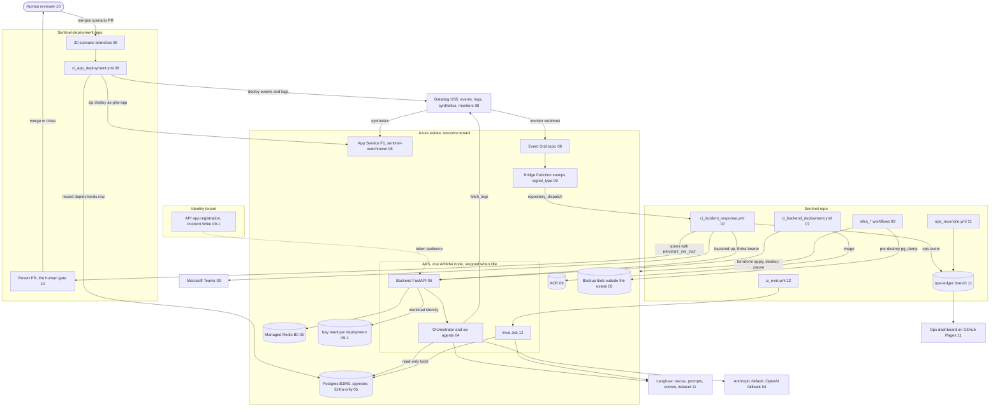

# sentinel: architecture diagram

> Part of [architecture](architecture.md) · deep-dive index: [deep-dive/README.md](deep-dive/README.md)

The full flow of Sentinel Phase 2 in one picture. Each component node ends with the number of the
deep-dive file that holds its detail; the table below maps node, file and ADRs.

| Node | Deep-dive | ADRs |
|---|---|---|
| Scenario branches, deploy pipeline, App Service, Datadog monitors | [08](deep-dive/08-deployment-and-scenarios.md) | ADR-018, ADR-030, ADR-031 |
| Event Grid, bridge Function, ACR, infra workflows | [09](deep-dive/09-infra-terraform.md) | ADR-027, ADR-028, ADR-042 |
| Key Vault, API app registration, identities | [09-1](deep-dive/09-1-identity-plane.md) | ADR-014, ADR-016, ADR-021, ADR-022 |
| Backend FastAPI | [06](deep-dive/06-interfaces-and-contracts.md) | ADR-036 |
| Orchestrator and agents, LLMs | [04](deep-dive/04-agent-pipeline.md) | ADR-003, ADR-006, ADR-034, ADR-035 |
| Postgres, Redis, backup blob | [05](deep-dive/05-data-and-memory.md) | ADR-007, ADR-044 |
| Incident, deploy and scale workflows | [07](deep-dive/07-backend-hosting-and-ci.md) | ADR-013, ADR-026, ADR-039 |
| Eval Job and workflow | [12](deep-dive/12-evaluation.md) | ADR-037, ADR-045 |
| Langfuse, ops ledger, reconciler, dashboard | [11](deep-dive/11-observability-and-ops-dashboard.md) | ADR-009, ADR-043 |
| Revert PR, human reviewer | [10](deep-dive/10-security-and-hitl.md) | ADR-004, ADR-005, ADR-010 |
| Teams, external services | [03](deep-dive/03-system-context-and-boundaries.md) | ADR-001 |

Sequence diagrams of the critical flows: [deep-dive/04-1-key-flows.md](deep-dive/04-1-key-flows.md).
