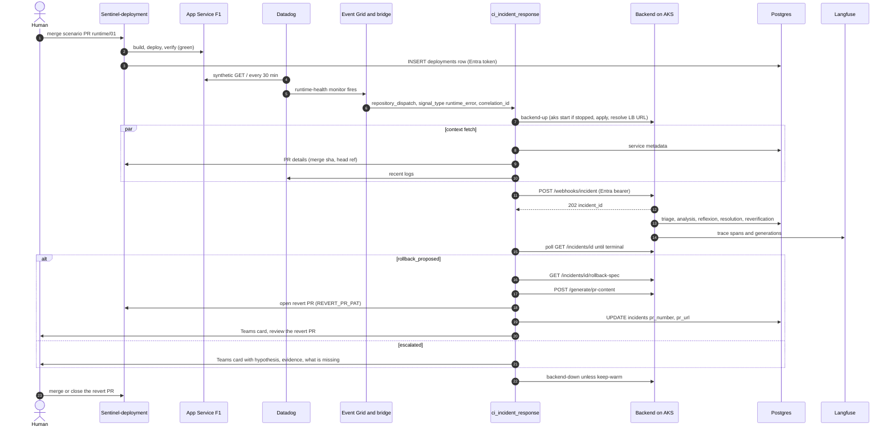
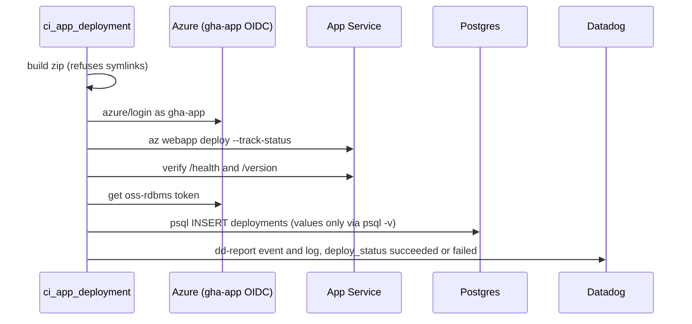
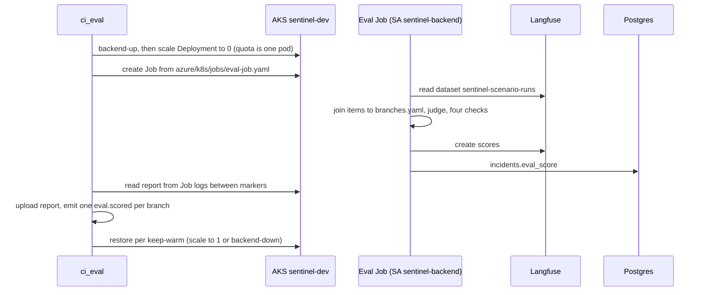

> Part of [architecture](../architecture.md) · [diagram](../architecture-diagram.md)
## 4.1 Key flows (sequence diagrams)

### 4.7 Runtime error: full incident response

### 4.8 Deploy failure: rollback fast path

The deploy never went live (or a verify-stage failure left the broken version live). The bridge
stamps `deploy_failure`; the orchestrator skips triage and analysis and drafts the rollback spec for
the failed deploy's SHA, which must equal the merge commit in `pr_details.sha` and match a
`deployments` row, then reverifies. Branches that also break `/health` carry
`also_expected: [runtime_error]`: the second alert must correlate to the same deploy.

### 4.9 Deploy record

The record stage is `continue-on-error`: a failed record is reported to Datadog as `stage:record`
and never changes `deploy_status`.

### 4.10 Eval run

