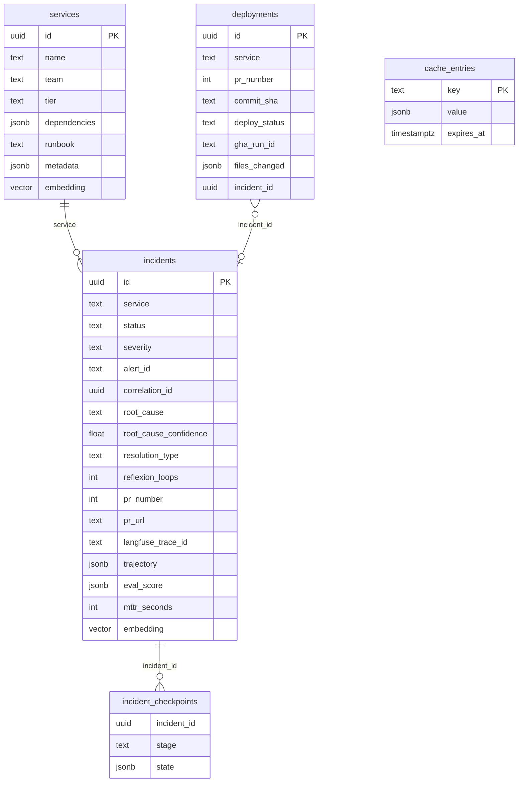

> Part of [architecture](../architecture.md) · [diagram](../architecture-diagram.md)
## 5. Data and memory

### 5.1 Schema

Azure PostgreSQL Flexible Server (B1MS, PG 16, Entra-only auth) with pgvector, migrated by Alembic
(`alembic/` in Sentinel). Three core tables plus two operational ones.

(Columns abridged; the migrations are authoritative.) Migrations: 001 schema and grants (including
`INSERT, SELECT ON deployments TO "gha-app"`, guarded on the role existing), 002 seed of the one real
service `sentinel-watchtower`, 003 checkpoints and cache. Embeddings: `all-MiniLM-L6-v2`, 384
dimensions, IVFFlat with `SET LOCAL ivfflat.probes` per query (incidents 10, services 5) so small
tables never miss rows. `deploy_status` vocabulary: `succeeded | failed | rolled_back`.

### 5.2 Correlation chain

Every incident threads `correlation_id` (minted by the bridge; a non-UUID id becomes
`uuid5(NAMESPACE_URL, "sentinel:" + id)` so dedupe holds) through GHA, the backend and every agent:

`alert / correlation_id -> deployments row (pr, merge sha, run id) -> incident -> langfuse_trace_id -> revert PR`

`incidents.langfuse_trace_id` is the incident UUID without dashes (W3C trace id), so incident and
trace are 1:1. The same `correlation_id` appears in the workflow logs, the incident row, the trace and
the Teams card.

### 5.3 Episodic and semantic memory

- **Episodic** (`incidents`): the agent recalls similar past incidents by vector similarity over
  the observed symptoms only, never over earlier agent hypotheses. Recalled root causes are labelled
  "model-generated, unverified"; `trajectory.provenance` records who produced each field.
- **Semantic** (`services`): owner, tier, dependencies and runbook without an LLM call. A NULL tier
  reads as `standard`.
- Memory is Postgres-only. With no database the app still boots, but every memory call raises
  `SentinelMemoryError` and tools report "memory unavailable"; there are no silent fake results.

### 5.4 Short-term memory

Per incident, keyed by `incident_id`. In-process dict in phases 4-10; since phase 11 Redis-backed with
an in-process fallback, plus a status pub/sub. In-flight incidents are served from short-term memory
with `status: "in_progress"`.

### 5.5 Hardening

Decided 2026-10-25, built in backend phase 11 ([ADR-044](../decision-logs.md#adr-044),
[E21](../../epic/E21-backend-11-memory-hardening-and-eval/epic.md)):

| Option | What | Rules |
|---|---|---|
| A. Memory survives teardown | pre-destroy `pg_dump` to blob storage outside the destroyable estate; data-only restore after apply | fails closed (any Terraform, state or dump error blocks destroy unless `force_destroy_without_backup`); restore runs only when `incidents` exists and is empty; skips `alembic_version`, `services`, `cache_entries`, `incident_checkpoints`; restored `in_progress` rows closed as `escalated` |
| B. Agent checkpoints | `incident_checkpoints` + write-through of short-term memory | one resume after a pod restart; tool budget checkpointed per call; reflexion loops and the wall-clock deadline absolute from first start |
| C. Tool/LLM cache | `cache_entries`, exact-match key, TTL (measured on the DB clock) | `fetch_logs` always; deterministic LLM calls behind a flag; the judge never; never exported (R14) |
| D. Redis | Azure Managed Redis Balanced B0 (about $13/month), private endpoint, Entra auth, no access keys | hot cache, short-term memory, pub/sub; no durable state; created and destroyed with the estate |

The backup role: `grant-db-access.sh` creates `gha-deploy` as a non-admin role on this deployment's
database only (CONNECT, SELECT for the dump, INSERT for the restore, and a column-level
`UPDATE (status, resolution) ON incidents` for closing placeholders). No table-wide UPDATE, no
server-wide `pg_read_all_data` (the platform server is shared), table owners unchanged.
