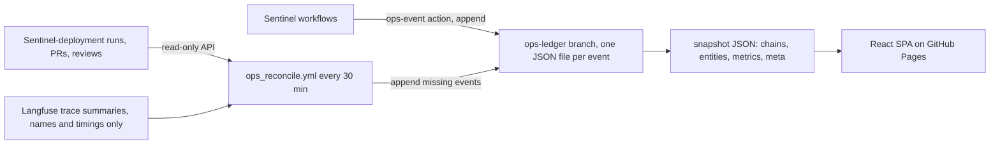

> Part of [architecture](../architecture.md) · [diagram](../architecture-diagram.md)
## 11. Observability and the ops dashboard

### 11.1 Langfuse (agent traces, prompts, scores)

Langfuse v3 (pinned; the v2 decorator API is gone):
- **Traces:** one root `incident-pipeline` observation per incident, trace id = `incident_id.hex`
  (W3C, 32 lowercase hex); agents as `agent`, tools as `tool` observations; context propagates
  through OTel `contextvars` (a task inherits the span current at creation; `run_in_executor` does
  not). `propagate_attributes` carries `correlation_id`. The lifespan calls `shutdown()` and CLIs call
  `flush()` so scale-to-zero does not drop the tail of a trace.
- **Generations:** a custom add-only openai-agents `TracingProcessor` bridges each LLM generation to
  a Langfuse `generation` with model, token usage and the prompt-version link (R14, no I/O).
- **Prompt management:** `get_prompt(name, cache_ttl_seconds=300)` with a mandatory local-file
  fallback (a keyless client raises on `get_prompt`).
- **Scores:** judge dimensions and ground-truth checks as NUMERIC scores in [0, 1].
- **Datasets:** `sentinel-scenario-runs`, one item per terminal incident ([12](12-evaluation.md)).
- Missing keys give a disabled client: tracing becomes a no-op, the app keeps running.

### 11.2 Datadog (the signal)

The deploy pipeline sends events (timeline markers) and logs (searchable records) tagged with
`service:sentinel-watchtower`, `deploy_status`, `failed_stage`, `version`. Synthetics probe the live
app. The backend reads Synthetics results and CI deploy logs through `fetch_logs`. The org is on US5:
every URL is built from `DD_SITE`, never hard-coded. Teams carries the human-facing notifications,
sent only by GHA.

### 11.3 Ops dashboard

A public, observe-only dashboard for builds, deploys, incidents, agent runs, revert PRs and reviews,
backend CI/CD, eval scores and traces ([ADR-043](../decision-logs.md#adr-043), built in
[E20](../../epic/E20-backend-10-ops-dashboard/epic.md)). URL:
https://keshav0375.github.io/Sentinel/ (not live until GitHub Pages is enabled).

- **Store:** orphan branch `ops-ledger`, append-only, one file per event at
  `events/YYYY/MM/DD/<ts>-<kind>-<event_id>.json`; `event_id = sha256(kind + source + source_id + state)`
  so a replay is a no-op; git history is the audit log; counts are derived, never stored. Azure
  Postgres was rejected (destroyed with the estate), as was an external DB (a vendor, a secret, an API).
- **Event model `ops.v1`:** envelope `schema, event_id, kind, ts, recorded_at, source, chain{correlation_id,
  sha, pr, run_id, incident_id, scenario}, data`. Kinds: build/deploy started/succeeded/failed,
  `ci.pr_gate.completed`, `scale.changed`, `alert.received`, `agent.started|decided|failed`,
  `revert_pr.opened|review_submitted|merged|closed`, `escalation.raised`, `eval.scored`,
  `trace.summarized`. Chains correlate by `correlation_id`, then `sha`, then `pr`.
- **Completeness:** event-time writes from every state-changing step (non-blocking), plus the
  reconciler (schedule, `workflow_run`, manual) with a cursor and a weekly full sweep.
- **Frontend:** React 18 + TypeScript + Vite, Tailwind with CSS-variable tokens, Radix UI, TanStack
  Table and Virtual, Recharts; light/dark/system; KPI cards, a needs-action lane (revert PRs awaiting
  review, escalations, failed builds with no incident), a chain timeline, a chain drawer with a trace
  waterfall; detail toggles in the URL; staleness banner over 1 h. WCAG AA, keyboard navigable,
  360 px; Vitest, Playwright smoke in both themes, Lighthouse >= 0.90 (shipped: perf 0.97, a11y 1.00).
- **Permissions:** writers use `GITHUB_TOKEN` with `contents: write` to `ops-ledger` only (`main` is
  ruleset-protected); Pages deploys only from `main` with `pages: write` + `id-token: write`.
