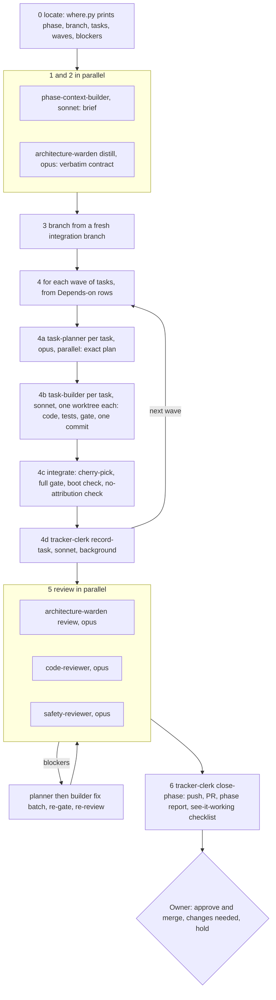

# sentinel: implementation plan

High level. Epics and tickets live in `epic/<E>-<slug>/` (epic.md and tickets/). Architecture:
`arch/architecture.md` (cited as `deep-dive/<file>.md#n`); decisions: `arch/decision-logs.md`
(ADR-nnn). Source: `sentinel-brain/implementation/` (TODO.md, STATE.md, the task files) and
`sentinel-brain/reports/`. Status fact: every epic is merged; nothing has run live end to end.

## Phases

| Phase | Epics | Source | Outcome |
|---|---|---|---|
| 1. Infra | E1-E6 | infra phases 1-6, `Sentinel-infra` PRs #1-#15, 2026-08-15 to 2026-09-13 | A Terraform estate on free grants with an OIDC/Entra identity plane, rebuilt as a dynamic platform: apply, destroy and pause whole deployments from workflow inputs, proven live from an empty subscription |
| 2. Deployment | E8-E10 | deployment phases 1-3, `Sentinel-deployment` PRs #1-#4, 2026-10-04 to 2026-10-07 | The `sentinel-watchtower` target app, its deploy pipeline with an Entra-token record stage, the Datadog triggers and 30 deterministic scenario branches |
| 3. Backend (Phase 2 release) | E11-E19 | backend phases 1-9, `Sentinel` PRs #19-#28 into `release-phase-2`, 2026-10-12 to 2026-10-25; release PR #29 | Postgres memory, Langfuse, six tools, the orchestrator and six agents, the API with Entra auth, eval, container and K8s, CI/CD, Phase-1 cleanup and an offline e2e |
| 4. Post-release | E7, E20, E21 | infra phase 7, backend phases 10-11, `Sentinel` PRs #32, #33, #35, 2026-10-25 to 2026-10-30 | The monorepo, the public ops dashboard, memory hardening, in-cluster eval and the README |

**Epic order (acyclic).** Infra first so the other repos build on real, provisioned ground truth:
E1 to E6, then E8 to E10, then E11 to E19 and the release, then E7 (needs the release), E20 (needs
E7), E21 (needs E20).

## Timeline

| Date | Milestone |
|---|---|
| 2026-05-10 to 05-24 | Phase-1 MVP built (`Sentinel` PRs #1-#8) |
| 2026-06-29 to 07-26 | Phase-2 planning rounds up to rev-8 (`Sentinel` PRs #9-#14); control plane split into `sentinel-brain` |
| 2026-08-15 | Infra phase 1 signed; rev-9 identity plane, two tenants |
| 2026-08-24 to 08-25 | Infra phases 3-5; the static estate replaced by the dynamic platform |
| 2026-09-13 | Infra category complete |
| 2026-10-07 | Deployment category complete |
| 2026-10-12 to 10-25 | Backend phases 1-9 |
| 2026-10-25 | Phase 2 release (PR #29); infra phase 7 monorepo (PR #32) |
| 2026-10-28 | Backend phase 10, ops dashboard (PR #33) |
| 2026-10-30 | Backend phase 11, memory hardening and in-cluster eval (PR #35) |

## Build process

The build was driven from `sentinel-brain` (no app code) by Claude Code agents, phase by phase,
with Keshav signing off every phase. Rules that applied to every agent (the "ground rules"):
architecture is law and a silent spec halts and asks; an open reconciliation item (R-item) is a
decision the owner owes and is never defaulted; no backend tool modifies external state; never open
the Phase-1 archive; no AI attribution in any commit, PR or merge; green means `VERDICT GREEN` from a
full gate run; the backend must boot after dependency changes; never put planning docs in code repos;
the board is a mirror.

### /implement-phase: a DAG in waves

"Opus decides, Sonnet types": every judgement (contract, plan, review) runs on Opus; every
mechanical step (building to a plan, bookkeeping) on Sonnet; the cheap independent `/check` verifier
on Haiku. Each specialist works in a fresh, discarded context and returns a short report; the
orchestrator holds only the phase block, the brief, the contract and those reports. A builder that
hits a gap goes back to its planner (`GAP`), never decides itself; two gaps on one task go to the owner.

| Agent | Model | Job |
|---|---|---|
| `phase-context-builder` | sonnet | brief: prior work consumed, tasks, dependencies, blockers, tracker/git drift |
| `architecture-warden` | opus | distill the verbatim conformance contract; review a finished phase diff |
| `task-planner` | opus | every design decision for one task, as an exact plan in `.plans/` |
| `task-builder` | sonnet | build to the plan in a wave worktree, tests, gate, one commit |
| `task-implementer` | opus | single-agent build for `/new-tool` and `/new-agent` scaffolds |
| `gate-runner` | haiku | `/check` only: run the gate, check commit-clean and attribution-free |
| `tracker-clerk` | sonnet | task reports, TODO/STATE, phase report, PR, sign-off merge, board sync |
| `code-reviewer` | opus | correctness: bugs, error handling, async, test quality, style match |
| `safety-reviewer` | opus | HITL/no-execute boundary, caps, memory provenance, no self-grading, secrets, least privilege |

Other skills: `/progress` (tracker overview), `/check <cat>` (gate), `/review [cat]` (quick diff
review), `/new-ticket` (add a task or phase, tracker first), `/new-tool`, `/new-agent`.

### Quality gate

`Sentinel/scripts/quality_gate.py --repo {infra|deployment|backend}` is the exact body CI calls.
From the brain it runs through `scripts/gate.py <cat>`, which takes the gate from the right ref (the
local checkout may be stale), puts the target repo's `.venv` on PATH, and ends with one
`VERDICT GREEN|PARTIAL|INCONCLUSIVE|RED` line, exiting non-zero unless fully green.

| Repo | Checks |
|---|---|
| backend | ruff check + format, pyright, gitleaks, pip-audit, pytest unit and integration (pgvector via `TEST_DATABASE_URL`), plus the web lanes since phase 10 |
| infra | terraform fmt, init, validate, tflint, tfsec, gitleaks, shellcheck, Python unittest for the Function handlers, actionlint, ruff |
| deployment | ruff, actionlint, yamllint, gitleaks, pytest |

The gate itself was fixed several times out of phase via `fix/*` PRs (actionlint on repos without
workflows, shellcheck for the bootstrap scripts, the infra Python handlers). One lesson recorded in
infra phase 5: every "gate PASS" in that phase came from an unmerged gate branch checked out locally,
which is why `gate.py` pins the gate source.

### Tracker and board

- `implementation/TODO.md` (heading, file, status) and one task file per task (spec up front,
  report filled on completion) are the source of truth; `STATE.md` holds only live state (position,
  blockers, R-items, the phase gate ledger); closed items move to `history.md`.
- Helper scripts: `where.py` (the active phase, its branch, gate, tasks, dependency waves and gating
  blockers; exit 1 means do not enter), `arch.py` (one architecture section or decision entry at a
  time, to keep agent context small), `gate.py`, `task_status.py` (flip a status and re-sync),
  `board_sync.py`.
- The GitHub board (https://github.com/users/Keshav0375/projects/4) is a one-way mirror: Epic
  (category), Phase (sub-issue), Task (sub-issue) in `sentinel-brain`, with Status, Level, Category,
  Phase, Task ID, Priority and Target date. `board_sync.py` regenerates it idempotently from hidden
  markers; issues are never edited by hand.
- Tracker commits go straight to brain `main`; one phase = one code PR plus tracker commits.

### Review loop and the human gate

Each phase ended with the three reviewers in parallel; findings in a fixed format (verdict, then at
most 10 blocker/warning lines). Blockers went back through a planner-then-builder fix batch, the
full gate, and a re-review by only the reviewers that raised them. The owner then got a
see-it-working checklist and chose approve-and-merge, changes needed, or hold. Examples the loop
caught: a branch-in-prompt leak of the ground-truth label (phase 9), the vendor trace exporter
uploading full spans (phase 4), self-grading judge configurations (phases 4 and 6), the
`guard-main-source.yml` script injection (phase 8), and an unscoped backup role (phase 11).
